# TimingShow — Developer Guide

> Version 1.9.3 · Target framework .NET Framework 4.8.1 · Language level C# 7.3 · Licence MIT

This document is for developers who need to read, modify, build or extend the mod. It covers the repository layout and build system, startup and runtime lifecycle, the complete Harmony patch inventory, the data model and computation core, the presentation and rendering pipeline, the co-op subsystem, the log format specification, the log chart window architecture, the settings and localisation system, the bridge and diagnostics facilities, testing, and a catalogue of known defects.

For the player-facing feature documentation, see the User Guide in the same folder.

---

## Table of contents

1. [Technology stack and hard constraints](#1-technology-stack-and-hard-constraints)
2. [Repository layout](#2-repository-layout)
3. [Build and packaging](#3-build-and-packaging)
4. [Startup and lifecycle](#4-startup-and-lifecycle)
5. [Runtime architecture](#5-runtime-architecture)
6. [The Harmony integration layer](#6-the-harmony-integration-layer)
7. [Data model](#7-data-model)
8. [Computation core](#8-computation-core)
9. [Presentation: text HUDs and charts](#9-presentation-text-huds-and-charts)
10. [Rendering and geometry constraints](#10-rendering-and-geometry-constraints)
11. [Co-op subsystem](#11-co-op-subsystem)
12. [Logging subsystem](#12-logging-subsystem)
13. [Log chart window (LogGraph)](#13-log-chart-window-loggraph)
14. [Level editor hit markers](#14-level-editor-hit-markers)
15. [Settings and localisation](#15-settings-and-localisation)
16. [Bridges and diagnostics](#16-bridges-and-diagnostics)
17. [Testing and geometry validation](#17-testing-and-geometry-validation)
18. [Development workflow](#18-development-workflow)
19. [Known defects and technical debt](#19-known-defects-and-technical-debt)
20. [Troubleshooting](#20-troubleshooting)
21. [Third-party dependencies](#21-third-party-dependencies)
22. [Appendix: file index](#22-appendix-file-index)

---

## 1. Technology stack and hard constraints

| Item | Value | Consequence |
|---|---|---|
| Runtime | .NET Framework **4.8.1** (`TargetFrameworkVersion=v4.8.1`) | Build machines need the 4.8.1 targeting pack; 4.8 alone produces `MSB3644` |
| Language level | **C# 7.3** (no explicit `LangVersion`, legacy project default) | No `is not`, target-typed `new`, switch expressions, records, `using` declarations, nullable reference types |
| Project format | legacy (`ToolsVersion="15.0"`, MSBuild XML namespace, explicit `<Compile Include>`) | **Every new `.cs` file must be registered manually in the csproj** or it will not compile |
| UI technology | uGUI (`MaskableGraphic` + `VertexHelper` self-drawing) + TextMeshPro | No IMGUI-drawn charts, no dedicated camera, no CommandBuffer, no custom shaders |
| Injection | Harmony (`0Harmony`) | Prefix/Postfix only; **no transpilers anywhere** |
| Dependency injection | None | All-static classes and fields; `ModContext` is the service hub |
| Unit tests | No framework | Only `Tools/GeometryTests`, a standalone layout-maths validator, not in `slnx` |
| Platform | AnyCPU, `Deterministic=true` | Release: `DebugType=pdbonly`, `Optimize=true`, `DefineConstants=TRACE` |

Conventions from `AGENTS.md`:

- Shared implementation is split by feature into `HUD/`, `Logging/`, `Options/`, `Patches/`, `Bridge/`, `Diagnostics/`, `LevelEditor/`.
- Partial classes are split by responsibility with suffixes: `.Render.cs`, `.Input.cs`, `.Data.cs`, `.Text.cs`, `.Views.cs`, `.Layout.cs`.
- 4-space indentation, braces on their own line, PascalCase, descriptive names.
- All user-visible strings go through `i18n.T()` and must be mirrored in `lang.json`.
- Commit messages are short, frequently in Chinese.

---

## 2. Repository layout

```
TimingShow/                        # the shared implementation (the only source project)
  Source/
    Bridge/                        # XPerfectBridge, LogAnalyzerBridge
    Diagnostics/                   # PerfStatsRecorder
    HUD/                           # HUDMan, TextUI, GraphDrawerBase, JColors, BumpAnim,
                                   # XACCGraphDrawer, TimingScatterDrawer, ScatterDrawerBase*
      LogGraph/                    # log chart window (30 files / ~11,400 lines)
        Charts/
          Scatter/ Xacc/ Distribution/ Delta/ Rolling/ Return/ Combo/ Acf/ Overview/
        Font/                      # LogGraphFont (embedded font resolution)
        LogGraphUi/                # LogChartDrawer, LogChartUi, LogRoundedRect
      LogGraphWindow/              # LogGraphWindow main class + 8 partials
      LogGraphSettingsUI/          # in-window settings panel (5 files)
    LevelEditor/                   # EditorHitSnapshot, EditorHitMarkerController
    Logging/                       # TimingLogger, TimingLoggerBinary, TimingLogReader,
                                   # LogRetention, VarInt, ColorConverter
    Options/                       # Options, OptionsWidgets, OptionLogList
    Patches/                       # TimingCalcPatches, UIPatches, PlayStatePatches
    Calc.cs  Coop.cs  HitMan.cs  i18n.cs  ModContext.cs  PlayerSession.cs
  IModLogger.cs
  Settings.cs
  lang.json
  TimingShow.csproj
  assets/                          # font sources (tracked)
  embedded/                        # compressed fonts (.gitignore, build output)
TimingShow.Loader.UMM/             # UMM entry + Info.json
TimingShow.Loader.Melon/           # MelonMod entry + self-drawn settings window
TimingShow.slnx                    # lists only the three projects above
Tools/
  GeometryTests/                   # net8.0 console validator
  Pack-EmbeddedAssets.ps1          # font DEFLATE packer
libs/                              # 18 game/Unity assemblies (.gitignore, not committed)
build.bat  build2.ps1              # build / local deployment
.github/workflows/                 # build-dev.yml, build-release.yml
docs/                              # this documentation set
```

| Project | ProjectGuid | AssemblyName | RootNamespace | Notes |
|---|---|---|---|---|
| `TimingShow/TimingShow.csproj` | `{BD86317D-26B5-43F4-9CFA-3761BD6863E0}` | `TimingShow` | `TimingShow` | Emits `TimingShow.dll` with 14.3 MB of embedded fonts |
| `TimingShow.Loader.UMM/TimingShow.Loader.UMM.csproj` | `{…-3761BD6863E1}` | `TimingShow.Loader.UMM` | `TimingShow.UMM` | ProjectReference to the shared library (copy-local by default) |
| `TimingShow.Loader.Melon/TimingShow.Loader.Melon.csproj` | `{…-3761BD6863E2}` | `TimingShow.Loader.Melon` | `TimingShow.Melon` | Same |

> The root-level `TimingShow.BepInEx/`, `TimingShow.UMM/`, `TimingShow.Melon/`, `TimingShow.Core/` folders contain only historical build artefacts. **They have no source and do not participate in the build.**

---

## 3. Build and packaging

### 3.1 Environment

1. Visual Studio 2022 or Build Tools with **MSBuild 17.x**, run from a Developer environment (`dotnet msbuild` cannot build legacy .NET Framework projects).
2. The **.NET Framework 4.8.1 targeting pack**.
3. `powershell` on `PATH` — the csproj `<Exec>` invokes Windows PowerShell 5.1, not `pwsh`.
4. `libs\`: copy the 18 DLLs from the private repo `SleepingCui/adofai-libs@main` into `libs\` at the repository root (gitignored).
5. The three files in `TimingShow\assets\` must be present (`SourceHanSansSC-Regular.otf`, `GmarketSansMedium.otf`, `OFL.txt`).

### 3.2 `build.bat`

```
msbuild TimingShow\TimingShow.csproj            /p:Configuration=Release /p:Platform="AnyCPU"
msbuild TimingShow.Loader.UMM\...UMM.csproj     /p:Configuration=Release /p:Platform="AnyCPU"
msbuild TimingShow.Loader.Melon\...Melon.csproj /p:Configuration=Release /p:Platform="AnyCPU"
powershell -NoProfile -Command "Compress-Archive -Path '<5 files>' -DestinationPath 'TimingShow.zip' -Force"
```

Each step short-circuits with `if %ERRORLEVEL% neq 0 exit /b %ERRORLEVEL%`. There is no clean step, no libs validation and no version stamping.

`TimingShow.zip` always contains exactly **5 entries**: `TimingShow.dll`, `TimingShow.Loader.UMM.dll`, `TimingShow.Loader.Melon.dll`, `Info.json`, `lang.json`. No PDBs, no fonts (they are embedded), no library DLLs.

> In Git Bash, `/p:` is treated as a path — use `-p:`.

### 3.3 Building a single project

```
msbuild TimingShow/TimingShow.csproj /p:Configuration=Release /p:Platform="AnyCPU"
```

### 3.4 Embedded font pipeline

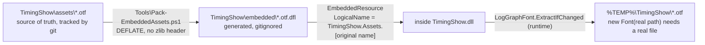

- `Pack-EmbeddedAssets.ps1`: `param($SourceDir='..\TimingShow\assets', $OutDir='..\TimingShow\embedded')`; per file `ReadAllBytes` → `DeflateStream(CompressionLevel.Optimal, leaveOpen:true)` → `<name>.dfl`.
- The csproj `<Target Name="PackEmbeddedAssets" BeforeTargets="PrepareResources" Inputs=… Outputs=…>` relies on `Inputs/Outputs` for incrementality and shells out via `<Exec>`.
- LogicalNames are **flat**: `TimingShow.Assets.SourceHanSansSC-Regular.otf` (no directory), matching the constants in `LogGraphFont.cs` verbatim.
- Consequently `TimingShow.dll` is ~7.5 MB even before compression. **Changing font assets requires `/t:Rebuild`**; incremental builds skip re-embedding and leave the old font inside the DLL.
- `build2.ps1` (machine-specific, not in CI) therefore forces `/t:Rebuild` and deletes the renamed legacy artefacts `TimingShow.Core.dll` / `TimingShow.UMM.dll` / `TimingShow.Melon.dll` before deploying.

### 3.5 CI

```mermaid
flowchart TD
    subgraph dev["build-dev.yml · workflow_dispatch(branch) · contents: read"]
        D1["checkout@v4 (fetch-depth 1)"] --> D2["private libs checkout<br/>SleepingCui/adofai-libs @ main → libs/"]
        D2 --> D3["Prepare CI version<br/>version = CI-[branch]-[hash6]"]
        D3 --> D4["rewrite MelonInfo version + Info.json.Version"]
        D4 --> D5["setup-msbuild@v2 → msbuild × 3"]
        D5 --> D6["collect the 5 files, validate Info.json.Version"]
        D6 --> D7["upload-artifact TimingShow-[version]<br/>retention 14 days · no zip · no release"]
    end
    subgraph rel["build-release.yml · workflow_dispatch(tag) · contents: write"]
        R1["checkout@v6"] --> R2["private libs checkout + Inspect libs"]
        R2 --> R3["setup-msbuild@v2 → build.bat (shell: cmd)"]
        R3 --> R4["validate TimingShow.zip"]
        R4 --> R5["CHANGELOG.md → GITHUB_OUTPUT heredoc"]
        R5 --> R6["git tag + git push origin tag"]
        R6 --> R7["gh release create --draft<br/>(title = tag, notes = CHANGELOG)"]
        R7 --> R8["rewrite Repository.json (Version / DownloadUrl / Changes)<br/>commit as github-actions[bot] → push HEAD:[branch]"]
    end
```

The dev workflow only produces a CI artifact; the release workflow is the only one that rewrites `Repository.json` and publishes a Draft release. **Neither of them bumps the mod version** — `Info.json` and `MelonInfo` keep whatever the repo says (only the dev workflow injects a CI-version string into its own artifact).

**`build-dev.yml` — Development Build** (`workflow_dispatch` with a `branch` input, `windows-latest`, `permissions: contents: read`)

1. `actions/checkout@v4` (`fetch-depth: 1`)
2. Private libs checkout: `repository: SleepingCui/adofai-libs`, `ref: main`, `token: secrets.ADOFAI_LIBS_TOKEN`, `path: libs`
3. `Prepare CI version`: `version = "CI-<safeBranch>-<shortHash>"` (first 6 hash chars; branch name `-replace '[^A-Za-z0-9._-]','-'`); rewrites the version inside `MelonInfo(...)` by regex (failure: `throw "Could not update the MelonInfo version in …"`); rewrites `Info.json.Version` in place (`-Depth 100`)
4. `microsoft/setup-msbuild@v2` → three msbuild runs
5. Copies the 5 files to `$RUNNER_TEMP/TimingShow-CI-<version>`; missing files raise `throw "Build output not found: …"`; validates `Info.json.Version` (`throw "Info.json version mismatch"`)
6. `actions/upload-artifact@v4` (`name: TimingShow-<version>`, `retention-days: 14`, `if-no-files-found: error`)

No zip, no release, no tests.

**`build-release.yml` — Build Release** (`workflow_dispatch` with a `tag` input, `permissions: contents: write`)

1. `actions/checkout@v6` (note: inconsistent with the dev workflow's `@v4`)
2. Same private libs checkout + `Inspect libs`
3. `setup-msbuild@v2` → **runs `build.bat` with `shell: cmd`**
4. Validates that `TimingShow.zip` exists
5. Reads all of `CHANGELOG.md` into `$GITHUB_OUTPUT` via a heredoc (`body<<EOF … EOF`)
6. `git tag <tag>` + `git push origin <tag>`
7. `gh release create <tag> TimingShow.zip --draft --title <tag> --notes <CHANGELOG contents>`
8. Rewrites `Repository.json`: `Version=<tag>`, `DownloadUrl=https://github.com/<repo>/releases/download/<tag>/TimingShow.zip`, `Changes=""`, `-Encoding utf8NoBOM`
9. Commits as `github-actions[bot]` with message `Update Repository.json to <tag>` and pushes `git push origin "HEAD:${{ github.ref_name }}"`

**Known gaps**: the release workflow **does not bump the version** (`Info.json` / `MelonInfo` keep whatever the repository holds; only the dev workflow rewrites them); no tests; no check that the tag is new; `Repository.json` is pushed to the **current branch** while `Info.json.Repository` points at the master raw URL, so dispatching from a version branch leaves UMM reading a stale release.

### 3.6 Install locations and runtime files

| Loader | Deployment | Required files |
|---|---|---|
| UMM | `<game>\Mods\TimingShow\` | `Info.json`, `TimingShow.Loader.UMM.dll`, `TimingShow.dll`, `lang.json` |
| Melon | `<game>\Mods\` (flat) | `TimingShow.Loader.Melon.dll`, `TimingShow.dll`, `lang.json` |

Runtime artefacts: `<modPath>\Settings.json`, `<game>\Mods\TimingShow\Logs\` (default logs), `...\Cache\logmeta.cache`, `%TEMP%\TimingShow\` (font cache).

---

## 4. Startup and lifecycle

### 4.1 UMM entry

`TimingShow.Loader.UMM\UMMEntry.cs` (34 lines)

```csharp
public static bool Load(UnityModManager.ModEntry modEntry)
```

Exact order:

1. `new UmmLogger(modEntry.Logger)` → `ModContext.Logger`
2. `ModContext.Initialize(modEntry.Path, logger)` (which internally calls `PlayStatePatches.RegisterSceneHook()`)
3. `ModContext.Settings = Settings.Load(modEntry.Path)`
4. `i18n.LoadLanguages(ModContext.ModPath)`
5. `ModContext.InitializeJudgeCompat()` (→ `HitMarginCompat.Initialize()`)
6. `XPerfectBridge.TryInit()`
7. `ModContext.HarmonyInstance = new Harmony(modEntry.Info.Id)` (Id = `TimingShow`)

Callbacks:

```csharp
modEntry.OnToggle   = (entry, value) => { if (value) ModContext.Enable(); else ModContext.Disable(); return true; };
modEntry.OnGUI      = entry => ModContext.OnGUI();          // → Options.OnGUI()
modEntry.OnSaveGUI  = entry => ModContext.SaveSettings();   // → Settings.Save(modPath)
```

**UMM does not call `Enable()` itself**; it relies on UMM's own `OnToggle`. If the mod is configured as enabled at startup, the callback fires right after loading.

### 4.2 Melon entry

`TimingShow.Loader.Melon\MelonEntry.cs` (109 lines), `class MelonEntry : MelonMod` (namespace `TimingShow.Melon`).

`OnInitializeMelon()`: `modPath = Path.GetDirectoryName(Assembly.GetExecutingAssembly().Location)` → `MelonLoggerAdapter` → the same steps 3–6 → `new HarmonyLib.Harmony("TimingShow.Loader.Melon")` → **calls `ModContext.Enable()` directly** (Melon has no toggle callback).

Self-drawn settings window:

- Constants `WindowWidth = 900f`, `WindowHeight = 600f`; fields `_showSettings`, `_isRebinding`, `_settingsWindowRect = new Rect(20,20,900,600)`, `_scrollPos`.
- `OnUpdate()`: `Input.GetKeyDown(Settings.ConfigKey)` (falling back to `KeyCode.F9` when `None`) toggles `_showSettings`; `SaveSettings()` fires when it closes.
- `OnGUI()`: `GUILayout.Window(GetHashCode(), rect, …)` → `BeginScrollView(_scrollPos, WindowWidth-20, WindowHeight-60)` wrapping `OptionsPage.OnGUI()`; two extra bottom rows (rebind `ConfigKey`, "save and close"); `GUI.DragWindow(new Rect(0,0,WindowWidth,20))`; title `$"TimingShow v{Info.Version}"`.
- `OnApplicationQuit()`: `SaveSettings()` + `Disable()`.

### 4.3 `ModContext` — the service hub

`TimingShow.ModContext` (`static class`, 192 lines) owns every piece of cross-module state:

| Member | Type | Responsibility |
|---|---|---|
| `Logger` | `IModLogger` | Injected by the loader |
| `ModPath` | `string` | Directory of settings and `lang.json` |
| `Settings` | `Settings` | The single configuration instance |
| `HarmonyInstance` | `Harmony` | Patch/Unpatch on `Enable`/`Disable` |
| `IsEnabled` | `bool` | Master guard for every patch |
| `IsPlaying` / `IsLevelFinished` | `bool` | Run state |
| `UIDirty` | `bool` | Text HUDs need recomputation |
| `XAccVersion` | `int` | XACC line data version |
| `TimingScatterSamples` | `List<TimingScatterSample>` (initial capacity 1024) | Accumulating scatter samples (**no cap**, but writes are guarded at 100,000) |
| `TimingScatterVersion` | `int` | Scatter data version |
| `FullXAccHistory` | `readonly List<float>[MaxPlayers]` | Per-player full XACC history |
| `LastTiming/LastAngle/LastSongTimeMs/LastJudge/LastRawMargin/LastIsXP/LastBpm/LastSpeed/LastPitch` | various | **Forwarded to `Players.Current.*`** — sugar for "the player who just hit" |
| `LastConfigGuiFrame` / `IsConfigOpen` | `int` / `bool` | IMGUI frame-number heuristic: `Time.frameCount - LastConfigGuiFrame <= 1` |

Key methods:

```csharp
static void Initialize(string modPath, IModLogger logger)   // then PlayStatePatches.RegisterSceneHook()
static void InitializeJudgeCompat()                          // HitMarginCompat.Initialize() + log "Detected version: ..."
static void Enable()                                         // IsEnabled = true; HarmonyInstance?.PatchAll()
static void Disable()                                        // IsEnabled = false; UnpatchAll(Id);
                                                             // Players.ResetAll(); ClearTimingScatterSamples();
                                                             // HUDMan.Destroy(); EditorHitSnapshot.Clear()
static void OnGUI()                                          // Options.Options.OnGUI()
static void SaveSettings()                                   // Settings.Save(ModPath)
static void ClearTimingScatterSamples()                      // Clear() + InvalidatePendingScatterSample() + Version++
static string Format(double val, int precision)              // $"{val.ToString("F"+precision)}ms"
static string FormatAngle(double val, int precision)         // same + "°"
```

> `Disable()` **does not clear** the `Options` static foldout state, the `OptionLogList` cache, the `LogGraphWindow` instance, or `HUDMan._badFormats`. All of it survives an enable/disable cycle.

### 4.4 Lifecycle sequence

```mermaid
sequenceDiagram
    autonumber
    participant L as Loader
    participant MC as ModContext
    participant ST as Settings / i18n
    participant PT as Patches
    participant HUD as HUDMan

    Note over L,PT: Initialisation
    L->>MC: ModContext.Initialize(modPath, logger)
    MC->>MC: record ModPath, subscribe SceneManager.sceneLoaded
    L->>ST: Settings.Load(path) → deserialise + Migrate + Sanitize
    L->>ST: i18n.LoadLanguages(modPath) → read lang.json
    L->>MC: InitializeJudgeCompat() → reflect the HitMargin enum, pick Legacy vs Game34
    L->>PT: XPerfectBridge.TryInit() (non-Game34 only)
    L->>MC: Enable() → HarmonyInstance.PatchAll()<br/>(Melon: in OnInitializeMelon; UMM: in OnToggle)

    Note over PT,HUD: Entering a level
    L->>PT: scrController.Start_Rewind (Postfix)
    PT->>PT: LevelStartPatch → SessionTimer.Restart, IsPlaying=true, IsLevelFinished=false
    PT->>PT: Players.ResetAll / ClearXAccHistory / ClearTimingScatterSamples / EditorHitSnapshot.Clear
    PT->>PT: UIDirty=true, JColors.ResetCache, HitBump.StopAll, BumpTrigger.Reset
    PT->>PT: [Diag_PerfLogEnabled] PerfStatsRecorder.StartSession(levelPath, song)
    PT->>PT: [logging gate] TimingLogger.StartNewSession(levelPath, song, bpm, speed, pitch, dir, bufferKB)

    Note over PT,HUD: Every frame
    PT->>HUD: scrUIController.Update (Postfix) → UIReplacePatch
    HUD->>HUD: IsPlaying: HitBump.Tick → ApplyTitleText → SyncPauseState → HUDMan.Update (timed)<br/>otherwise: UIDirty=false, HitBump.StopAll, BumpTrigger.Reset, title caches reset

    Note over PT,HUD: Ending (death / clear / quit / back to editor / scene change)
    PT->>PT: the respective Postfix → EndSession()
    PT->>PT: PerfStatsRecorder.EndSession(result) → SessionTimer.Stop → Players.ResetAll
    PT->>PT: ClearTimingScatterSamples() → TimingLogger.CloseSession() → HUDMan.Destroy()
```

The fixed order inside `EndSession()` (`PlayStatePatches.cs`) is deliberate: **end the perf session, stop the clock, reset players, clear samples, close the log, then destroy the HUD**.

---

## 5. Runtime architecture

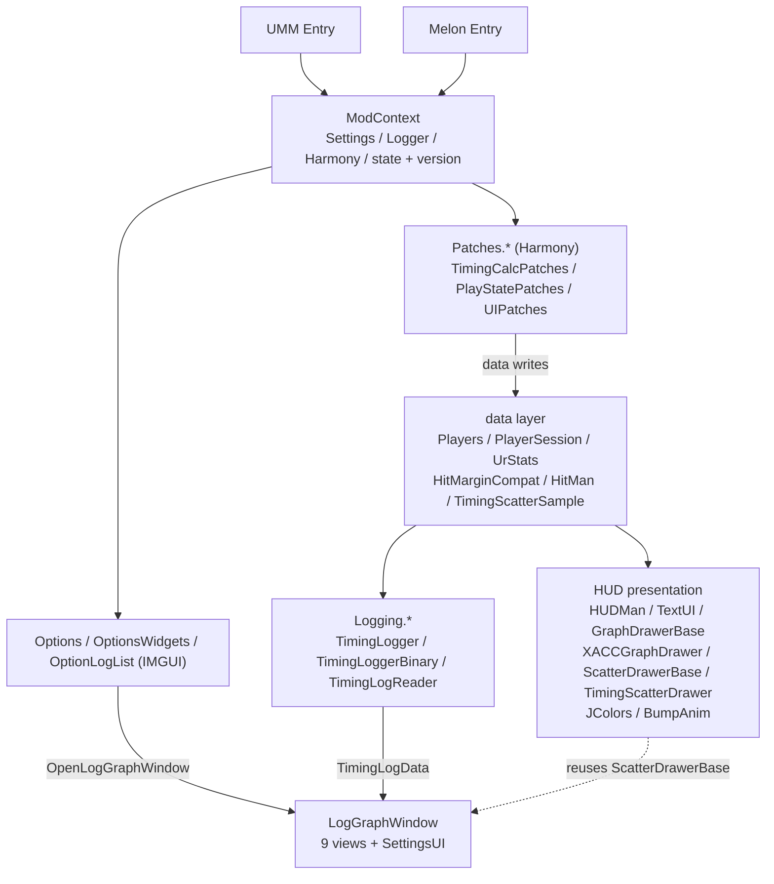

Dependencies are strictly one-directional: `Loader → ModContext → {Patches, Options, HUD, Logging}`. The only reverse edges are `Options` calling `LogGraphWindow.Open`, and `HUD.LogGraph` reading `Settings` / `ModContext`.

---

## 6. The Harmony integration layer

### 6.1 Patch inventory

Three static container classes, all registered at once by `ModContext.Enable()` → `HarmonyInstance.PatchAll()`.

#### `TimingShow\Source\Patches\TimingCalcPatches.cs` (444 lines)

| Patch | Target | Kind | Guard | Purpose |
|---|---|---|---|---|
| `PlanetSwitchPatch` | `scrPlanet.SwitchChosen(Nullable<long>)` | Prefix + Postfix | — | Capture per-hit context on every planet switch: player, BPM/speed/pitch, angle delta, floor. Postfix resets `Players.CurrentId` |
| `ScrMiscGetHitMarginInDegPatch` | `scrMisc.GetHitMarginInDeg(float,float,bool,float,float)` | Postfix | `Prepare() => HitMarginCompat.IsGame34` | On 3.4+, derive timing from the angle delta |
| `ScrMiscGetHitMarginInSecPatch` | `scrMisc.GetHitMarginInSec(double,float,float)` | Postfix | same | On 3.4+, derive the angle from the time delta |
| `MarginTrackerAddHitPatch` | `scrMarginTracker.AddHit(HitMargin)` | Prefix | `IsEnabled && IsPlaying` | The **single authoritative** judgement entry point: judge, counters, log |
| `MarginTrackerRevertPatch` (in PlayStatePatches) | `scrMarginTracker.RevertToLastCheckpoint()` | Postfix | — | Clear scatter + `SyncFromTracker` |

#### `TimingShow\Source\Patches\PlayStatePatches.cs` (214 lines)

| Patch | Target | Kind | Purpose |
|---|---|---|---|
| `LevelStartPatch` | `scrController.Start_Rewind()` | Postfix | Run initialisation (see 4.4) |
| `TogglePauseGamePatch` | `scrController.TogglePauseGame()` | Postfix | `SyncPauseState()` starts/stops the session stopwatch |
| `scnEditor_SwitchToEditModePatch` | `scnEditor.SwitchToEditMode()` | Prefix | **First** `EditorHitSnapshot.CaptureFromSession()`, **then** `EndSession()` |
| `QuitToMainMenu_Patch` | `scrController.QuitToMainMenu()` | Prefix | `EditorHitSnapshot.Clear()` + `EndSession()` |
| `FailPatch` | `scrController.Fail2Action()` | Postfix | `IsLevelFinished=true`; `XAccVersion++`; `TimingScatterVersion++`; `UIDirty`; `PerfStatsRecorder.EndSession("fail")` |
| `OnLandOnPortalPatch` | `scrController.OnLandOnPortal(scrPlanet, Portal, string)` | Postfix | As above, `EndSession("complete")` |

There is also a plain (non-Harmony) `SceneManager.sceneLoaded` subscription: `OnSceneLoaded` calls `EditorHitSnapshot.Clear(); EndSession();` whenever the scene is not `scnGame`.

#### `TimingShow\Source\Patches\UIPatches.cs` (389 lines)

| Patch | Target | Kind | Priority | Purpose |
|---|---|---|---|---|
| `HitTextManagerShowPatch` | `scrHitTextManager.ShowHitText(HitMargin, scrPlanet, float?, int?)` | Prefix + Postfix | — | Brackets `Players.CurrentId` and `CurrentHitMargin` |
| `HitTextMeshShowPatch` | `scrHitTextMesh.Show(Vector3, Vector3?, float?, float?, float?, float?, string?)` | Postfix | **199** | Replace the judgement word with the deviation (`ShowOnPlanet`) |
| `Fail2ActionPatch` | `scrController.Fail2Action()` | Postfix | — | Overwrite `txtTryCalibrating.text` (`ShowOnDeath`) + `CloseSession()` |
| `WinPagePatch` | `scrController.OnLandOnPortal(...)` | Postfix | — | Reflect `DetailedResults.results` and append statistics (`ShowInWinPage`) + `CloseSession()` |
| `UIReplacePatch` | `scrUIController.Update()` | Postfix | — | **Per-frame HUD driver**, and the title replacement site |

> `[HarmonyPriority(199)]` on `HitTextMeshShowPatch` makes it run before other `Show` patches, so `__instance` state has not been rewritten yet.

### 6.2 The full per-hit call chain

This is the most important chain in the mod, and the most expensive one to rediscover:

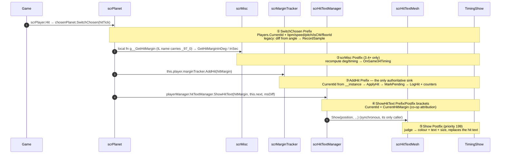

Hard constraints:

- `GetHitMarginInDeg/Sec` have **exactly one caller** in the whole game assembly (that local function), so player attribution can only be done indirectly by stashing the planet in `SwitchChosen`'s Prefix.
- `g__GetHitMargin|97_0` is called **exactly once** per `SwitchChosen` → one hit means one sample.
- `scrHitTextMesh.Show` has only two callers in the entire assembly, both inside `scrHitTextManager.ShowHitText` and both synchronous → bracketing `ShowHitText` with Prefix/Postfix is sufficient.
- Harmony injects **by parameter name**. Signatures and names must match the game exactly, or `PatchAll` throws as a whole. Verified against the IL dump:

```
ShowHitText(HitMargin hitMargin, scrPlanet planet, [opt] float32 missAngle, [opt] Nullable<int32> msDiffNullable)
AddHit(HitMargin hit)
SwitchChosen([opt] Nullable<int64> hitTick)
Show(Vector3 position, [opt] Vector3 borderOffset, [opt] float32 missAngle, [opt] float32 scale, [opt] float32 angle, [opt] float32 fadeSpeed, [opt] string customText)
scrController.Fail2Action()                                  // no parameters
scrController.OnLandOnPortal(scrPlanet planetThatWon, Portal, string)
```

### 6.3 Core patches in detail

#### `PlanetSwitchPatch` (Prefix)

```csharp
static void Prefix(scrPlanet __instance)
{
    Players.CurrentId = Players.ResolvePlayerId(__instance);

    bool hasParams = conductor != null && conductor.song != null && planetarySystem != null;
    // capture bpm / speed(pitch) / system.isCW
    // write player.LastFloorId / LastBpm / LastSpeed / LastPitch

    if (bpm * speed * pitch == 0) return;     // divide-by-zero guard; abandon this sample

    double diff = (__instance.angle - __instance.targetExitAngle)
                * (isCW ? 1.0 : -1.0)
                * 60000.0 / (Math.PI * bpm * speed * pitch);

    player.LastAngle = (__instance.angle - __instance.targetExitAngle)
                     * (isCW ? 1.0 : -1.0) * 180.0 / Math.PI;

    player.HasHit = true; ModContext.UIDirty = true;

    if (!HitMarginCompat.IsGame34)
    {
        player.LastIsXP = CalcXP.IsLegacyXPerfect(diff, bpm, speed, pitch);
        RecordSample(diff, player.LastAngle);
    }
}
```

Key points:

- Legacy versions compute timing here; 3.4+ gets it from the `scrMisc` Postfixes.
- `speed` and `isCW` come from `__instance.planetarySystem` (this planet's own system), not `scrController.instance.planetarySystem` (player 1's). Equivalent in single player; a necessary correction in co-op.
- The zero check multiplies `bpm*speed*pitch` so no division produces `Infinity`.

#### `MarginTrackerAddHitPatch` (Prefix)

```csharp
static void Prefix(HitMargin hit, scrMarginTracker __instance)
{
    if (!ModContext.IsEnabled || !ModContext.IsPlaying) return;
    Players.CurrentId = Players.ResolvePlayerId(__instance);   // reverse index into marginTrackers
    int raw = HitMarginCompat.ToRawCode(hit);
    PerfStatsRecorder.HitBegin();
    try { ApplyHit(raw, allowLog: !RDC.auto); } finally { PerfStatsRecorder.HitEnd(); }
}
```

`ApplyHit(int rawMargin, bool allowLog, bool countHit = true, double? timingOverride = null, double? angleOverride = null)`:

1. Writes `LastRawMargin` / `LastJudge` / `LastIsXP`
2. `MarkPendingTimingScatterSample(judge, isXP, rawMargin)` — completes the sample created earlier by `AppendTimingScatterSample` and bumps `TimingScatterVersion`
3. When `countHit`: increments `TotalHitsCount`; `IsPerfectFamily` → `PerfectFamilyCount++`; `IsNormalPerfect` → `NormalPerfectCount++`; `LastIsXP` → `XPerfectCount++`
4. When `allowLog`: `TimingLogger.LogHit(timing, angle, rawMargin, judge, isXP, floorId, bpm, speed, pitch)`

`ApplyAutoHit(timing, angle, allowLog)` takes the same path with `countHit: false` and `rawMargin = HitMarginCompat.RawAutoCode`.

#### The pending-sample mechanism

Scatter samples may be created **before** the judgement exists (`RecordSample` runs in `SwitchChosen`; the judgement arrives in `AddHit`), so completion is two-phase:

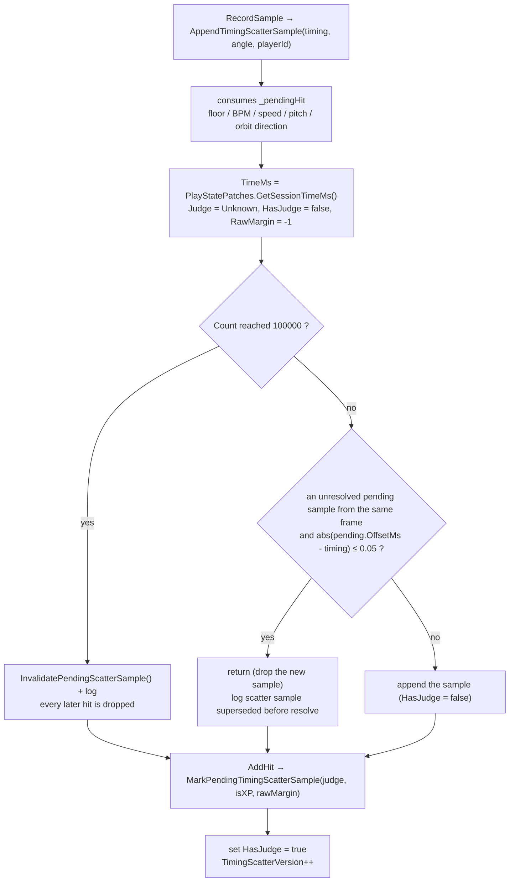

Constants: `TimingScatterHardLimit = 100000`, `TimingScatterDedupeToleranceMs = 0.05f`, `TimingScatterWarningLimit` (from `Settings.Diag_ScatterWarningLimit`, default 5, clamped 0–100).

#### `UIReplacePatch` (Postfix) — the single per-frame driver

```csharp
if (!IsEnabled) return;
if (IsPlaying)
{
    int frameId = PerfStatsRecorder.BeginFrame();
    HitBump.Tick(Time.deltaTime * 1000.0);
    ApplyTitleText(__instance);            // title replacement (gated by UIDirty)
    PlayStatePatches.SyncPauseState();
    double hudMs = timed { HUDMan.Update(); };
    PerfStatsRecorder.EndFrame(frameId, Time.unscaledDeltaTime * 1000f, hudMs);
}
else { UIDirty = false; HitBump.StopAll(); BumpTrigger.Reset(); _titleBase = null; _titleAppliedSize = -1; }
```

### 6.4 The three co-op attribution write sites

| Site | Location | Source | Reliability |
|---|---|---|---|
| `SwitchChosen` Prefix/Postfix | `TimingCalcPatches.cs` | `scrPlanet.player.playerID` (fallback: compare `planetarySystem`) | Used for sample creation |
| `AddHit` Prefix | same | the `__instance` **index** in `scrMistakesManager.marginTrackers` | Most authoritative; used for judgement accounting |
| `ShowHitText` Prefix/Postfix | `UIPatches.cs` | the `scrPlanet` parameter | Used for judgement text replacement |

Every path in `ResolvePlayerId` is exception-free and ultimately falls back to 0.

---

## 7. Data model

### 7.1 `HitMan` and `HitMarginCompat`

`TimingShow\Source\HitMan.cs` (241 lines)

```csharp
enum HitMan {
    Unknown=-1, TooEarly=0, VeryEarly=1, EarlyPerfect=2,
    PerfectMinus=3, LegacyPerfect=3,          // same value: two game generations share 3
    XPerfect=4, PerfectPlus=5, LatePerfect=6, VeryLate=7, TooLate=8,
    Multipress=9, FailMiss=10, FailOverload=11, Auto=12,
    OverPress=13, Midspin=14, FailedFloor=15
}
enum HitMarginVersion { Unknown=0, Legacy=1, Game34=2 }
```

`static class HitMarginCompat` maps the game's `HitMargin` enum (whose members differ per version) onto stable internal codes.

| Member | Meaning |
|---|---|
| `Version` / `IsInitialized` / `IsGame34` / `IsLegacy` | Detection result |
| `RawAutoCode` / `RawXPerfectCode` | Real code values obtained by reflection (`-1` = absent) |
| `AllRawValues` / `PerfectFamilyRawValues` | Sorted valid code sets |
| `HasNativeXPerfect => IsGame34` | Whether the game natively has XPerfect |
| `Initialize(bool force = false)` | Reflects the public static literal fields of `typeof(HitMargin)` into a signature string; returns early if unchanged |
| `DetectVersion()` | Any of `XPerfect`/`PerfectMinus`/`PerfectPlus`/`Midspin`/`FailedFloor` → **Game34**; `Perfect`+`LatePerfect`+`Auto`+`OverPress` → **Legacy**; otherwise **Unknown** |
| `ToJudgeKind(int raw)` / `ToRawCode(HitMargin)` / `FromRawCode(int)` | Code conversions |
| `IsPerfectFamily` | `{EarlyPerfect, PerfectMinus, XPerfect, PerfectPlus, LatePerfect}` |
| `IsFailFamily` | `{FailMiss, FailOverload, OverPress, FailedFloor}` |
| `IsNormalPerfect` | `LegacyPerfect`, or `IsGame34 && PerfectPlus` |

`const int JudgeCodeVersion = 1`: the code is simply `(int)HitMargin`, interpreted alongside `hitMarginVersion`.

### 7.2 `TimingScatterSample` (struct)

Declared in `ModContext.cs` with 18 fields; it is the atomic data unit for every scatter plot, chart, log record and editor marker.

```csharp
struct TimingScatterSample {
    float  TimeMs, OffsetMs;          // session time / deviation (ms or degrees, decided by context)
    HitMan Judge;  bool HasJudge;
    bool   IsXPerfect;
    int    PlayerId;
    int    FloorId;  bool HasFloorId, FloorIdEstimated;
    float  AngleDeg, Bpm, Speed, Pitch;  bool HasAngle, HasHitParams;
    int    RawMargin;
    bool   OrbitClockwise, HasOrbitDirection;   // runtime only, never serialised
}
```

Design notes:

- `TimeMs` comes from the **pause-aware** `Stopwatch` in `PlayStatePatches.GetSessionTimeMs()`, not from an audio clock.
- The `Has*` flags distinguish "value is zero" from "this version has no such data". Logs older than v8 (JSON) / v9 (binary) come back with these flags at their unknown defaults.
- `OrbitClockwise` / `HasOrbitDirection` are **not serialised**; editor markers fall back to the negation of `scrFloor.isCCW` for old data.
- `RawMargin` is never assigned when reading logs (defaults to 0); only live sampling carries the real code.

### 7.3 `PlayerSession`, `UrStats`, `Players`

`TimingShow\Source\PlayerSession.cs` (237 lines)

```csharp
sealed class UrStats {
    void Add(double x);   // Welford: n=++_count; d=x-_mean; _mean+=d/n; _s+=d*(x-_mean);
    double Mean(); double StdDev();   // StdDev = sqrt(_s / _count) * 10.0
    void Reset();
}

sealed class PlayerSession {
    readonly int PlayerId;
    bool HasHit;
    double LastTiming, LastAngle, LastSongTimeMs = -1.0;
    HitMan LastJudge = Unknown; int LastRawMargin = -1; bool LastIsXP;
    double LastBpm, LastSpeed = 1.0, LastPitch = 1.0;
    int LastFloorId = -1;
    readonly List<double> Offsets;    // every deviation (used by the two-pass death/results formatter)
    readonly UrStats Ur;              // streaming, used by the HUD
    int NormalPerfectCount, PerfectFamilyCount, XPerfectCount, TotalHitsCount;
    bool IsXPerfect(HitMan judge) => IsGame34 ? judge == XPerfect : LastIsXP;
    void ResetLastHit(); void ResetCounters(); void ResetSession();
}

static class Players {
    const int MaxPlayers = 4, Unset = -1;
    int Count { get; }          // reads scrPlayerManager.playerCount live (try/catch→1, clamp 1..4, deliberately uncached)
    bool IsCoop => Count > 1;
    int CurrentId { get; set; } // attribution for the current hit
    PlayerSession Current => Get(CurrentId);
    PlayerSession Get(int id);  // out-of-range falls back to 0
    void ResetAll();
    int ResolvePlayerId(scrPlanet);
    int ResolvePlayerId(scrMarginTracker);
}
```

**Why two mean/standard-deviation implementations**: the HUD uses `UrStats` (Welford, single-pass, O(1) memory) while the death/results screens use `CalcUR.Mean(list)` / `CalcUR.calc(list)` (two-pass, O(n) memory). Numerically equivalent; the split is deliberate so single-player byte-for-byte behaviour is preserved.

---

## 8. Computation core

`TimingShow\Source\Calc.cs` (109 lines)

### 8.1 UR

```csharp
static class CalcUR {
    double Mean(List<double> list);              // empty → 0
    double calc(List<double> list);              // population std dev × 10.0
}
```

### 8.2 Ratio

```csharp
class CalcRatio {
    string GetRatioString(PlayerSession p);   // numerator/denominator by Settings.Ratio_Mode
    string GetRatioText(PlayerSession p);     // prefix + ":1"
}
```

`Ratio_Mode`: `RatioMode_NormalPerfect = 0` (default), `RatioMode_PerfectFamily = 1`, `RatioMode_XPerfect = 2`.
`total == 0 → "0"`; `total - target <= 0 → "infinity"`; otherwise `(target/other).ToString("F" + Settings.PercRatioHUD)`.

### 8.3 Legacy XPerfect boundary

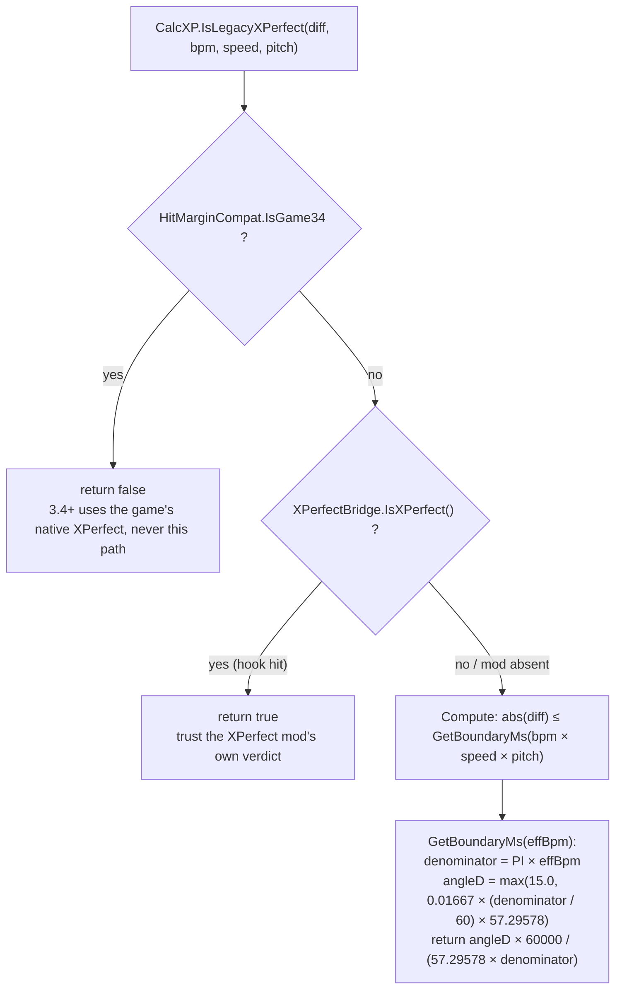

```csharp
static class CalcXP {
    bool IsLegacyXPerfect(double diff, double bpm, double speed, double pitch) {
        if (HitMarginCompat.IsGame34) return false;      // 3.4+ gets it from the game
        if (XPerfectBridge.IsXPerfect()) return true;    // hook mode
        return Compute(diff, bpm, speed, pitch);
    }

    double GetBoundaryMs(double effectiveBpm) {
        double denominator = Math.PI * effectiveBpm;
        double angleR = 0.01667 * (denominator / 60.0);
        double angleD = angleR * 57.295780181884766;
        double fBoundaryD = Math.Max(15.0, angleD);
        return (fBoundaryD * 60000.0) / (57.295780181884766 * denominator);
    }

    bool Compute(diff, bpm, speed, pitch) =>
        Math.Abs(diff) <= GetBoundaryMs(bpm * speed * pitch);
}
```

`15.0` is the angle floor in degrees; `57.295780181884766` is the exact single-precision value of 180/π. Algorithm from [XPerfect](https://github.com/8100print/XPerfect) (MIT).

### 8.4 Deriving values on 3.4+

```csharp
// GetHitMarginInDeg Postfix
double deg    = (hitAngle - refAngle) * (clockwise ? 1 : -1) * 57.29578;
double timing = deg / 180.0 / floorBpm / conductorPitch * 60000.0;

// GetHitMarginInSec Postfix
double timing = timeDiff * 1000.0;
double deg    = timeDiff * 3.0 * floorBpm * conductorPitch;
```

`3.0` is the fused constant `180 / 60`. The two paths handle "the game gave an angle" and "the game gave seconds" respectively.

---

## 9. Presentation: text HUDs and charts

### 9.1 `HUDMan` (223 lines)

Static class managing six dynamically created UI objects:

| Field | Type | Content |
|---|---|---|
| `_hudObj/_hudInstance` | `GameObject` + `TextUI` | Timing |
| `_avgHudObj/_avgHudInstance` | same | Avg |
| `_urhudObj/_urHudInstance` | same | UR |
| `_ratiohudObj/_ratioHudInstance` | same | Ratio |
| `_xaccGraphObject/_xaccGraphInstance` | `GameObject` + `XACCGraphDrawer` | XACC graph |
| `_timingScatterObject/_timingScatterInstance` | `GameObject` + `TimingScatterDrawer` | Scatter plot |

Visibility conditions (**two different sets, intentionally**):

```csharp
bool isPlayBase = IsPlaying && scrController.instance != null && scrController.instance.gameworld
               && (!scrController.instance.paused || ModContext.IsConfigOpen);
// used by text HUDs and XACC

bool isScatterBase = IsPlaying && scrController.instance != null && scrController.instance.gameworld;
// used by the scatter plot — missing paused / IsConfigOpen
```

The scatter plot must keep rendering while paused because its interaction only opens up once the level is over or paused. **Changing `isPlayBase` will break paused scatter interaction.**

Chart canvas creation:

| Chart | Name | sortingOrder | Extra component |
|---|---|---|---|
| XACC | `TimingShow_XACCCanvas` | 100 | — |
| Scatter | `TimingShow_TimingScatterCanvas` | 101 | `GraphicRaycaster` (required for interaction) |
| Text HUD | one canvas per instance | 10001 | `CanvasScaler(1920×1080, MatchWidthOrHeight, 0.5)` |

`UIDirty` gating: text is recomputed only when `UIDirty` is set (`Coop.Join(…)` → `BumpTrigger.Xxx(text)` → `UpdateTextHUD`), then the flag is cleared. `ApplyBumpSize` and `ApplyFont` run every frame (the former reads a cached ease, the latter only compares strings).

Formatters:

```csharp
FormatTiming(player) // HUD_ShowAngle ? LastAngle : LastTiming; with HUD_UseJudgeColor only the number is wrapped in <color=#hex>; suffix ms / °
FormatAvg(player)    // Ur.Mean().ToString("F" + PercAvgHUD) + "ms"
FormatUr(player)     // Ur.StdDev().ToString("F" + PercURHUD)
FormatRatio(player)  // CalcRatio.GetRatioText(player)
```

`SafeFormat` records throwing format strings in `HashSet<string> _badFormats` and degrades to the bare value — but there is **no clearing path**; fixing the format requires reloading the mod.

`SetPosition` pitfall: `anchoredPosition = (x * Screen.width, y * Screen.height)` writes canvas-local units while the canvas has a `CanvasScaler`. **It is only exact at 1920×1080 (scaleFactor = 1)**; other resolutions double-apply the scale.

### 9.2 `TextUI` (219 lines)

`public class TextUI : MonoBehaviour`; every instance creates its own `Canvas` (`ScreenSpaceOverlay`, `sortingOrder = 10001`).

| Method | Signature | Notes |
|---|---|---|
| `SetText` | `public void SetText(string value)` | TMP assignment |
| `SetSize` | `public void SetSize(int size)` | Writes `fontSize` only when changed |
| `SetPosition` | `public void SetPosition(float x, float y)` | See the pitfall above |
| `ApplyFont` | `public void ApplyFont(bool useCustomFont, string fontPath)` | Called every frame; early-outs via `_fontConfigKey` |
| `SetAlignment` | `public void SetAlignment(int align)` | 0/1/2 → `MidlineLeft/Center/MidlineRight` |
| `SetBold` | `public void SetBold(bool bold)` | `FontStyles.Bold` / `Normal` |

Font chain: custom (reflection on `Font.Internal_CreateFontFromPath` → `TMP_FontAsset.CreateFontAsset`) → game font (scan `Resources.FindObjectsOfTypeAll<scrHitTextMesh>()` for the first non-null `text.font`) → `TMP_Settings.defaultFontAsset`.

Shadow: the `Shadow` component is created but **`enabled = false`** (`effectColor=(0,0,0,0.45)`, `effectDistance=(2,-2)` are vestigial). The real shadow duplicates the material (`new Material(text.fontSharedMaterial)`) and enables the TMP underlay keyword (`ShaderUtilities.Keyword_Underlay`, `OffsetX 0.1`, `OffsetY -0.1`, `Dilate 0.1`, `Softness 0.05`).

**Text HUDs have no static font cache**: four HUDs sharing one font each build their own atlas.

### 9.3 `GraphDrawerBase` (824 lines)

`[RequireComponent(typeof(CanvasRenderer))] public abstract class GraphDrawerBase : MaskableGraphic`

Abstract contract:

```csharp
protected abstract bool IsEnabled { get; }
protected abstract bool ShowGraph { get; }
protected abstract float Scale / Width / Height / PosX / PosY { get; }
protected abstract Color BgColor / GridColor / LineColor { get; }
protected abstract int MaxPoints { get; }
public abstract string GraphName { get; }          // PerfStatsRecorder key
protected virtual int DataVersion => ModContext.XAccVersion;

protected abstract void UpdateData();
protected abstract int GetDataCount();
protected abstract double GetDataValue(int index);
protected abstract double GetMinY(); GetMaxY();
```

Overridable hooks: `ShowBorder`, `BorderColor`, `UseCustomFont`, `FontPath`, `AllowGameFontFallback`, `ShowPerfInfo`, `PerfDataCount`, `PerfExtraInfo`, `PerfTextColor`.

The redraw predicate (**a version bump is not the only trigger**):

```csharp
needsRedraw = _lastDataVersion != DataVersion
           || rectChanged
           || settingsHash != _lastSettingsHash
           || continuousRedraw;
```

`ComputeSettingsHash()` folds Scale/Width/Height/PosX/PosY/MaxPoints/three colours/Border/font/ShowPerfInfo via `hash = 17; hash = hash * 31 + X`. **Appearance changes therefore take effect without bumping any version.**

`UpdateTransform()` coordinate semantics (**opposite from the text HUDs**):

```csharp
float w = Width * scale, h = Height * scale;
anchorMin = anchorMax = Vector2.zero; pivot = Vector2.zero;
sizeDelta = new Vector2(w, h);
anchoredPosition = new Vector2(Screen.width * PosX, Screen.height * (1.0f - PosY));
```

So chart `PosX/PosY` are **0–1 screen fractions measured from the top**, with a bottom-left anchor. Chart canvases have no `CanvasScaler`, making this pixel-exact.

`OnPopulateMesh` order: `vh.Clear()` → size validation → background → grid → reference lines → series → border; then vertex counts are recorded into `PerfStatsRecorder`.

Text: five fixed TMP children (`TitleText` UpperLeft, `TopLabel`/`MidLabel`/`BotLabel` MiddleRight, `PerfInfoLabel` UpperLeft). `CreateText` sets `anchorMin=anchorMax=(0,0)`, `pivot=(1,0.5)`, `raycastTarget=false`, `richText=false`, `NoWrap`, `Overflow`.

Font cache: `static readonly Dictionary<string, TMP_FontAsset> FontCache`, keyed `"custom:"+path` / `"game"` / `"system"`. It **caches null**: if the game font is not ready on first use, that key stays null for the whole session.

### 9.4 `XACCGraphDrawer` (333 lines)

```csharp
GraphName => "XACC";
MaxPoints => XACCGraph_MaxPoints > 0 ? XACCGraph_MaxPoints : 250;
IsEnabled => ModContext.IsEnabled && ModContext.IsPlaying;
SeriesCount => Mathf.Clamp(Coop.ActiveCount, 1, Players.MaxPlayers);
```

Drawing: one `DrawSegment` per sample, `float stepX = w / Mathf.Max(1, maxCapacity - 1);`, `normY = Mathf.Clamp01((value - minY) / rangeY)`.

Two decimation modes (`BuildSeriesCache`):

```csharp
// level finished and total > targetPoints: uniform downsample
float step = (float)(total - 1) / (targetPoints - 1);
int idx = Mathf.Clamp((int)(i * step), 0, total - 1);

// during play: sliding tail window
int startIdx = Math.Max(0, total - targetPoints);
```

Y range: after the level ends `_cachedMaxY = 100f` and `_cachedMinY = Mathf.Max(0f, Mathf.Floor(minVal - 1f))`, switching to `Mathf.Floor(minVal * 10f) / 10f` when very close to 100, with a minimum span of `MinYRange = 0.1f`. During play, `maxVal - minVal < 0.2f` selects 1.0 or 1.5 of padding.

Multi-series colouring: `SeriesCount > 1 ? Coop.PlayerColor(s) : LineColor`; the legend is assembled with `StringBuilder` as `<color=#RRGGBB>P{n}</color>`.

### 9.5 `ScatterDrawerBase` (partial, 6 files / 2250+ lines)

`public abstract partial class ScatterDrawerBase : GraphDrawerBase, IPointerDownHandler, IPointerUpHandler, IScrollHandler`

| File | Lines | Responsibility |
|---|---|---|
| `ScatterDrawerBase.cs` | 210 | Abstraction, `ComputeSettingsHash`, `NeedsContinuousRedraw`, `Update` |
| `.Data.cs` | 571 | Sampling, signature, viewport smoothing, outlier filtering, decimation |
| `.Render.cs` | 390 | Bands, reference lines, circles, average line, grid, out-of-range markers |
| `.Text.cs` | 221 | X labels, average label, gesture hint |
| `.Interaction.cs` | 501 | Pan/zoom/clamping/auto-scroll |
| `.Detail.cs` | 283 | Hover hit-testing, detail panel |
| `.Players.cs` | 222 | Player legend and filtering |

Two subclasses: `TimingScatterDrawer` (in-game) and `LogScatterDrawer` (log window).

Key virtual points: `LevelFinished`, `GamePaused`, `FullRangeMode`, `YUnitSuffix`, `ExternalPointerInput`, `ResetViewOnSizeChange`, `AllowPlayerFilter`, `ScatterDistinguishPlayers`, `ScatterPlayerCount`, `RobustYViewport`, `AxisLabelsInside`, `HintInFooter`, `GridAlphaScale`.

`DetailInteractive` (decides whether the mouse is accepted):

```csharp
if (!IsEnabled || !ShowGraph) return false;
if (InteractionSuspended) return false;
if (LevelFinished) return true;      // fully interactive once the level is over
return GamePaused;                   // during play, only while paused
```

Every frame this drives `raycastTarget = interactive` — **the single switch between the scatter canvas and the mouse event bus**.

### 9.6 `TimingScatterDrawer` (343 lines) and the judgement window formulas

Constants:

```csharp
internal const float ThresholdLenientBpm = 220f;
internal const float ThresholdNormalBpm  = 310f;
internal const float ThresholdStrictBpm  = 500f;
private const float PassAngleMsScale = 20000f;
private const float MinWindowMs = 25f;
private const float PerfectBaseMs = 20f;
private const float ElPerfectBaseMs = 30f;
private const float XpMinWindowMs = 16.666666f;
```

Effective BPM:

```csharp
double windowBpm = bpm * pitch * speed / marginScale / speedTrial;
```

`marginScale = controller.currFloor.marginScale` (only when `> 0.0`); `speedTrial` is reflected from `GCS.currentSpeedTrial` (invalid values fall back to 1f).

Angle → milliseconds:

```csharp
float angleTerm = 60000f / safeBpm * angle / 180f;
return Mathf.Max(Mathf.Max(angleTerm, baseWindowMs) / safeSpeedTrial, MinWindowMs);
```

Three judgement bands: `perfectMs = CalcWindow(bpm, trial, 30f, PerfectBaseMs)`, `elPerfectMs = CalcWindow(…, 45f, ElPerfectBaseMs)`, `passMs = CalcWindow(…, 60f, GetPassBaseMs())`.

`GetPassBaseMs()`: manual mode `20000f / manualBpm` (identically equal to the 60° term); automatic mode by `GCS.difficulty`: 0→91f, 1→65f, 2→40f, default 65f.

`GetThresholdBpm()`: manual `Clamp(TimingScatter_BandThresholdBpm, 100, 600)` (default 310); automatic by difficulty 0→220, 1→310, 2→500.

XPerfect band: `xpMs = 60000f / windowBpm * 12.5f / 180f / speedTrial`, `Max(xpMs, 16.666666f)` (about one frame at 60 fps).

At 310 BPM with all other factors at 1: `perfectMs ≈ 32.26`, `elPerfectMs ≈ 48.39`, `passMs ≈ 64.52`, `xpMs ≈ 13.44 → raised to 16.67`.

Bands are drawn outside-in: pass segments → elPerfect segments → perfect → XP. Threshold changes animate with a 0.4 s cubic ease-out (first frame snaps).

### 9.7 Title, death screen, results screen

**Title** (`UIPatches.ApplyTitleText`), recomputed only when `UIDirty`:

```csharp
BumpTrigger.Title(Coop.Join(BuildTitleValue));
_titleBase = Coop.Join(BuildTitlePart);      // may contain <color=#RRGGBB>
int size = Title_Bump ? BumpAnim.Scale(_titleBaseSize, HitBump.Title.Ease) : _titleBaseSize;
ui.txtLevelName.supportRichText = true;
ui.txtLevelName.text = size == 100 ? _titleBase : $"<size={size}%>{_titleBase}</size>";
```

TMP `<size>` is a percentage, so 100 is treated as "no effect" and the raw text is emitted (saving a rich-text parse).

**Death screen** (`Fail2ActionPatch`):

```csharp
// assembled item by item, joined with four spaces
i18n.T("Avg_Timing") + Format(CalcUR.Mean(Offsets), Perc3)
i18n.T("Label_UR")   + CalcUR.calc(Offsets).ToString("F" + Perc3)
"XACC: " + (GetPercentXAcc(player) * 100).ToString("F" + Perc3) + "%"
"Ratio: " + CalcRatio.GetRatioText(player)
// wrapped in <size=Pct%> … </size>
```

**Results screen** (`WinPagePatch`): reflects `typeof(DetailedResults).GetField("results", NonPublic | Instance)` (the `FieldInfo` is cached) and appends lines to `resultsArray[i]`; if reflection fails it falls back to writing `textComponent.text` directly.

The single-player path `JoinLines(..., "    ")` produces output byte-identical to the original implementation — a deliberate compatibility constraint from the co-op refactor.

### 9.8 `JColors` and `BumpAnim`

**`JColors`** (185 lines): judgement → colour.

```csharp
public static Color GetColor(HitMan judge, bool isXP, bool enableXP) {
    int code = (int)judge;
    if (code < -1 || code >= MaxFastJudgeCode /*20*/) return -1;
    int key = ((code + 1) << 2) | (isXP ? 2 : 0) | (enableXP ? 1 : 0);
    if (FastColorsSet[key]) return FastColors[key];     // 80-entry flat table, zero allocation on the hot path
    return ResolveColor(judge, isXP, enableXP);         // reflection fallback
}
```

Colour sources: `RDC.hitMarginColoursBySettings` (static field) → `RDConstants.data.hitMarginColours` (static) → instance members. Reads accept both `Color` and `Color32`. Three cache layers: `Dictionary<string,Color> Cache`, `HashSet<string> Missing`, `FastColors/FastColorsSet`.

XPerfect fallback colour is `#4DCCFF` (`Color32(77,204,255,255)`). `ResetCache()` runs only at level start.

The **XPerfect override applies only on non-3.4** (3.4 has no separate XP judge) — the easiest branch to misread in `JColors`.

**`BumpAnim`** (123 lines): `DurationMs = 500.0`, `PeakRatio = 0.28f`.

```csharp
// 31-entry exponential decay table
float p = i / 30f;
table[i] = p >= 1f ? 0f : (float)Math.Pow(2.0, -10.0 * p);
// lookup: nearest neighbour
int idx = (int)(_elapsedMs / DurationMs * 30.0 + 0.5);

// font-size mapping
int extra = (int)(baseSize * PeakRatio * ease + 0.5f);
return extra <= 0 ? baseSize : baseSize + extra;
```

The single driver is `HitBump.Tick(Time.deltaTime * 1000.0)` (**deltaTime, not unscaled**, so the animation freezes while paused). Trigger deduplication lives in `BumpTrigger`: only a change in the **displayed text** starts a bounce.

---

## 10. Rendering and geometry constraints

### 10.1 Vertex primitives

```csharp
// GraphDrawerBase
protected static void DrawQuad(VertexHelper vh, Vector2 min, Vector2 max, Color color);       // 4 verts, 2 tris, zero UVs
protected static void DrawSegment(VertexHelper vh, Vector2 p1, Vector2 p2,
                                  float halfWidth, Color color);                              // takes a HALF width
```

`DrawSegment` takes a **half** width; callers consistently write `lineWidth * 0.5f`.

Dots (`ScatterDrawerBase.Render.cs`): a regular-polygon fan with `segments` vertices on the rim and **no centre vertex**; triangles are `(base, base+i, base+i+1)`. Unit-circle vertices are cached per segment count (`Dictionary<int, Vector2[]> CircleUnitCache`), so repeated draws allocate nothing.

### 10.2 Hard limits

| Constant | Value | Location | Meaning |
|---|---|---|---|
| `MaxMeshVertexCount` | 65535 | `ScatterDrawerBase.Render.cs` | UGUI 16-bit index buffer limit |
| `FixedVertexBudget` | 128 | same | Reserved for borders/lines/panels |
| `MinCircleSegments` / `MaxCircleSegments` | 6 / 16 | same | Per-dot segment count range |
| `MaxCircleSagittaPx` | 0.35 | same | Sagitta tolerance in pixels, drives the segment count |
| `MaxSafePointCount` | `(65535-128)/(6+4)` = **6540** | same | Largest point count that cannot overflow |
| `MinRenderPoints` / `MaxRenderPoints` / `DefaultRenderPoints` | 20 / 8000 / 800 | same | Settings clamp range |
| `MinYRangeMs` / `MinYPadMs` / `YPadRatio` | 2f / 1.5f / 0.08f | `.Data.cs` | Y viewport minimum span and padding |
| `ViewSmoothTauSeconds` / `AvgSmoothTauSeconds` | 0.30f | `.Data.cs` | Viewport/average smoothing time constant |
| `ViewMarginRatio` / `MinViewSpanRatio` | 0.05f / 0.001f | `.Interaction.cs` | Pan bounds and minimum span |
| `MaxOutOfRangeIndicators` | 120 | `ScatterDrawerBase.cs` | Out-of-range marker cap |
| `GestureDragThreshold` / `WheelZoomSpeed` | 5f / 0.08f | `.Interaction.cs` | Gesture threshold and wheel speed |
| Text width cache limit | 8192 entries | `GraphDrawerBase.cs` | Cleared when exceeded |
| Perf text refresh interval | 0.2 s | `GraphDrawerBase.cs` | FPS EMA coefficient 0.05 |

### 10.3 Decimation algorithms

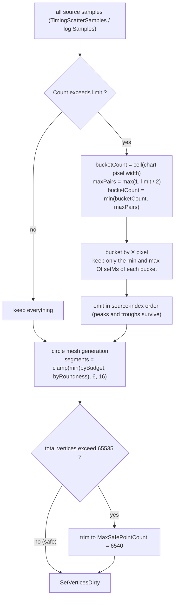

**Bucket min/max** (`ScatterDrawerBase.Data.cs`, the core of the scatter plot):

```csharp
int bucketCount = Mathf.Max(1, Mathf.CeilToInt(rectTransform.rect.width));  // one bucket per horizontal pixel
int maxPairs    = Mathf.Max(1, limit / 2);
if (bucketCount > maxPairs) bucketCount = maxPairs;
// each bucket keeps only the minimum and maximum OffsetMs, emitted in source order
```

Effect: extremes are preserved and density converges per pixel. **This is why tens of thousands of points do not destroy performance.** The cost is that deep zooming overlaps points inside a bucket, so the hover "nearest point" may differ from the visible overlap order.

**Adaptive dot segment count**:

```csharp
int budgetPerPoint = (MaxMeshVertexCount - FixedVertexBudget) / Mathf.Max(1, pointCount);
int byBudget = budgetPerPoint - 4;
float cosHalf = Mathf.Clamp(1f - MaxCircleSagittaPx / radius, -1f, 1f);
float step = 2f * Mathf.Acos(cosHalf);
int byRoundness = Mathf.CeilToInt((Mathf.PI * 2f) / step);
return Mathf.Clamp(Mathf.Min(byBudget, byRoundness), 6, 16);
```

### 10.4 Performance hot spots

| Scenario | Cost | Trigger |
|---|---|---|
| Auto-scroll | **full geometry rebuild every frame** | `LiveScrollActive` (time axis + no manual pan + Always Scroll + not paused) |
| Gesture pan | redraw every frame | `_gesturePanning` |
| Hover hit-testing | O(n) linear scan | `FindNearestRenderPoint` every frame, n ≤ 6540 |
| Settings panel open | `UIDirty = true` every frame | title/HUD text rebuilt each frame |
| Log list | ≤60 rows × ~10 IMGUI controls | `LogListDrawBudget` |
| Large log parse | whole-file parse on a worker thread | opening the log chart window |

Measured baseline (32.64 s / 6009 frames, 5.46 ms average = 183 FPS): drawer mesh averages 0.455 ms/frame (~8.3% of frame time), peaking at 1.400 ms; drawer text averages 0.301 ms; update averages 0.064 ms.

### 10.5 A failed optimisation — do not redo

**Direct vertex path** (bypassing `VertexHelper` to write streams directly) was implemented and then **reverted after failing in-game validation**:

- Symptom: all scatter dots vanished while background, grid, reference lines, average curve, zoom/pan and hover all worked.
- Root cause: `FlushDirectVertices()` in `ScatterDrawerBase.Render.cs` copied `_scratchVerts` into `_streamVerts` but **never copied `_scratchTris` into `_streamTris`** → indices were always empty → zero triangles.
- Secondary risks: duplicated submission of `existingVerts`; reliance on `VertexHelper.AddUIVertexStream` forwarding to `CanvasRenderer.AddUIVertexStream` is only weakly guaranteed.
- Resolution: reverted `ScatterDrawerBase.Render.cs` to HEAD and removed the `GraphDrawerBase.OnBeforeDrawSeries` hook; a copy is kept at `.work/backup/ScatterDrawerBase.Render.directpath.cs`.

---

## 11. Co-op subsystem

### 11.1 Game-side mechanics (the most expensive knowledge to rediscover)

- Co-op is **local, same-screen, 1–4 players** (`scrPlayerManager.MaxPlayers = 4`). Entry: pause menu → `PauseMenu.Submenu.PlayerSelect` → `PlayerSelect.Finish()` → `scrPlayerManager.SetPlayerCount(n)`.
- The only switch is `scrController.coopMode => scrPlayerManager.playerCount > 1`. **There is no `isCoop` field and no persistence flag.**
- `scrPlayerManager.playerCount` (`public static int`) is the single source of truth; switching to `scnCLS` / `scnEditor` / `scnMinesweeper` resets it to 1.
- Identity: `scrPlayer.playerID` (`public int`, 0-based). Per-player judgements live in `scrPlayer.marginTracker` → `scrMistakesManager.marginTrackers[playerID]` (`public static scrMarginTracker[]`, **index == playerID**).
- Planet → player: `scrPlanet.player` (`public scrPlayer`, serialized field, reads never throw). Each player has their own `scrPlayer.planetarySystem`.
- **`scrController.playerTwo` does not exist**; only `playerOne` (`= players[0]`).
- Game behaviour in co-op: judgement text is a single instance offset per living player and coloured by planet; the error meter is a single instance; the song title is globally unique; the death hint is globally unique; `DetailedResults` pages per player (`results` is a `private string[]`, which the mod reflects); one camera follows the leading living player; failure requires the last living player to die; `SaveCheckpointProgress`/`LoadCheckpointProgress` return immediately; save prefix is `coop_`.

### 11.2 Mod-side implementation

`TimingShow\Source\Coop.cs` (100 lines)

```csharp
const string Placeholder = "--";
const string Separator = ",";
static readonly Color[] PlayerColors = {
    (1.00,0.35,0.35), (0.31,0.76,0.97), (1.00,0.84,0.31), (0.70,0.53,1.00)
};
static bool IsCoop => Players.IsCoop;
static int ActiveCount => IsCoop ? Players.Count : 1;
static string Label(int id) => "P" + (id + 1);
static string Join(Func<PlayerSession,string> format);                     // single player = Text(format, Get(0)); co-op joins with Separator
static string Join(bool perPlayer, Func<...> format);
static string JoinLines(Func<...> format, string lineIndent = "");         // one line per player, prefixed Label+"  " when count > 1
static string JoinLines(bool perPlayer, Func<...>, string lineIndent);
static string Text(...);                                                   // IsCoop && !HasHit → "--"
```

A single shared `StringBuilder _sb` is reused (**not reentrant**; every call site is sequential).

**The six guarantees of byte-for-byte single-player equivalence** (established during the refactor; do not break them):

1. `Coop.ActiveCount` is always 1 in single player.
2. `Coop.Text()`'s `"--"` only applies when `IsCoop`.
3. Death/results screens use `CalcUR.Mean(list)` / `CalcUR.calc(list)`, the HUD uses `UrStats` (Welford) — both paths are kept intentionally.
4. `FormatTiming` wraps only the number in the judgement colour; units stay outside.
5. `ApplyTitleText`'s `BumpTrigger` receives the uncoloured value.
6. `WinPagePatch` uses `JoinLines(..., "    ")` in single player, byte-identical to the original `$"<size=N%>    {string.Join("    ", items)}</size>"`.

**The only intentional behaviour change**: HUD format strings moved units into the value (`"Timing - {0}ms"` → `"Timing - {0}"` etc.), migrated automatically by `Settings.Migrate`'s `StripValueSuffix`.

---

## 12. Logging subsystem

### 12.1 Backend selection

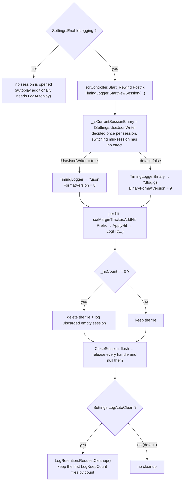

There are six close points (`Fail2Action` / `OnLandOnPortal` / `scnEditor.SwitchToEditMode` / `QuitToMainMenu` / entering any scene other than `scnGame` / the next level start after `EnableLogging` is turned off); inside `EndSession()` the `CloseSession()` call sits after stopping the clock, resetting players and clearing samples, and before destroying the HUD.

The single switch:

```csharp
// TimingShow\Source\Logging\TimingLogger.cs
_isCurrentSessionBinary = !ModContext.Settings.UseJsonWriter;   // default false → binary is the default
```

**Per run**; flipping it mid-run has no effect.

| Aspect | JSON `TimingLogger` | Binary `TimingLoggerBinary` |
|---|---|---|
| Extension | `*.json` | `*.tlog.gz` (`GZipStream`, always compressed) |
| Version constant | `FormatVersion = 8` | `BinaryFormatVersion = 9` |
| Writing | `StreamWriter` (UTF-8, no BOM), manual appends; one `StringBuilder` (4096) per player | `BinaryWriter`, record by record, no aggregation |
| Size per record | ≈45–90 bytes | ≈24–50 bytes after gzip |
| Empty session | `_hitCount == 0` → delete the file, log `Discarded empty session` | Same (with `(binary)`) |

### 12.2 Naming, directory, buffering

```csharp
long timestamp = DateTimeOffset.UtcNow.ToUnixTimeSeconds();       // second precision
string fileName = $"{timestamp}_{safeSongName}{ext}";
```

`safeSongName` = `Path.GetFileNameWithoutExtension` → invalid chars to `'_'` → spaces to `'_'` → `"Unknown"` when empty. **Length is never truncated.**

Collision handling: `new FileStream(path, FileMode.Create, …)` — **two runs of the same song in the same second silently overwrite each other**; no suffix, no existence check.

Buffering: `int bufferSizeBytes = Math.Max(4, bufferSize) * 1024;` (default 64 → 65536). **Flushing happens only when the session closes** (no `AutoFlush`, no timer), so a crash loses the whole buffer.

### 12.3 JSON v8 format

Eleven header lines in fixed order:

```
songName                // JsonEscape handles only \\ and \"
levelPath
timestamp               // Unix seconds
bpm / speed / pitch     // ToString("R", InvariantCulture)
isAngle                 // bool
formatVersion           // 8
hitMarginVersion        // "Unknown" / "Legacy" / "Game34"
judgeCodeVersion        // 1
```

Body: `"offsets"` (old single-player) or `"offsets_1"` … `"offsets_N"`. Each element is a **fixed 10-tuple** (no per-record player or xacc; the player is the array index):

| Index | Field | Notes |
|---|---|---|
| 0 | `songTimeMs` | `"F3"` invariant; NaN/∞/<0 → `null` |
| 1 | `value` | `"F{PercLog}"`; `isAngle` decides degrees vs ms. **Missing InvariantCulture** (a comma-decimal locale writes `1,234` and the reader parses NaN) |
| 2 | `rawMarginCode` | int, **explicitly discarded by the reader** |
| 3 | `judgeCode` | int |
| 4 | `isXPerfect` | 1/0, condition `isXP && (IsGame34 \|\| Logger_EnableXPerfect)` |
| 5 | `angleDeg` | `"F4"` invariant or null |
| 6–8 | `hitBpm` / `hitSpeed` / `hitPitch` | `"R"` or null |
| 9 | `floorId` | int or -1 |

Freeze conditions: `hasHitParams = bpm > 0 && speed > 0 && pitch > 0`; `hasAngle = hasHitParams && angle is finite`.

**There is no xacc field**: XACC/UR/Avg are all derived from offsets on the presentation side.

Version history: v≤6 a single `offsets` 5-tuple; v7 introduced `offsets_N`; v8 widened to 10 elements plus the two version fields. **The reader does not branch on `formatVersion`** — it reads by index, so a missing element simply means "no such capability".

### 12.4 Binary v9 format

Header:

| Offset | Content |
|---|---|
| 0–3 | magic ASCII `TSMZ` (`54 53 4D 5A`) |
| 4 | version u8 = 9 |
| 5–12 | timestamp int64 LE |
| 13… | songName (7-bit LEB128 length + UTF-8) |
| … | levelPath likewise |
| … | bpm / speed / pitch float64 LE × 3 |
| … | isAngle u8 |
| … | hitMarginVersion u8 (1=Legacy, 2=Game34, 0=Unknown) |
| … | judgeCodeVersion u8 = 1 |
| … | playerCount u8 (v≥8 only) |

Records:

| Field | Encoding |
|---|---|
| `playerId` | u8 (v≥8, out-of-range → 0) |
| `songTime` | XOR-double |
| `value` | XOR-double |
| `rawMarginCode` | ZigZag varint |
| `judgeCode` | ZigZag varint |
| `isXPerfect` | u8 |
| `angle` / `bpm` / `speed` / `pitch` | float32 LE × 4 (`SafeFloat`: invalid → NaN; v≥9) |
| `floorId` | ZigZag varint (-1 = absent; v≥9) |

**VarInt** (`VarInt.cs`, 42 lines):

```csharp
uint ZigZag(int v)   => (uint)((v << 1) ^ (v >> 31));
int  UnZigZag(uint v) => (int)(v >> 1) ^ -(int)(v & 1);
// LEB128: 7 bits per byte plus a 0x80 continuation bit; int32 caps at 5 bytes, and the reader fails at bytesRead >= 5
```

**XOR-double** (`TimingLoggerBinary.cs`):

```
xor = curBits ^ prevBits
xor == 0            → write a single 0x00 byte (reuse the previous value; prev unchanged)
otherwise           → control = 0x80 | (leadingBytes << 4) | significantBytes
                     leadingBytes    = CountLeadingZeroBytes(xor)   // 0..7
                     trailingBytes   = CountTrailingZeroBytes(xor)
                     significantBytes = 8 - leading - trailing      // 1..8
                     then write significantBytes (little-endian window)
```

Time and value each maintain their own `prevBits` (first record starts at 0).

**No per-record checksum**; only the gzip trailer ISIZE is validated: file length ≥ 18 and the 4 bytes before the final 4-byte length, read little-endian, must equal `(uint)(decompressed byte count & 0xFFFFFFFF)`; otherwise `Truncated = true` (CRC32 is not checked).

### 12.5 Reader

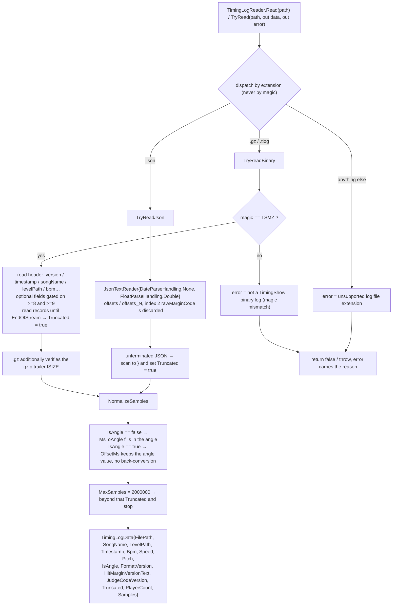

`TimingShow\Source\Logging\TimingLogReader.cs` (1026 lines)

```csharp
public sealed class TimingLogData {
    string FilePath, SongName, LevelPath;
    long   Timestamp;
    double Bpm, Speed, Pitch;
    bool   IsAngle;
    int    FormatVersion;
    string HitMarginVersionText;
    int    JudgeCodeVersion;
    bool   Truncated;
    int    PlayerCount;                        // default 1
    List<TimingScatterSample> Samples;         // capacity 1024
}
public static class TimingLogReader {
    bool IsSupportedLogFile(string path);
    TimingLogData Read(string path);
    bool TryRead(string path, out TimingLogData data, out string error);
}
```

Dispatch is by **extension**, not magic: `.gz` / `.tlog` → `TryReadBinary`; `.json` → `TryReadJson`; anything else reports `unsupported log file extension`. `MaxSamples = 2000000` (beyond it, `Truncated = true` and reading stops).

JSON specifics:

- `JsonTextReader { DateParseHandling.None, FloatParseHandling.Double }`
- `IsOffsetsField` accepts `offsets` / `offsets_<digits>`; `OffsetsFieldPlayerId` takes N−1 from the key (invalid/>1000 → 0) and raises `PlayerCount`
- **Index 2 `rawMarginCode` is explicitly discarded** (empty `case 2:`)
- No recognised header field at all → `not a TimingShow JSON log (no recognized fields)`

Binary specifics: only `.gz` wraps `GZipStream` + `CountingStream` + `BufferedStream`; magic mismatch → `not a TimingShow binary log (magic mismatch)`; header failure → `binary header is incomplete or corrupt: <type name>`; `EndOfStreamException` in the record loop → break with `Truncated = true`.

`NormalizeSamples`:

```csharp
// IsAngle == false: derive the angle
ms * 180.0 * bpm * speed * pitch / 60000.0
// IsAngle == true: OffsetMs keeps the angular value; no conversion back
```

**Downstream code must consult `IsAngle`** and cannot assume `OffsetMs` is milliseconds.

### 12.6 Retention policy

`TimingShow\Source\Logging\LogRetention.cs` (207 lines)

- Trigger: `TimingLogger.CloseSession()` **always** calls `RequestCleanup()`; whether anything is deleted depends on `Settings.LogAutoClean`.
- `LogKeepCount` (default 50) is a **count-based** retention, `keep = Clamp(LogKeepCount, 0, 100000)`; `keep = 0` empties the directory.
- Ordering reuses `Settings.LogSort`: 0 = time descending, 1 = size descending, 2 = song name `OrdinalIgnoreCase` ascending; ties fall back to time descending, then filename ascending.
- Timestamp source: digits before the first `_` in the filename (else before the first `.`) → `LastWriteTimeUtc` → 0.
- Scope: `Directory.GetFiles(dir)` non-recursive, only `.json` / `.tlog` / `.tlog.gz`, skipping `TimingLogger.IsFileBeingWritten(path)`.
- Concurrency: `_running` single-flight + `_pending` coalescing + thread pool; each round ends with `Interlocked.Increment(ref _completedVersion)` so the log list notices.

### 12.7 Checklist for changing the format

Twelve places must stay in sync (missing one causes silent misreads):

1. Version constants and backend selection in `TimingLogger.cs`
2. The eleven header lines, the 10-tuple and the `"offsets_N"` tail (mind the locale hazard)
3. Field order, `WriteXorDouble` / `SafeFloat` / `VarInt` and flush order in `TimingLoggerBinary.cs`
4. `VarInt.cs` (changing it makes old files unreadable)
5. `TimingLogReader.cs`: index table (including the discarded `case 2`), `ApplyHeaderField` key names, the `>= 8` / `>= 9` gates, `NormalizeSamples`, the gzip ISIZE check
6. Enum values in `HitMan.cs` and the reflection name list in `HitMarginCompat`
7. Extension filter and `TimestampFromFileName` in `LogRetention.cs`
8. Extension filter, `ReadLogMetadata` header probe, `CompareLogEntries` and `AbsLogPath` in `OptionLogList.cs`
9. `ContentType` / request matching / CORS-PNA headers in `LogAnalyzerBridge.cs`, plus the web analyser's JS parser
10. `EditorHitSnapshot.cs` and every consumer of `TimingLogData.Samples` (`IsAngle` / `HasFloorId` / `HasHitParams` semantics)
11. `newformat.md`
12. `lang.json` strings and the related controls in `Options.cs`

**Compatibility red line**: any new field must come with an explicit version gate (e.g. `>= 10`), otherwise an old reader will mistake new fields for record headers.

---

## 13. Log chart window (LogGraph)

About 30 files / 11,410 lines. **Pure uGUI immediate-mode self-drawing** — not IMGUI, and no dedicated camera.

### 13.1 Object hierarchy

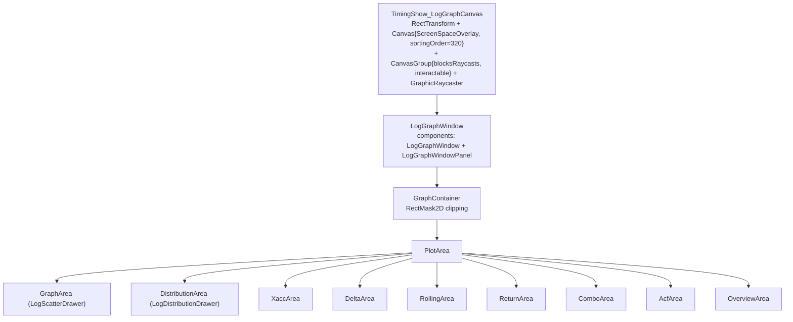

### 13.2 `LogGraphWindow` partial split (9 files / 3007 lines)

| File | Lines | Responsibility |
|---|---|---|
| `LogGraphWindow.cs` | 643 | Constants, singleton, `Open/Close/Build/Update/OnDestroy`, static layout core, palette |
| `.Window.cs` | 317 | Size/position clamping, drag proxies, settings toggle, drag/resize commit, hit-testing, size persistence |
| `.Views.cs` | 415 | `GraphView` enum, `SetView`, `PushViewData`, `Ensure*Data`, drop-down menus |
| `.Stats.cs` | 435 | Statistic computation and the four-row text per view |
| `.Layout.cs` | 351 | Header layout, `ApplyLayout`, selector positioning, settings-page layout |
| `.Distribution.cs` | 15 | `PushDistributionData()` forwarding |
| `.Input.cs` | 310 | EventSystem callbacks plus per-frame polling fallback |
| `.Pane.cs` | 314 | `ILogGraphPanelInteraction` + `LogGraphWindowPanel` chrome |
| `.Diagnostics.cs` | 207 | Out-of-bounds / layout-drift diagnostics |

Singleton semantics:

```csharp
private static LogGraphWindow _instance;
private static GameObject _root;
public static bool IsOpen => _instance != null && _root != null;
```

`Open(data)` calls `Close()` then `Build(data)`; `Close()` **nulls every reference before `Destroy(root)`** (to prevent `OnDestroy` reentry).

### 13.3 Open path (the only entry point)

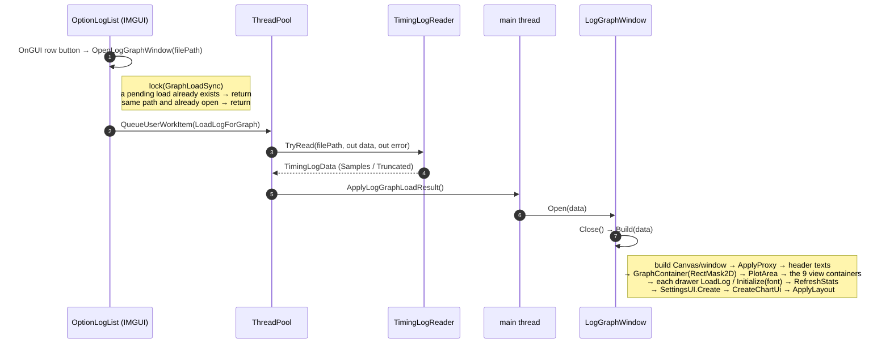

`Build` order: `LogRoundedRect.SyncFromSettings()` → read `SavedWindowSize()`, clamp and centre → create canvas/window → `ApplyProxy()` → header texts → `GraphContainer(RectMask2D)` → `PlotArea` → `GraphArea` (`LogScatterDrawer`) → `DistributionArea` → seven `CreateChartArea` calls → `_drawer.LoadLog(data)` → `Initialize(font)` on the other eight → fill `_viewAreas[9]` activating one → `RefreshStats()` → `GraphSettingsUI.Create(...)` → `CreateChartUi(font)` → `ApplyLayout(size, position)`.

Open animation: `Build` leaves `CanvasGroup.alpha = 0` on the root; `UpdateOpenAnimation()` then eases over 0.18s with `Time.unscaledDeltaTime` (OutCubic), driving alpha 0→1 and the window's `localScale` 0.94→1. Because the window pivots on its bottom-left corner, `anchoredPosition` is compensated by `target + size * (1 - scale) / 2` so the zoom stays centred; the animation pauses while dragging/resizing, and `ApplyLayout` keeps `_openAnimTargetPosition` / `_openAnimSize` in sync while it runs.

### 13.4 View enum and data classes

```csharp
enum GraphView { Scatter=0, Distribution=1, Xacc=2, Delta=3, Rolling=4,
                 ReturnMap=5, Combo=6, Acf=7, Overview=8 }
// default _view = GraphView.Overview
```

| idx | View | Drawer | Data class | Metrics |
|---|---|---|---|---|
| 0 | Scatter | `LogScatterDrawer : ScatterDrawerBase` | `TimingLogData.Samples` directly | Per-hit deviation, bands, zero/average lines, player legend |
| 1 | Distribution | `LogDistributionDrawer` | `DistributionStats` | Histogram + normal fit + mean/±σ |
| 2 | XACC | `LogXaccDrawer` | `XaccData` | Per-player cumulative weighted accuracy |
| 3 | Delta | `LogDistributionDrawer` (reused) | `DeltaData` (contains `DistributionStats`) | Difference-of-consecutive-hits histogram (no fit curve) |
| 4 | Rolling | `LogRollingDrawer` | `RollingData` | ±1σ sliding mean band + 5–500 window slider |
| 5 | Return map | `LogReturnDrawer` | `ReturnData` | Previous vs current, y=x, Pearson r, 98% axis range |
| 6 | Combo | `LogComboDrawer` | `ComboData` | Combo strip chart + break segments + legend |
| 7 | ACF | `LogAcfDrawer` | `AcfData` | Lag 1–50 bars + confidence band |
| 8 | Overview | `LogOverviewDrawer` | `OverviewData` | Four cards + XACC + judgement distribution + metadata |

Lazy caching: `EnsureXaccData` / `EnsureDeltaData` / `EnsureRollingData` / `EnsureReturnData` / `EnsureComboData` / `EnsureAcfData` / `EnsureOverviewData`. Player filter changes call `ClearChartCaches()` (**which does not clear `_xaccData`**).

`EffectivePlayerId = _drawer.SelectedPlayerId >= 0 ? It : 0` (−1 = all players, aggregated as player 0).

Interaction gating on the scatter page:

```csharp
bool suspended = (_settingsUI != null && _settingsUI.IsOpen) || _view != GraphView.Scatter;
_drawer.InteractionSuspended = suspended;
```

### 13.5 Per-view algorithms

**XACC** (`XaccData.Compute(samples, playerCount)`)

```csharp
// pass 1: count hits per player (!HasJudge skipped, invalid playerId → 0), allocate float[hitCount] filled with NaN
// pass 2:
int ordinal = ordinals[playerId]++;
double? weight = WeightOf(sample.Judge);
if (weight == null) continue;
weightedSums += weight.Value; countedHits++;
double value = weightedSums / countedHits * 100.0;      // cumulative weighted accuracy
values[ordinal] = value;
```

Weight table: `TooEarly 0.2`, `VeryEarly 0.4`, `EarlyPerfect 0.75`, `PerfectMinus/XPerfect/PerfectPlus 1.0`, `LatePerfect 0.75`, `VeryLate 0.4`, `TooLate 0.4`, `FailMiss/FailOverload/OverPress/FailedFloor 0.0`, `Auto 1.0`, `default null` (unknown judgements never enter the denominator).

Decimation: `MaxRenderPointsPerSeries = 2048`; beyond it `bucketCount = 2048/4 = 512`, `bucketSize = ceil(count/512)`, and each bucket emits **first/min/max/last** candidate indices deduplicated and sorted by index (LTTB-style peak preservation); an all-NaN bucket emits `x = start + (end-start)*0.5f + 0.5f, y = NaN` to force a line break.

**Distribution** (`DistributionStats.ComputeValues(values, binCount = 60, buildCurve)`)

1. `mean = Σx/n`; **`variance = Σ(x-mean)²/n` (population)**
2. Skewness `(Σz³)/n`, excess kurtosis `(Σz⁴)/n - 3`, `z = (x-mean)/stdDev` (only when `stdDev > 0`)
3. Sort, then `median` / `q1` / `q3` using **type-7 linear interpolation** (`position = (count-1)*q`)
4. **`robustSigma = (q3 - q1) / 1.349`**; clamp the range to `[median - 4σ, median + 4σ]` ∩ data range
5. Pad by 5% to get `extendedMin/Max`; `binWidth = span / binCount` (1.0 when `span == 0`)
6. Bucket index `Floor((v - extendedMin) / binWidth)` clamped to `[0, binCount-1]`; out-of-range samples only bump `ClippedCount` (**they still count towards mean/variance/quantiles**)
7. Fit curve: `scale = maxBinCount / GaussianPdf(mean, mean, stdDev)` over 201 samples

Drawing: `_yMax = Max(MaxBinCount, CurveMax) * 1.10f`; 3 Y ticks, 3 X ticks, 4 grid divisions; Δ mode uses bar colour `(0.475,0.525,0.796,1)`; mean line `(1,0.7176,0.3020,1)` dashed dash 5/gap 5; ±σ lines `(0.3098,0.7647,0.9686,0.6)` dash 3/gap 3, **omitted in Δ mode**.

**Delta** (`DeltaData.Compute`): `!HasJudge || !IsTap(judge)` or a NaN/Inf value **breaks the chain** (no cross-break differences); statistics are `Mean`, `MeanAbs`, population `StdDev`, `MedianAbs` (mean of the two middle values for even counts).

**Rolling** (`RollingData`): ring buffer `double[] window`; when full, `sum -= dropped; sumSquares -= dropped*dropped;` before accumulating.

```csharp
mean = sum / windowCount;
variance = sumSquares / windowCount - mean * mean;   // population
sigma = variance > 0 ? sqrt(variance) : 0;
Upper = mean + sigma; Lower = mean - sigma;
// drift: difference of the head and tail 25% means
headLimit = Max(1, Floor(count*0.25)); tailStart = count - Max(1, Floor(count*0.25));
Drift = TailMean - HeadMean;
```

NaN/Inf offsets skip the window but still advance `ordinal` (reusing the previous state, so no break is introduced). Slider is 5–500 step 5, default 50; decimation `limit = 4000`.

**Return map** (`ReturnData`): `ReturnPair{ Previous, Current, Hit }`, `MaxRenderPairs = 4000`.

```csharp
r = (Σxy/n - x̄ȳ) / (σx·σy);                      // population moments; NaN when n < 2 or σ ≤ 0
Limit = ComputeLimit(magnitudes);                  // 98th percentile of |offset|, floored at 1.0
OutsideCount = magnitudes.Count(m => m > Limit);   // element-wise count
```

Verdict thresholds: `r < -0.3` → `ReturnOvercorrect`; `r > 0.3` → `ReturnDrift`; otherwise `ReturnIndependent`.

**Combo** (`ComboData`)

```csharp
bool keepsStreak = HitMarginCompat.IsPerfectFamily(sample.Judge) || sample.Judge == HitMan.Auto;
// segmentation: runs plus gap breaks; MaxStoredSegments = 200000
// statistics: RunCount / LongestRun / AverageRun (runs only)
int ComboBin(int len, int maxLen) => Mathf.Clamp(Mathf.FloorToInt(6 * Mathf.Sqrt((float)len / maxLen)), 0, 5);
```

Six green steps from `(0.227,0.420,0.204)` to `(0.376,1.000,0.306)`; break colour `(0.20,0.20,0.20,1)`; strip height `Clamp(plotHeight*0.46f, 12f, 90f*UiScale)` vertically centred. **This is the only chart that owns its own pan and wheel handling** (`raycastTarget = true`): 0.85 per wheel notch, `MinVisibleHits = 10f`, hover resolved by binary search over `FindSegmentAt(hit)`.

**Autocorrelation** (`AcfData`): taps only, **a non-tap or NaN/Inf breaks the run**, so ACF pairs exist only inside runs; gives up when `values.Count < 3`.

```csharp
R = (Σab/n - āb̄) / (σa·σb);
Band = 1.96 / Math.Sqrt(pairs - 1);          // only when pairs > 2
// Strongest: Lag >= 2 && |R| > Band && not NaN, by maximum |R|
YSpan = Min(1.0, Max(0.2, Max(maxAbsR * 1.3, maxBand * 1.3)));
```

Drawing: `step = plotWidth / 50`, `barWidth = Max(1, step*0.7)`, `LagCenterX(lag) = xMin + (lag - 0.5) * step`.

**Overview** (`OverviewData`): `Ur = StdDev * 10.0` (hidden in angle mode); `Xacc = Σ(group·weight) / Σgroup * 100` with groups `{failMiss, TooEarly, VeryEarly, EarlyPerfect, perfectGroup, LatePerfect, VeryLate/TooLate}` and weights `{0, 0.2, 0.4, 0.75, 1.0, 0.75, 0.4}` (**a different scheme from the XACC view's per-judgement weights**).

Four cards: blue `(0.129,0.588,0.953)`, orange `(1,0.718,0.302)`, purple `(0.851,0.345,1)`, green `(0.376,1,0.306)`; `cardHeight = 68*UiScale`. Judgement distribution order is `Game34Order = {9,0,1,2,3,4,5,6,7,8,10,11,12,13,14,15}` (Multipress first) or `LegacyOrder`.

### 13.6 Statistics panel

`StatsRowCount = 4`; `StatLabelKeys = {StatTotalHits, StatUR, StatRatio, StatXAcc}` and `DistributionStatLabelKeys = {DistMean, DistStdDev, DistSkewness, DistKurtosis}`; headers are `ToUpperInvariant()`.

`ComputeStats()`: `_playerCount` is **capped again at 4**; per-player `[4]` arrays across five groups; UR delegates to `CalcUR.calc(all)`.

> **Semantic trap**: the "XACC" row on the scatter page is actually `xPerfect / total * 100` (the XPerfect share), while the XACC view is cumulative weighted accuracy and the overview page uses grouped weights — **three different definitions of the same name**. Always state which one you mean when comparing values.

Precision helpers: `FormatStat` returns `"-"` for NaN/Inf (`CultureInfo.InvariantCulture`); `FormatSigned` prefixes positives with `"+"`; `UnitSuffix => IsAngle ? "°" : "ms"`.

### 13.7 Settings panel (`LogGraphSettingsUI`, 5 files / 1317 lines)

`public sealed partial class LogGraphSettingsUI : MonoBehaviour` (namespace `TimingShow.HUD.LogGraphSettingsUI`).

**Row model plus self-drawing**: `List<Row> _rows` (`RowKind{Title,Tab,Slider,Toggle,ColorPick,ColorPreview,Text,Button}`) + `List<TextMeshProUGUI> _texts` + a nested `SettingsPanelGraphic : MaskableGraphic`.

All input is **polled** in `Update()` (`Input.mousePosition` + `RectTransformUtility.ScreenPointToLocalPointInRectangle`); EventSystem is not used, and `_graphic.raycastTarget = false` — the panel does not consume raycasts and resolves hits from screen coordinates instead.

Base metrics (all multiplied by `UiScale`): `BasePadding=10`, `BaseContentMaxWidth=420`, `BaseTitleHeight=20`, `BaseTabHeight=22`, `BaseRowHeight=22`, `BaseRowGap=4`, `BaseFontSize=12`, `BaseTrackHeight=8`, `BaseToggleSize=14`, `BaseLabelRatio=0.42`, `LineHeightRatio=1.4`. Row heights adapt: `rowHeight = Min(22*scale, available/count - rowGap)`, minimum 12, font `Clamp(Min(fontSize*0.9, rowHeight/1.4), 8, fontSize)`.

**Draft mechanism**:

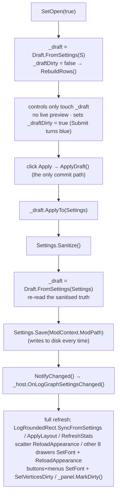

The host callback `OnLogGraphSettingsChanged()` performs a full refresh: `LogRoundedRect.SyncFromSettings()` → `ApplyLayout` → `RefreshStats()` → scatter `ReloadAppearance()` → the other eight drawers `SetFont + ReloadAppearance` → buttons/menus `SetFont + SetVerticesDirty` → `_panel.MarkDirty()`.

**Basic page, 16 rows**: `LogGraph_UiScale` (0.75–3, F2), `LogGraph_CornerScale` (0–2, F2), `Label_PointSize` (1–12, F1), `Label_MaxRenderPoints` (**logarithmic slider** 20–8000, F0), `Toggle_IgnoreOutliers`, `Toggle_UseHitAxis`, `Toggle_UseJudgeColor`, `Toggle_DistinguishPlayers`, `Toggle_ShowZeroLine`, `Toggle_ShowAvgLine`, `Toggle_ShowGrid`, `Toggle_ShowJudgeBands`, `Toggle_ShowXpBand`, `Label_BandThresholdBpm` (100–600, F0), `Toggle_CustomFont`, `LogGraph_FontHint`.

**Colors page**: `ColorSlotCount = 10` (Bg/Grid/Point/ZeroLine/AvgLine/AxisText/BandPerfect/BandElPerfect/BandEarlyLate/BandXp) in two columns; three RGB sliders (`ByteDisplay` shows `RoundToInt(Clamp01(v)*255)`); each slot's Reset **resets RGB only, preserving alpha**; the bottom preview shows `"#" + ToHtmlStringRGB + "    A " + alpha.ToString("F2")` with text colour chosen by luminance `0.299r+0.587g+0.114b > 0.55`.

### 13.8 Fonts and drawing primitives

**`LogGraphFont`** (static, 398 lines)

- Resources: `TimingShow.Assets.SourceHanSansSC-Regular.otf`, `…GmarketSansMedium.otf`, `…OFL.txt`; Korean detection is `Settings.Language == "한국어"`.
- **Resolution order: bundled → latin → cjk → hangul**; on success `PreloadSettingsGlyphs(_primary)` runs and fallbacks are added.
- System candidates: CJK = Microsoft YaHei UI / Microsoft YaHei / SimHei / SimSun; Hangul = Malgun Gothic; Latin = Segoe UI / Arial / Tahoma / Verdana / Liberation Sans; probes `"字"` / `"한"` / `"Aa0"`.
- Loading: `EnsureBundledAssets()` inflates to `Application.temporaryCachePath/TimingShow` (falling back to `Path.GetTempPath()`); `ExtractIfChanged` writes `.tmp` first, compares byte-wise via `SameContent`, and only then does `File.Delete + File.Move` (**Unity's `new Font(path)` needs a real file path, and a mod update with the same filename must refresh by content**).
- Atlas: `SamplingPointSize=48`, `AtlasPadding=6`, `AtlasWidth=AtlasHeight=2048`, `atlasPopulationMode=Dynamic`, `isMultiAtlasTexturesEnabled=true`.
- Compatibility hack: `TryCreateAssetWithAtlas` reflects the **8-parameter** `TMP_FontAsset.CreateFontAsset`, builds `renderMode = Enum.ToObject(parameters[3].ParameterType, 0x1045)` and invokes `{source, 48, 6, renderMode, 2048, 2048, Dynamic, true}`; if not found it falls back to the 3-parameter overload.
- Cache `Dictionary<string, TMP_FontAsset>` (**including nulls**).

**`LogChartDrawer`** (abstract base, 327 lines) primitives:

```csharp
protected static void DrawQuad(VertexHelper vh, Vector2 min, Vector2 max, Color color);
protected static void DrawTriangleQuad(VertexHelper vh, Vector2 a, Vector2 b, Vector2 c, Vector2 d, Color color);
protected static void DrawSegment(VertexHelper vh, Vector2 from, Vector2 to, float halfWidth, Color color);
protected static void DrawCircle(VertexHelper vh, Vector2 center, float radius, Color color, int segments);
protected static void DrawDashedVertical(VertexHelper vh, float x, float yMin, float yMax, float dash, float gap, float halfWidth, Color color);
protected static void DrawDashedHorizontal(VertexHelper vh, float y, float xMin, float xMax, float dash, float gap, float halfWidth, Color color);
protected static string ColorToHex(Color color);
protected static float EstimateTextWidth(string content, float fontSize);   // length * fontSize * 0.62f
```

**`LogRoundedRect`** (static, 134 lines): `GlobalScale` comes from `Settings.LogGraph_CornerScale` (default 0.4, `Clamp(0,2)`); the radii `WindowRadius=10`, `InnerPanelRadius=6`, `PanelRadius=8`, `ControlRadius=4`, `SmallRadius=3`, `SwatchRadius=2`, `MenuRadius=7`, `MenuItemRadius=4` are all multiplied by it; `CapsuleRatio = Clamp01(0.5f * GlobalScale)`. `GlobalScale = 0` means fully square corners.

**`LogChartUi.cs`** (561 lines): `LogPillButton`, `LogSlider` (defaults `5/500/50/5`), `LogChartMenu` (defaults `180/22/4`, `MaxRows = 12`).

### 13.9 Dual input channels

1. **EventSystem channel**: `LogGraphWindowPanel` implements `IPointerDownHandler / IDragHandler / IPointerUpHandler / IPointerClickHandler / IPointerMoveHandler / IPointerExitHandler` and forwards to `ILogGraphPanelInteraction`, implemented by `LogGraphWindow` itself.
2. **Per-frame polling fallback** `UpdateInputFallback()` (the de-facto main channel): forces gesture termination on focus loss, window drag/resize, wheel zoom, buttons that fire only on mouse-up, title-bar dragging, and chart-area left-clicks that first try `TryPlayerLegendClick(screen)` before `BeginPan`.

`_ignoreNextClick` is fragile: a fast press/release, a focus loss, or a menu toggle ordering can all swallow the wrong click.

---

### 13.10 The last-hit report (in-memory snapshot)

A one-run report that also works with logging disabled. **It reads no file at all**: before the session dies, `ModContext.TimingScatterSamples` is deep-copied, wrapped in a synthetic `TimingLogData` and handed to `LogGraphWindow.Open()` — all nine views, the player filter and the stats panel are reused, with no new chart code.

| Step | Location |
|---|---|
| Session metadata (song / level / bpm / speed / pitch) | `LevelStartPatch` in `TimingShow/Source/Patches/PlayStatePatches.cs`, captured **before the logging gate**, so the values exist with logging off |
| Snapshot points | `Fail2Action` Postfix, `OnLandOnPortal` Postfix, first line of `EndSession()` (covers back-to-editor, quit-to-menu, scene change) |
| Snapshot and window control | `TimingShow/Source/SessionReport/LastSessionReport.cs`: `HasReport` / `Capture` / `OpenWindow` / `ToggleWindow` / `CloseOnLevelStart` / `Clear` |
| Hotkey polling | `TimingShow/Source/SessionReport/SessionReportHotkey.cs`: a persistent `DontDestroyOnLoad` `MonoBehaviour`. UMM has no per-frame callback and the report must answer in both `scnGame` and `scnEditor`, so owning a host beats patching two unrelated scene objects |
| Setting | `Settings.ReportKey` (defaults to `KeyCode.F10`; `None` disables it) |

Three deliberate choices: `data.IsAngle` is always `false` because in-memory samples keep milliseconds in `OffsetMs` and the angle in `AngleDeg` (`Logger_ShowAngle` only decides the on-disk unit); `PlayerCount` is `max(players at start, highest sample PlayerId + 1)` because `scrPlayerManager` may already be reset when returning to the editor; and starting a new level closes the window but **keeps the data** until the next finished run replaces it.

### 13.11 Scatter range filter

The `[min] ~ [max]` inputs at the top-left of the scatter view filter points by their y value (`OffsetMs`, which is the angle for angle logs).

| Step | Location |
|---|---|
| Data filtering | `ScatterDrawerBase.Data.cs` gains the virtual `IsOffsetInRange(float)` / `HasOffsetRangeFilter`; samples outside the range are skipped while `_visibleIndices` is collected, and `OffsetRangeKept` / `OffsetRangeHidden` are counted. The in-game HUD scatter does not override them, so its behaviour is unchanged |
| Average line | `BuildAverageSeries` restricts itself to `_visibleIndices` when `dropOutliers || _playerFilter >= 0 || HasOffsetRangeFilter`, so filtered-out points never enter the mean |
| State | `LogScatterDrawer.SetOffsetRange(hasMin, min, hasMax, max)` returns early when nothing changed, otherwise bumps `_dataVersion` to force a rebuild; `RangeKeptCount` / `RangeHiddenCount` feed the status text |
| Input control | `LogRangeField.cs`: a self-drawn `MaskableGraphic` that consumes `Input.inputString` for digits, `-` and `.`, handles backspace, ends editing on `Enter` / `Escape` / clicking elsewhere, and draws a blinking caret while editing. It deliberately avoids `TMP_InputField`, which would add an EventSystem dependency and a second focus model |
| Layout and state | `LogGraphWindow.Filter.cs`: `CreateRangeFilter` builds the bar; `ApplyLayout` / `SetView` call `SyncRangeFilterVisible` (scatter view only, hidden while the settings page is open); `PositionRangeFilter` pins it to the top-left of `ResolvedPlotRect()` |
| Input conflicts | `LogGraphWindow.Input.cs` skips wheel zoom and drag panning while the pointer is over the bar, and ends editing of any field the click did not land on |

Localisation keys: `LogGraph_RangeFilter`, `LogGraph_RangeInRange` (`{0}` is the in-range count); the reset button reuses `Btn_ResetColor`.

Known limitation: the field consumes the keyboard directly, so the game's own shortcuts (for example `-` zooming the editor out) still fire; blocking them would require patching.

## 14. Level editor hit markers

`Source\LevelEditor\EditorHitSnapshot.cs` (202 lines) + `EditorHitMarkerController.cs` (787 lines)

### 14.1 Data and snapshot

```csharp
class EditorHitSnapshotData {
    string LevelPath, SongName;
    int FloorCount, PlayerCount, SampleCount;
    bool Truncated;
    long CapturedAtUtcTicks;
    TimingScatterSample[] Samples;
}
```

`MatchesEditor`: prefers an `OrdinalIgnoreCase` comparison of `ADOBase.levelPath`; when the path is empty it **degrades to comparing floor counts**; access to `editor.floors` is wrapped in try/catch.

`CaptureFromSession()` runs in the **Prefix** of `scnEditor.SwitchToEditMode`, **before** `EndSession()` (the deep copy must happen before cleanup). Each field is captured in its own try/catch; `Truncated = copy.Length >= TimingCalcPatches.SampleHardLimit` (= 100000).

`TryLoadFromLog` error keys: `EditorHits_ImportNotEditor`, `_ImportReadFailed`, `_ImportNoFloor` (no `HasFloorId`, requiring JSON v8+ / TLog v9+), `_ImportLevelMismatch`.

### 14.2 Rendering

**One Mesh plus one MeshRenderer**, not one GameObject per point:

- Each marker is a dashed ring: `MarkerDashCount = 8` × `MarkerDashSegments = 3` = **96 vertices / 48 triangles**.
- Rebuilt on the CPU into reused lists → `SetVertices` / `SetColors` / `SetTriangles(..., 0, true)`; `IndexFormat.UInt32`; `MarkDynamic()`.
- Shader `Sprites/Default`, falling back to `Unlit/Transparent`; `sortingOrder = 32000`.
- Billboard using `right/up/towardCamera`, offset `+ towardCamera * 0.15f`.
- `WorldPerPixel`: orthographic `orthographicSize * 2f / pixelHeight`; perspective `2f * Tan(fov * 0.5f * Deg2Rad) * depth / pixelHeight` (`depth = max(0.01f, |cam.z|)`).
- Zoom-following size: `zoomScale = Clamp(1f / userSizeMultiplier, 0.1f, 10f)` (reflection on the `userSizeMultiplier` field of a MonoBehaviour sharing the camera's GameObject; falls back to 1 when missing); `radiusPixels = Clamp(MarkerSize * zoomScale, 2f, 200f)` (fallback `MarkerRadiusPixels = 35f`), `radius = radiusPixels * worldPerPixel`; outline `Clamp(radiusPixels * 0.16f, 0.75f, 4f)` px converted to a world half-width; `dashStep = 2π/8`, `dashAngle = dashStep * 0.72f` (72% duty cycle), `segmentAngle = dashAngle / 3`.
- Multi-player vertical offset: `up * ((PlayerId - (playerCount-1) * 0.5f) * Clamp(3.5f * zoomScale, 1f, 30f) * worldPerPixel)`.
- Culling: `screen.z <= 0` and a `pixelRect ± (radiusPixels + 8f)` margin.

### 14.3 Coordinate conversion

```csharp
Vector3 AngleOffsetPosition(scrFloor floor, TimingScatterSample sample, float scale) {
    Vector3 center = floor.transform.position;
    if (!hasAngle || NaN/Inf || floor.prevfloor == null || spacing < 1e-5f) return center;

    // baseX/baseY = the floor's facing unit vector (i.e. 0°)
    bool clockwise = HasOrbitDirection ? OrbitClockwise : !floor.previous.isCCW;  // legacy fallback
    float delta = (clockwise ? 1f : -1f) * AngleDeg * Deg2Rad;
    float actualX = baseX * cos + baseY * sin;
    float actualY = baseY * cos - baseX * sin;

    float radiusScale = floor.previous.radiusScale;   // < 0.001f → 1
    float radius = spacing * radiusScale * Clamp(scale, 0, 3);
    center.x += (actualX - baseX) * radius;
    center.y += (actualY - baseY) * radius;
    return center;      // scale only scales the radius delta
}
```

### 14.4 State machine

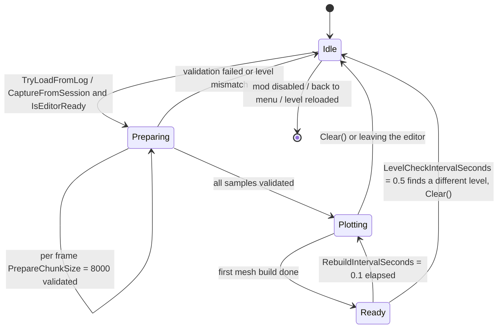

`Phase { Idle, Preparing, Plotting, Ready }`; `PrepareChunkSize = 8000` validates `HasJudge && floors != null && FloorId >= 0 && < floors.Count && floor != null && floor.seqID == FloorId`; `RebuildIntervalSeconds = 0.1f`; `LevelCheckIntervalSeconds = 0.5f` clears on mismatch; `IsEditorReady` requires `editor`, `!IsPlaying`, `camera` and `floors` all ready.

Progress bar 360×26 at `(center.x, yMin+20f)`, text `EditorHits_Progress = "Preparing hit markers: {0} / {1}"`.

### 14.5 Hover

Hover radius `max(HoverRadiusPixels = 11f, radiusPixels + 3f)`, refreshed on every rebuild; tooltip at `mouse + (14, -14)`, size `max(150, …) × max(40, …)` clamped into the viewport (`pivot = (0,1)`); rebuilt only when `best != _hoverSampleIndex`. Content includes `Detail_Player/Timing/Angle/Judge`, `BPM:{F1} ×{Speed:F2}` (only when `HasHitParams`) and the floor as `(FloorIdEstimated ? "~#" : "#") + FloorId`.

---

## 15. Settings and localisation

### 15.1 Settings UI architecture

`Options.OnGUI()` has **no tabs**; it is a linear stack of foldout sections, with the outer scrollbar supplied by the loader. There are exactly 17 calls per frame, in page order:

```
DrawLanguageSettings → DrawTitleSettings → DrawPlanetSettings → DrawDeathAndWinSettings
→ DrawTimingHUD → DrawAvgHUD → DrawURHUD → DrawRatioHUD
→ DrawXACCGraphSettings → DrawTimingScatterSettings → DrawEditorHitSettings
→ DrawLoggingSettings → DrawSessionControls → OptionLogList.Draw
→ DrawLogGraphSettings → DrawAdvancedSettings (which calls DrawDebugSettings)
```

Entry side effects:

```csharp
if (!ModContext.IsConfigOpen) OptionLogList.OnConfigOpened();   // refresh logs, trigger auto-clean
ModContext.LastConfigGuiFrame = Time.frameCount;
ModContext.UIDirty = true;
```

`IsConfigOpen` is a **frame-number heuristic** (`Time.frameCount - LastConfigGuiFrame <= 1`), so `OnConfigOpened` fires once per panel opening even when IMGUI calls `OnGUI` several times in a frame.

Three foldout implementations coexist (an inconsistency that explains most layout quirks):

1. `OptionsWidgets.FoldoutToggle` / `ToggleFold`: the checkbox is the master switch; the arrow appears only when open, and a `GUILayout.Toggle(false, "", ExpandStyle)` **placeholder** keeps alignment when closed.
2. Self-drawn `GUILayout.Button($"{label} {▲|▼}")` at width 150: replacement settings, log chart window, advanced, Debug, log list.
3. Foldout state lives entirely in `Options` `private static bool` fields — **not in `Settings`, not persisted, reset on restart**.

Seven text-field static snapshots also exist: `_bufferSizeText`, `_maxPointsText`, `_analyzerPortText`, `_analyzerTimeoutText`, `_scatterSampleCountText`, `_scatterMaxPointsText`, `_logGraphMaxPointsText` — initialised from `Settings` only when `null`, then written one-way.

### 15.2 `OptionsWidgets` control factory

`internal static class OptionsWidgets`, `public const float ContentIndent = 40f;`

| Signature | Behaviour |
|---|---|
| `ActiveButton(string label, bool active, float width)` | Reuses one `GUIStyle`, toggling `fontStyle` |
| `FoldoutToggle(string label, ref bool toggle, ref bool foldout)` | Arrow + checkbox on one row (placeholder when closed) |
| `ToggleFold(string label, ref bool toggle, ref bool foldout)` | Semantic alias of `FoldoutToggle` |
| `SettingFold(...)` / `SettingRow(...)` | **Currently uncalled** (dead code) |
| `ToggleWithDescription(bool value, string labelKey, string descKey, string extraDescriptionHtml = "", float indent = ContentIndent, string extraLabelHtml = "")` | Rich-text checkbox plus a grey description; **returns the new value without assigning**, enabling "compare old/new then trigger side effects" |
| `IndentedLabel(string text, float indent = ContentIndent)` | Indented label |
| `HUDBase(ref float x, ref float y, ref float scale, ref bool bold, ref int align, ref string format, ref int prec)` | Shared HUD quintet |
| `SliderFloat(string labelKey, ref float value, float min, float max)` | Label carries its own colon, e.g. `"X Offset: 0.05"`, slider width 120 |
| `SliderInt(...)` | As above, width 100 |
| `Toggle(ref bool value, string labelKey, float indent = ContentIndent)` | `indent = 0` for the compact 14 judgement switches |
| `IntField(string labelKey, ref string text, ref int value, int min, int max, int fallback, float labelWidth = 120)` | **Any invalid or out-of-range input immediately resets both the text and the value to `fallback`** |
| `RatioModeButtons()` / `AlignButtons(ref int align)` | Three-button groups |
| `ColorPicker(string label, ref Color color)` | Label + R/G/B/A letters + four 0–1 sliders; **no swatch preview, no hex input** |

### 15.3 `Settings` persistence

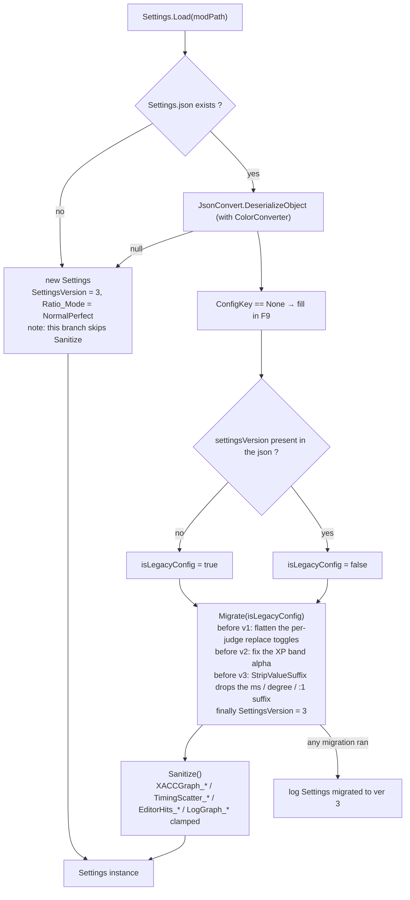

`TimingShow\Source\Settings.cs` (588 lines)

```csharp
public const int CurrentSettingsVersion = 3;
public int SettingsVersion;   // default 0; serialised as "settingsVersion"
```

**`Load(string modPath)`**:

1. If the file exists → `JsonConvert.DeserializeObject<Settings>` (with `ColorConverter` for `UnityEngine.Color`); `null` counts as failure
2. `ConfigKey == KeyCode.None` → refill `F9`
3. `isLegacyConfig = json.IndexOf("settingsVersion", OrdinalIgnoreCase) < 0`
4. `Migrate(isLegacyConfig)` → `Sanitize()`
5. On exception → `Logger?.Error($"Failed to load settings: {e.Message}")`
6. Fallback object `new Settings { SettingsVersion = CurrentSettingsVersion, Ratio_Mode = RatioMode_NormalPerfect }` (**Sanitize is not run**)

**`Migrate(bool isLegacyConfig)`** step by step:

| Condition | Action |
|---|---|
| `isLegacyConfig \|\| SettingsVersion < 1` | `ReplacePerfectMinus = ReplacePerfect`; `ReplacePerfectPlus = ReplacePerfect`; `ReplaceXPerfect = Planet_EnableXPerfect`; `ReplaceOverPress = ReplaceFailMiss`; `ReplaceAuto = false` |
| `SettingsVersion < 2` | if `TimingScatter_BandXpColor` is **exactly** `(77/255, 204/255, 1, 1)` per channel → `a = TimingScatter_BandPerfectColor.a` |
| `SettingsVersion < 3` | each of the four `*HUD_Format` strings goes through `StripValueSuffix`: `Replace("{0}ms","{0}")`, `("{0}°","{0}")`, `("{0}:1","{0}")` |
| `SettingsVersion < CurrentSettingsVersion` | `SettingsVersion = 3` |
| `Ratio_Mode < 0` | `Ratio_Mode = Ratio_UseXPerfect ? RatioMode_XPerfect : RatioMode_NormalPerfect` |

Any step firing logs `Logger?.Log("Settings migrated to ver " + CurrentSettingsVersion)` (the message always says 3, regardless of the source version).

**`Sanitize()`** covers `XACCGraph_*`, `TimingScatter_*`, `EditorHits_*`, `LogGraph_*` (including the conditional `> 0` clamp on `WindowWidth/Height`).

**Not sanitised**: `Perc1/2/3/4`, `PercHUD/AvgHUD/URHUD/RatioHUD`, `PercLog` (only `Math.Max(0, …)` at the use site), the four `*_FontSize` values, `LogBufferSizeKB`, `LogKeepCount`, `AnalyzerBridgePort/TimeoutSec`, `Title_FontSize`. Hand-editing the JSON to a negative number makes `ToString("F" + n)` throw `FormatException`.

**`Save`**: `File.WriteAllText(Path.Combine(modPath, "Settings.json"), JsonConvert.SerializeObject(this, Formatting.Indented, JsonSettings))`; exceptions are only logged. **No autosave, no dirty flag, not atomic.**

### 15.4 Localisation

`TimingShow\Source\i18n.cs` (49 lines)

```csharp
static Dictionary<string, Dictionary<string, string>> _langData;
static IEnumerable<string> AvailableLanguages => _langData.Keys;     // order = lang.json top-level order
static void LoadLanguages(string modPath);                            // reads <modPath>\lang.json (UTF8 + JsonConvert)
static string T(string key);
```

**Fallback chain**: `_langData[Settings?.Language ?? "English"][key]` → `_langData["English"][key]` → **the key itself**. Without `lang.json`, the whole UI degrades to key names.

`lang.json` (836 lines): three languages `简体中文` / `English` / `한국어`, flat two levels, key prefixes matching features (`Toggle_*`, `Label_*`, `Btn_*`, `Desc_*`, `Status_*`, `Err_*`, `LogGraph_*`, `EditorHits_*`, `SortBy*`, `Judge_*`, `Detail_*`, `Hint_*`).

**Coverage gaps** (measured): English has 284 keys; Simplified Chinese has 271 and is missing 13 — `Toggle_ShowPerfInfo`, `LogAnalyzerBridgeDisabled`, `Toggle_DiagGraphBounds`, `Toggle_DiagInputTrace`, `Toggle_DiagTrackMesh`, `Toggle_DiagPerfLog`, `Label_DiagBoundsInterval`, `Label_DiagBoundsTolerance`, `Label_DiagBoundsLogLimit`, `Label_DiagBoundsRepeat`, `Label_ScatterWarningLimit`, `Label_LogListDrawBudget`, `Label_UR`; Korean has 273 and is missing 11 (the same list minus the first two).

Language switching has **no cache and no reload**: `i18n.T` looks up live, so the next frame reflects the change. `Options._editorHitsStatus` is a pre-formatted string snapshot and keeps the old language.

> When adding an i18n key you must also update the hard-coded key table in `LogGraphFont.PreloadSettingsGlyphs`, or the settings panel may show missing glyphs.

---

## 16. Bridges and diagnostics

### 16.1 `XPerfectBridge` (121 lines)

```csharp
static Type t = AppDomain.CurrentDomain.GetAssemblies()
                    .Select(a => a.GetType("XPerfect.AccuracyState"))
                    .FirstOrDefault(x => x != null);
// property chain: GetProperty("LastJudgeForText", Public|Static) ?? GetProperty("LastJudge", …)
// Delegate.CreateDelegate(typeof(Func<int>), getter) cached → zero reflection calls, no compile-time reference
static bool IsXPerfect() => _getLastJudgeDelegate() == 1;     // XpEnum = 1
static bool IsSupported => !HitMarginCompat.IsGame34;         // 3.4 reports NotApplicable
enum HookState { Disabled, Success, Failed, NotApplicable }
```

`TryInit(force)` receives `force: true` only on an off→on UI transition; it **sets `_isInitialized = true` before attempting** (so failures are not retried); `SetState` forces `_getLastJudgeDelegate = null` on anything but Success. Status colours: green `#55FF55`, red `#FF5555`, blue `#55CCFF`.

### 16.2 `LogAnalyzerBridge` (167 lines)

Direction: **a temporary read-only HTTP server on the local machine that the browser GETs from** — not an outbound POST.

```csharp
const string AnalyzerUrl = "https://sleepingcui.github.io/adofai_offset_analyzer/";
// new TcpListener(IPAddress.Loopback, requestedPort)   // 0 → OS-assigned, read back
// path /log?token=<Guid.NewGuid().ToString("N")>
// GET     → 200 + full bytes + Content-Disposition: attachment; filename="…"
// OPTIONS → 204 (CORS preflight)
// other   → 404
// matching: StartsWith("GET " + expectedPath + " ", Ordinal)   // note the trailing space
```

Response headers: `Access-Control-Allow-Origin: https://sleepingcui.github.io`, `Allow-Methods: GET, OPTIONS`, `Allow-Headers: *`, `Allow-Private-Network: true`, `Cache-Control: no-store`, `Connection: close`.

`ContentType`: `.json` → `application/json`; `.tlog.gz` → `application/gzip`; anything else → `application/octet-stream`.

URL = `AnalyzerUrl + "?source=" + EscapeDataString("http://127.0.0.1:<port>/log?token=<token>") + "&name=" + EscapeDataString(fileName)`.

Constants `MinTimeoutSeconds = 5`, `MaxTimeoutSeconds = 3600`, `DefaultTimeoutSeconds = 60`; threads `TimingShow.LogAnalyzerBridge` (**single Accept**) and `TimingShow.LogAnalyzerExpiry`.

> **Known defect**: one Accept then Stop means a browser `OPTIONS` preflight consumes the only connection, so the following GET fails. Exceptions are only logged; the UI gets no feedback.

### 16.3 `PerfStatsRecorder` (699 lines)

A per-run frame-level probe, unrelated to `TimingLogger`; it only writes under `PerfLogs/`.

```csharp
static void StartSession(string levelPath, string songName);   // ← Start_Rewind Postfix, gated by Diag_PerfLogEnabled
static int  BeginFrame();                                      // ← UIReplacePatch (IsPlaying only; no increment when idle)
static void EndFrame(int frameId, double deltaMs, double hudMs);
static void HitBegin(); static void HitEnd();                  // finally-guarded, reentrant depth counter
static void EndSession(string result);                         // "quit" / "fail" / "complete"
```

Output `<LogDirectory>/PerfLogs/perf_{safeSong}_{yyyyMMdd_HHmmss}.txt|.csv` (`UTF8Encoding(false)`).

CSV header (18 columns):

```
time_s,frame_ms,fps,hud_ms,points,scatter_render_points,scatter_mesh_ms,scatter_text_ms,
scatter_update_ms,scatter_vtx,scatter_mesh_ran,scatter_text_ran,scatter_update_ran,
mesh_total_ms,vtx_total,drawers,hits,hit_ms
```

The `scatter_*_ran` computation (**ran vs carried-over**):

```csharp
updateRan = LastUpdateFrameId == frameId;
textRan   = LastTextFrameId   == frameId;
meshRan   = (LastMeshFrameId == frameId || LastMeshFrameId == frameId - 1)
            && LastMeshFrameId != MeshReportedFrameId;      // mesh may report one frame late; deduplicated
```

Values that did not execute are left empty, not zero. TXT sections: Frame rate / TimingShow CPU cost per frame / Frame rate vs scatter point count / Drawer cost vs scatter point count / Scatter rendered geometry / Frame time vs note rate / Graph drawers / Settings snapshot.

Magic numbers: `Samples` preallocated at 16384, `FrameCap = 400000` (silently dropped); point-count buckets `{50,100,150,200,300,400,600,800,1200,2000,5000,int.MaxValue}`; rate buckets `{8,16,24,32,48,64,96,int.MaxValue}` (rolling 1 s, `rate = span > 0.2 ? cum/span : 0`); percentiles are nearest-rank `idx = (int)Math.Round((len-1)*q)` without interpolation.

`DrawerStats` fields are all public and mutable: `Name`, `Frames/UpdateFrames/TextFrames/MeshFrames`, `UpdateMsSum/TextMsSum/MeshMsSum/MeshMsMax`, `VertexSum/VertexMax`, `LastUpdateMs/LastTextMs/LastMeshMs`, `LastVertices`, `LastRenderPoints`, `LastUpdateFrameId/LastTextFrameId/LastMeshFrameId/MeshReportedFrameId(=-1)`.

> Defects: static singleton; `FrameCap` truncates silently; `EndSession` sorts up to 400k entries on the main thread (hundreds of milliseconds of spike).

---

## 17. Testing and geometry validation

`Tools\GeometryTests\Program.cs` (644 lines, net8.0 Exe, **not in `slnx`**)

```bash
dotnet run --project Tools/GeometryTests/GeometryTests.csproj
```

Prerequisite: build `TimingShow/bin/Release/TimingShow.dll` in Release first. `FindRepoRoot()` walks up to 10 levels from `AppContext.BaseDirectory` looking for a directory containing both `libs/` and `TimingShow/`; `AssemblyResolve` loads `libs/{SimpleName}.dll`.

Coverage (`RunCase` over `windowWidths` × `windowHeights` × `scales` × `labelWidths` × `footers` = **648 cases**):

1. **2 hard assertions**: no static `PlotRect`; an instance `ResolvedPlotRect` must exist.
2. Layout invariants: content ⊆ window; container ⊆ window/content; `container != window`; `GraphRectsCore` container == `GraphContainerRectCore`; five sub-rectangles ⊆ container ⊆ window and ⊆ plot; centre lines in bounds; `plot.Width/Height >= 1`; `plot != container/window` (`Eps = 0.01`).
3. `MirrorLabels` (6 labels) recomputes `gap = 6*scale`, `yFont = clamp(round(12*scale), 8, 32)`, `xFont = clamp(round(11*scale), 8, 32)` etc. independently; results must be ⊆ plot ⊆ window.
4. `GridLineFractions(int)`: inputs `{-5,0,1,2,3,4,5,10,20,50,100}`; line count `= clamp(divisions,2,20) - 1`; fractions strictly in `(0,1)` and ascending.
5. Colour-slot geometry `ColorResetRect/ColorChipLabelWidth/ColorSwatchSize` (`cellWidths` × `chipHeights`).
6. `RunChromeChecks` (36 cases): injects a `Settings` instance via `RuntimeHelpers.GetUninitializedObject(typeof(Settings))` and asserts `UiScale`, `ContentWidth/Height`, `StatsColumnWidth`, `StatsRowMetrics`, `ViewToggleFits`, `ClampSize` (width `[480, max(480,min(1920,screenW))]`, height `[260, max(260,min(1080,screenH))]`), `ClampPosition`, `MetaReserveWidth == 0`.
7. `--dump w h scale [labelWidth=64] [footer=0]` prints the rectangles (F2).

Exit codes: `0` all passed / `1` hard failure / `2` DLL missing.

> This is the **only automatable regression safety net**. It covers LogGraph's pure layout functions; it does not cover the HUD window formulas, decimation, hover hit-testing or log encoding — those require manual testing.

---

## 18. Development workflow

### 18.1 Local hot debugging

`build2.ps1` (machine-specific, not in CI):

1. Hard-coded `$gameDir` at the top (edit for your machine)
2. Repack fonts → `/t:Rebuild` → deploy to `<game>\Mods\TimingShow`
3. Delete the renamed legacy artefacts `TimingShow.Core.dll` / `TimingShow.UMM.dll` / `TimingShow.Melon.dll` first
4. Launch the game
5. Tail `%USERPROFILE%\AppData\LocalLow\7th Beat Games\A Dance of Fire and Ice\Player.log` (`Start-Job { Get-Content $logPath -Wait -Encoding UTF8 }`, polling `Receive-Job` every 500 ms)

### 18.2 Adding a source file

1. Create the `.cs` file under `TimingShow/Source/<feature>/`
2. **Manually add `<Compile Include="Source\…\NewFile.cs" />` to `TimingShow/TimingShow.csproj`** (legacy projects do not auto-discover)
3. Do the same in the relevant loader csproj if applicable
4. Build to verify

### 18.3 Adding a setting

1. Add a `public` field with a default to `Settings.cs`
2. For numeric values, add a UI range and a `Sanitize()` clamp
3. If the default's meaning changes, add a `Migrate()` step and bump `CurrentSettingsVersion`
4. Add the control in `Options.cs` (right foldout group, indentation, `IntField` min/max/fallback)
5. Add the key to `lang.json` in all three languages
6. Null-guard the consumer against `ModContext.Settings == null`

### 18.4 Adding an i18n key

Add it in all three languages (otherwise the Chinese/Korean UI shows English or a raw key), and update the hard-coded table in `LogGraphFont.PreloadSettingsGlyphs`.

### 18.5 Adding a Harmony patch

1. Place it in the appropriate static container under `Source/Patches/`
2. Use `[HarmonyPatch(typeof(Target), "MethodName")]` plus `[HarmonyPatch]`
3. **Parameter names must match the game assembly exactly** (Harmony injects by name); verify against the IL dump
4. Add guards such as `if (!ModContext.IsEnabled) return;`
5. Record it in the patch inventory in section 6.1

### 18.6 Changing judgement or log handling

Read the sync checklist in 12.7 first. When touching the judgement enum, **never renumber existing codes** — old logs would be silently misread.

### 18.7 Changing drawing primitives

`DrawQuad` / `DrawSegment` / `DrawDashedVertical` and friends are **duplicated in four places**: `GraphDrawerBase`, `LogChartDrawer`, `LogXaccDrawer`, `LogDistributionDrawer` (the last two copied wholesale). All four must change together.

### 18.8 Pre-commit checklist

- [ ] New `.cs` files registered in the csproj
- [ ] `lang.json` complete for all three languages
- [ ] New `Settings` fields clamped in `Sanitize` where needed
- [ ] No post-C#-7.3 syntax
- [ ] `dotnet run --project Tools/GeometryTests/GeometryTests.csproj` passes (if LogGraph layout changed)
- [ ] Single-player behaviour unchanged by co-op branches (compare against the six guarantees in 11.2)

---

## 19. Known defects and technical debt

Ordered by severity. **These are code facts, not speculation.**

### 19.1 Correctness defects

| # | Defect | Location | Consequence |
|---|---|---|---|
| 1 | **`Perc2` / `Perc3` mismatch** ✅ Fixed | The planet precision slider in `Options.cs` writes `Settings.Perc3` while `UIPatches.cs:54-55` reads `Settings.Perc2` | That slider is **completely ineffective**, and it shares its field with the "death screen precision" slider (the two are linked) |
| 2 | **A `return` inside `DrawPlanetSettings` exits the whole `OnGUI`** | The `AutoReloadInEditor` branch in `Options.cs` | The remaining 10 section groups are not generated that frame; IMGUI Layout/Repaint control counts diverge → misplaced controls or `Getting control X's position` |
| 3 | **No `Sanitize` for `Perc*`** ✅ Fixed | `Settings.Sanitize()` omits the precision fields | Hand-editing the JSON to a negative value makes `ToString("F-1")` throw `FormatException`: the HUD number path degrades through `SafeFormat`, but the death/results/title paths have no guard, so the exception escapes the Harmony Postfix and that UI stops updating (log spam, not a crash) |
| 4 | **`LogGraph_Enabled` is dead** ✅ Removed | Only printed by `PerfStatsRecorder` | Turning it off cannot disable the window |
| 5 | **`IntField` cannot accept digit-by-digit input** | `OptionsWidgets.cs` | Typing `2` (min 10) resets to 200 immediately; `LogBufferSizeKB` typing `1` reverts to 64 |
| 6 | **JSON `value` lacks `InvariantCulture`** | `TimingLogger.cs` | Comma-decimal locales write `1,234`, which the reader parses as NaN |
| 7 | **`Settings.Save` is not atomic** | `Settings.cs` | Crashing mid-write leaves truncated JSON → next `Load` throws and falls back to defaults, losing all configuration |
| 8 | **`AnalyzerBridge` Stops after a single Accept** | `LogAnalyzerBridge.cs` | A browser `OPTIONS` preflight eats the only connection → the GET fails |
| 9 | **`TextUI` position conflicts with `CanvasScaler`** | `TextUI.SetPosition` | Exact only at 1920×1080; other resolutions double-apply the scale and offset the HUD |
| 10 | **`GraphDrawerBase.FontCache` caches null** | `GraphDrawerBase.cs` | If the game font is not ready on first use, that key stays null for the session with no retry |
| 11 | **`HUDMan._badFormats` has no clearing path** | `HUDMan.cs` | Fixing a format string still requires reloading the mod |
| 12 | **`JColors.Missing` clears only at level start** | `JColors.cs` | A judgement colour whose reflection failed stays grey until the next run |
| 13 | **`TimingScatterDrawer` does not override `AllowPlayerFilter`** | Defaults to false | The in-game scatter plot shows **no player legend and cannot filter by player** (though point colours still differ per player) |
| 14 | **Scatter rendering always passes `enableXP = true`** | `ScatterDrawerBase.Render.cs` | The same hit appears in the XP colour on the chart but not in the text HUD (which honours `HUD_EnableXPerfect`) — a known inconsistency |
| 15 | **`Settings.Load`'s fallback object skips `Sanitize()`** | `Settings.cs` | Harmless while defaults are valid; breaks as soon as they are not |
| 16 | **`i18n.LoadLanguages` does not clear the old dictionary on exception** | `i18n.cs` | Can leave a half-old, half-new language table |
| 17 | **`LogRetention` infers time/song from filenames only** | `LogRetention.cs` | With `LogSort_SongName`, the "keep first N" order can differ from the displayed order |
| 18 | **`MetaCache` invalidation key is `(Length, LastWriteTicks)`** | `OptionLogList.cs` | A same-length, same-mtime content rewrite (extremely rare) hits a stale cache |

### 19.2 Concurrency and state

| # | Issue |
|---|---|
| 19 | The log writers are a static single session; if two scene hooks start a session simultaneously, the later one overwrites the former via `FileMode.Create` |
| 20 | `TimingLogger`'s `_hitCount` and `StringBuilder` are unsynchronised (main-thread assumption) |
| 21 | The cleanup thread races the writer: after a check passes, a new session can `Create` the same path → `Delete` fails and logs an Error |
| 22 | The JSON empty-session branch returns early **without resetting** `_playerBuffers` / `_isCurrentSessionAngle` |
| 23 | `ModContext.Disable()` leaves `Options` foldout state, the `OptionLogList` cache, the `LogGraphWindow` instance and `_badFormats` untouched |
| 24 | `_ignoreNextClick` (window input) is fragile: fast press/release, focus loss or menu ordering can swallow the wrong click |
| 25 | `LogGraphSettingsUI` uses a Draft snapshot, so if `Options.cs` changes the same field while the panel is open, pressing Apply overwrites it with the old value |
| 26 | Changing `LogDirectory` / `PercLog` / `LogBufferSizeKB` mid-run only affects the next run (not a defect, but easily mistaken for one) |

### 19.3 Performance

| # | Issue |
|---|---|
| 27 | `LiveScrollActive` triggers a full geometry rebuild every frame (auto-scroll is the only sustained cost) |
| 28 | `FindNearestRenderPoint` / `IsRenderableSourceIndex` are O(n) linear scans, every frame while hovering |
| 29 | `Options.OnGUI` sets `UIDirty = true` every frame: title/HUD text is rebuilt each frame while the panel is open |
| 30 | `Options.OnGUI` builds all 17 groups every frame; the log list draws ≤60 rows × ~10 controls |
| 31 | `LogGraphWindow.Open` recreates `Canvas`/`GameObject` each time and `Destroy`s them on close |
| 32 | `RebuildRows()` / `ClearTexts()` `Destroy` every TMP text and recreate it on each layout change or tab switch; `PlaceText` also calls `ForceMeshUpdate()` per item |
| 33 | `FileBrowser.PickFile/PickFolder` are **synchronous modal** calls inside IMGUI, blocking the main thread until the dialog closes |
| 34 | `TextUI` has no static font cache → four HUDs build four atlases |
| 35 | Six overlay canvases (4 text + 2 charts) cannot batch together |
| 36 | `ModContext.TimingScatterSamples` and `FullXAccHistory` are unbounded; memory grows linearly on long songs/sessions |
| 37 | Version numbers are monotonically increasing `int`s with no overflow handling (`_lastDataVersion = -1` and an `int.MinValue` sentinel coexist) |

### 19.4 Compatibility and maintainability

| # | Issue |
|---|---|
| 38 | Heavy reflection: `RDC` / `RDConstants` / `GCS` / `DetailedResults.results` / `Font.Internal_CreateFontFromPath` / the 8-parameter `TMP_FontAsset.CreateFontAsset` / `XPerfect.AccuracyState`. Renames will not crash, but features degrade silently |
| 39 | `PlayerSession.MaxPlayers = 4` is hard-coded into the `FullXAccHistory` array, `_seriesCache` and `_legendTexts[4]`; more than four players silently lose series |
| 40 | `LogGraph_CornerScale`, the ten colour slots, `ShowGrid` and friends are editable only inside the window, so the two settings surfaces disagree |
| 41 | The chart window has no DPI awareness (no `CanvasScaler`); high-resolution displays need a manual `UIScale` bump |
| 42 | Drawing primitives are duplicated in `GraphDrawerBase` / `LogChartDrawer` / `LogXaccDrawer` / `LogDistributionDrawer` |
| 43 | "XACC" means three different things (game-native / per-judgement weighted in the XACC view / grouped weighting on the overview) |
| 44 | All statistics use population variance (÷n), inconsistent with external tools that use sample variance (÷n−1) |
| 45 | Judgement code 3 means both `Perfect` and `Perfect−` on legacy versions; cross-version data is not directly comparable |
| 46 | No unit test framework; `GeometryTests` covers only LogGraph's pure layout functions |
| 47 | `.github/workflows/build-release.yml` uses `actions/checkout@v6`, inconsistent with the dev workflow's `@v4` |
| 48 | The release workflow does not bump versions (`Info.json` / `MelonInfo` keep repository values), and `Repository.json` is pushed to the current branch while `Info.json.Repository` targets master |

---

## 20. Troubleshooting

| Symptom | Cause | Fix |
|---|---|---|
| `MSB3243` / `MC1000` cannot find `..\libs\*.dll` | `libs` missing or stale | Fetch all 18 DLLs from the private repo. Note the `Reference` name is `Assembly-CSharp` while the HintPath is `Assembly-CSharp340.dll` — this is **intentional**, not a typo |
| `MSB3644` "The reference assemblies for .NETFramework,Version=v4.8.1 were not found" | 4.8 runtime installed without the 4.8.1 targeting pack | Install the .NET Framework 4.8.1 Developer Pack |
| `'msbuild' is not recognized` | Running from a plain cmd rather than a Developer environment | Use "Developer Command Prompt for VS 2022"; `dotnet msbuild` **cannot** build legacy .NET Framework projects |
| Changed fonts but the game still shows old glyphs | Incremental build skipped re-embedding | `/t:Rebuild` (which `build2.ps1` already does) |
| `Compress-Archive` cannot find files | Packaging ran before the build, or a step failed silently | Check the exit code of all three msbuild invocations |
| Version bumped but UMM shows the old one | `Info.json` and `MelonInfo` out of sync | Update both. The release workflow **does not** bump versions |
| `Repository.json` updated but UMM still not updating | The bot committed to a version branch while `Info.json.Repository` points at the master raw URL | Merge to master, or dispatch from master |
| Release notes are mojibake | `Get-Content -Raw` without `-Encoding` | Add `-Encoding utf8` |
| Two overlapping HUDs in game | Both the UMM and Melon builds installed (different Harmony IDs — `TimingShow` vs `TimingShow.Loader.Melon` — each running `PatchAll`) | Keep exactly one |
| `Tools\` vs `tools\` fails on case-sensitive environments | The csproj says `..\tools\` while the directory is `Tools\`, relying on Windows case-insensitivity | Normalise the casing |
| `PatchAll` throws as a whole | Harmony parameter names do not match the game signature | Verify names against the IL dump |
| `Unrecognized HitMargin enum version` | The game changed its judgement enum | Update the reflection name list in `HitMarginCompat.DetectVersion` |
| All scatter dots vanish while the background and grid remain | `FlushDirectVertices` copied vertices but not indices | See 10.5; the direct path is reverted — do not repeat the mistake with `_streamTris` |
| Settings panel shows tofu boxes | `LogGraphFont.PreloadSettingsGlyphs`'s key table is stale | Add the new keys to it |

---

## 21. Third-party dependencies

`libs\` holds 18 DLLs, all `Private=False`, **none distributed with the mod**.

| DLL | Size | Referenced by | Purpose / notes |
|---|---|---|---|
| `0Harmony.dll` | 2,219,008 | all three projects | Method injection |
| `Assembly-CSharp.dll` | 2,783,232 | **no project** | 3.3.1 leftover, kept for comparison |
| `Assembly-CSharp340.dll` | 2,820,608 | build baseline | Despite the Reference name `Assembly-CSharp` |
| `BepInEx.dll` | 128,512 | **unreferenced** | Historical |
| `MelonLoader.dll` | 1,951,232 | Loader.Melon | `MelonMod` base class |
| `Newtonsoft.Json.dll` | 691,712 | hard runtime dependency | `Settings.cs`, `i18n.cs`, `ColorConverter.cs`, `TimingLogReader.cs` |
| `RDTools.dll` | 5,120 | `HUD/JColors.cs` | Reflects `RDConstants.data` |
| `Unity.TextMeshPro.dll` | 446,464 | all three | TMP |
| `UnityEngine.dll` | 196,520 | all three | Facade assembly |
| `UnityEngine.AudioModule.dll` | 142,248 | | Audio (`conductor.song`) |
| `UnityEngine.CoreModule.dll` | 1,938,432 | | Core |
| `UnityEngine.IMGUIModule.dll` | 213,936 | TimingShow + Melon | IMGUI (settings page) |
| `UnityEngine.InputLegacyModule.dll` | 45,480 | TimingShow + Melon | Legacy input (`Input.GetKeyDown`, `Input.mousePosition`) |
| `UnityEngine.TextRenderingModule.dll` | 39,344 | | `Font` |
| `UnityEngine.UI.dll` | 276,480 | | uGUI |
| `UnityEngine.UIModule.dll` | 49,576 | | `Canvas` / `CanvasRenderer` |
| `UnityFileDialog.dll` | 8,704 | `Source/Options/Options.cs` | `FileBrowser.PickFile/PickFolder` |
| `UnityModManager.dll` | 204,288 | Loader.UMM | `UnityModManager.ModEntry` |

Framework references: `System`, `System.Core`, `System.IO.Compression`, `System.Xml.Linq`, `System.Data.DataSetExtensions`, `Microsoft.CSharp`, `System.Data`, `System.Net.Http`, `System.Xml`.

---

## 22. Appendix: file index

Ordered by code size (measured with the `read` tool) for quick navigation:

| File | Lines | One-line responsibility |
|---|---|---|
| `TimingShow/Source/Logging/TimingLogReader.cs` | 1026 | Dual-format log reader + sample normalisation |
| `TimingShow/Source/Options/OptionLogList.cs` | 960 | IMGUI log list, metadata cache, chart-open chain |
| `TimingShow/lang.json` | 836 | Three-language strings |
| `TimingShow/Source/HUD/LogGraph/Charts/Histogram/LogDistributionDrawer.cs` | 830 | Histogram + normal-fit drawing |
| `TimingShow/Source/HUD/GraphDrawerBase.cs` | 824 | Chart base class (primitives, layout, font, perf reporting) |
| `TimingShow/Source/LevelEditor/EditorHitMarkerController.cs` | 787 | Editor marker single-mesh rendering + state machine + tooltip |
| `TimingShow/Source/HUD/LogGraph/Charts/Xacc/LogXaccDrawer.cs` | 788 | Log XACC polyline (duplicated primitive set) |
| `TimingShow/Source/HUD/LogGraph/Charts/Xacc/XaccData.cs` | 254 | Cumulative weighted accuracy + LTTB decimation |
| `TimingShow/Source/Diagnostics/PerfStatsRecorder.cs` | 699 | Frame-level probe and report writer |
| `TimingShow/Source/HUD/LogGraphWindow/LogGraphWindow.cs` | 643 | Window singleton, Build, static layout core (9 files in that folder total 3007 lines; the other 8 partials are listed in the table below) |
| `Tools/GeometryTests/Program.cs` | 644 | Layout invariant validator (648 + 36 cases) |
| `TimingShow/Source/Settings.cs` | 588 | All configuration fields + migration + Sanitize |
| `TimingShow/Source/HUD/LogGraph/Charts/Combo/LogComboDrawer.cs` | 598 | Combo strip chart (the only self-panning chart) |
| `TimingShow/Source/HUD/LogGraph/Charts/Rolling/LogRollingDrawer.cs` | 585 | Sliding-mean band |
| `TimingShow/Source/HUD/LogGraph/Charts/Scatter/LogScatterDrawer.cs` | 254 | Log scatter (reuses `ScatterDrawerBase`) |
| `TimingShow/Source/HUD/ScatterDrawerBase.Data.cs` | 571 | Sampling, signature, viewport smoothing, filtering, decimation |
| `TimingShow/Source/HUD/LogGraph/Charts/Overview/LogOverviewDrawer.cs` | 555 | Overview dashboard |
| `TimingShow/Source/HUD/ScatterDrawerBase.Interaction.cs` | 501 | Pan/zoom/clamping |
| `TimingShow/Source/HUD/TimingScatterDrawer.cs` | 343 | In-game scatter + judgement window formulas |
| `TimingShow/Source/Patches/TimingCalcPatches.cs` | 444 | Sampling and judgement accounting (core) |
| `TimingShow/Source/HUD/LogGraph/Charts/Acf/LogAcfDrawer.cs` | 410 | Autocorrelation bars |
| `TimingShow/Source/Patches/UIPatches.cs` | 389 | Per-frame driver + title/judgement/death/results replacement |
| `TimingShow/Source/HUD/LogGraph/Charts/Return/LogReturnDrawer.cs` | 372 | Return-map scatter |
| `TimingShow/Source/HUD/LogGraph/Font/LogGraphFont.cs` | 398 | Embedded font resolution and cache |
| `TimingShow/Source/HUD/ScatterDrawerBase.Render.cs` | 390 | Geometry drawing |
| `TimingShow/Source/HUD/LogGraph/LogGraphSettingsUI/*` (5 files) | 1317 | In-window settings panel |
| `TimingShow/Source/HUD/LogGraph/LogGraphUi/LogChartUi.cs` | 561 | Button / slider / menu trio |
| `TimingShow/Source/HUD/XACCGraphDrawer.cs` | 333 | In-game XACC polyline |
| `TimingShow/Source/HUD/LogGraph/LogGraphUi/LogChartDrawer.cs` | 327 | Chart base class + primitives |
| `TimingShow/Source/HUD/LogGraphWindow/LogGraphWindow.Window.cs` | 317 | Window size/position/drag/settings toggle |
| `TimingShow/Source/HUD/LogGraphWindow/LogGraphWindow.Input.cs` | 310 | Dual input channels |
| `TimingShow/Source/HUD/LogGraphWindow/LogGraphWindow.Pane.cs` | 314 | Self-drawn window chrome |
| `TimingShow/Source/PlayerSession.cs` | 237 | Per-player state + `Players` |
| `TimingShow/Source/HUD/HUDMan.cs` | 223 | Lifecycle of the six HUD objects |
| `TimingShow/Source/HUD/TextUI.cs` | 219 | Text HUD component |
| `TimingShow/Source/Patches/PlayStatePatches.cs` | 214 | Run lifecycle + session stopwatch |
| `TimingShow/Source/Logging/LogRetention.cs` | 207 | Log retention policy |
| `TimingShow/Source/LevelEditor/EditorHitSnapshot.cs` | 202 | Snapshot and log import |
| `TimingShow/ModContext.cs` | 192 | Service hub |
| `TimingShow/Source/Logging/TimingLogger.cs` | 191 | JSON writer |
| `TimingShow/Source/Logging/TimingLoggerBinary.cs` | 185 | Binary writer |
| `TimingShow/Source/HUD/JColors.cs` | 185 | Judgement colours (reflection + flat table) |
| `TimingShow/Source/Bridge/LogAnalyzerBridge.cs` | 167 | Local HTTP service |
| `TimingShow/Source/HUD/BumpAnim.cs` | 123 | Bounce animation |
| `TimingShow/Source/Bridge/XPerfectBridge.cs` | 121 | XPerfect reflective hook |
| `TimingShow/Source/Calc.cs` | 109 | UR / Ratio / XPerfect boundary |
| `TimingShow.Loader.Melon/MelonEntry.cs` | 109 | Melon entry + self-drawn window |
| `TimingShow/Source/Coop.cs` | 100 | Co-op string assembly |
| `TimingShow/Source/Logging/VarInt.cs` | 42 | ZigZag + LEB128 |
| `TimingShow/Source/Logging/ColorConverter.cs` | 43 | `UnityEngine.Color` JSON conversion |
| `TimingShow/Source/i18n.cs` | 49 | Localisation |
| `TimingShow.Loader.UMM/UMMEntry.cs` | 34 | UMM entry |
| `TimingShow/TimingShow.csproj` | 197 | Project definition + font packing target |

Companion documents:

- [`UserGuide.zh-CN.md`](UserGuide.zh-CN.md) / [`UserGuide.en.md`](UserGuide.en.md) — player-facing feature documentation
- [`DeveloperGuide.zh-CN.md`](DeveloperGuide.zh-CN.md) — this document in Chinese
