# TimingShow 开发者指南

> 版本：1.9.3　|　目标框架：.NET Framework 4.8.1　|　语言级别：C# 7.3　|　许可：MIT

本文档面向需要阅读、修改、编译或扩展本模组的开发者。内容包括：仓库结构与构建体系、启动与运行时生命周期、Harmony 接入层的完整补丁清单、数据模型与计算内核、表现层与渲染管线、Coop 子系统、日志格式规范、日志图表窗口架构、配置与本地化系统、桥接与诊断设施、测试与开发工作流，以及已知缺陷清单。

用户视角的功能说明见同目录的《用户手册》。

---

## 目录

1. [技术栈与硬约束](#1-技术栈与硬约束)
2. [仓库结构](#2-仓库结构)
3. [构建与打包](#3-构建与打包)
4. [启动与生命周期](#4-启动与生命周期)
5. [运行时架构总览](#5-运行时架构总览)
6. [Harmony 接入层](#6-harmony-接入层)
7. [数据模型](#7-数据模型)
8. [计算内核](#8-计算内核)
9. [表现层：文本 HUD 与图表](#9-表现层文本-hud-与图表)
10. [渲染与几何约束](#10-渲染与几何约束)
11. [Coop 子系统](#11-coop-子系统)
12. [日志子系统](#12-日志子系统)
13. [日志图表窗口（LogGraph）](#13-日志图表窗口loggraph)
14. [关卡编辑器击打点](#14-关卡编辑器击打点)
15. [配置与本地化系统](#15-配置与本地化系统)
16. [桥接与诊断](#16-桥接与诊断)
17. [测试与几何校验](#17-测试与几何校验)
18. [开发工作流](#18-开发工作流)
19. [已知缺陷与技术债](#19-已知缺陷与技术债)
20. [故障排查](#20-故障排查)
21. [第三方依赖清单](#21-第三方依赖清单)
22. [附录：文件索引](#22-附录文件索引)

---

## 1. 技术栈与硬约束

| 项目 | 值 | 影响 |
|---|---|---|
| 运行时 | .NET Framework **4.8.1**（`TargetFrameworkVersion=v4.8.1`） | 构建机必须装 4.8.1 的 targeting pack，只有 4.8 会报 `MSB3644` |
| 语言级别 | **C# 7.3**（未显式设 `LangVersion`，legacy 项目默认） | 不可用 `is not`、目标类型 `new`、switch 表达式、record、`using` 声明、可空引用类型 |
| 项目格式 | legacy（`ToolsVersion="15.0"`，MSBuild XML 命名空间，显式 `<Compile Include>`） | **新增 `.cs` 文件必须手工登记到 csproj**，否则不参与编译 |
| UI 技术 | uGUI（`MaskableGraphic` + `VertexHelper` 自绘）+ TextMeshPro | 无 IMGUI 自绘图表，无独立 Camera，无 CommandBuffer，mod 不写 shader |
| 事件注入 | Harmony（`0Harmony`） | 只用 Prefix/Postfix，**全库无 transpiler** |
| 依赖注入 | 无 | 全静态类 + 静态字段；`ModContext` 是服务中心 |
| 单元测试 | 无测试框架 | 只有 `Tools/GeometryTests`，是纯布局数学的独立校验程序，不在 `slnx` 内 |
| 平台 | AnyCPU，`Deterministic=true` | Release 下 `DebugType=pdbonly`、`Optimize=true`、`DefineConstants=TRACE` |

其它来自 `AGENTS.md` 的约定：

- 共享实现按功能分目录：`HUD/`、`Logging/`、`Options/`、`Patches/`、`Bridge/`、`Diagnostics/`、`LevelEditor/`。
- partial class 按职责后缀拆文件：`.Render.cs`、`.Input.cs`、`.Data.cs`、`.Text.cs`、`.Views.cs`、`.Layout.cs` 等。
- 4 空格缩进、大括号换行、PascalCase、描述性命名。
- 用户可见字符串一律走 `i18n.T()`，并同步 `lang.json`。
- 提交信息简短，常用中文。

---

## 2. 仓库结构

```
TimingShow/                        # 共享实现（唯一有源码的库）
  Source/
    Bridge/                        # XPerfectBridge, LogAnalyzerBridge
    Diagnostics/                   # PerfStatsRecorder
    HUD/                           # HUDMan, TextUI, GraphDrawerBase, JColors, BumpAnim,
                                   # XACCGraphDrawer, TimingScatterDrawer, ScatterDrawerBase*
      LogGraph/                    # 日志图表窗口（30 文件 / ~11400 行）
        Charts/
          Scatter/ Xacc/ Distribution/ Delta/ Rolling/ Return/ Combo/ Acf/ Overview/
        Font/                      # LogGraphFont（内嵌字体解析）
        LogGraphUi/                # LogChartDrawer, LogChartUi, LogRoundedRect
      LogGraphWindow/              # LogGraphWindow 主类 + 8 个 partial
      LogGraphSettingsUI/          # 窗口内设置面板（5 文件）
    LevelEditor/                   # EditorHitSnapshot, EditorHitMarkerController
    Logging/                       # TimingLogger, TimingLoggerBinary, TimingLogReader,
                                   # LogRetention, VarInt, ColorConverter
    Options/                       # Options, OptionsWidgets, OptionLogList
    Patches/                       # TimingCalcPatches, UIPatches, PlayStatePatches
    Calc.cs  Coop.cs  HitMan.cs  i18n.cs  ModContext.cs  PlayerSession.cs
  IModLogger.cs
  Settings.cs
  lang.json
  TimingShow.csproj
  assets/                          # 字体真源（git 跟踪）
  embedded/                        # 压缩后字体（.gitignore，构建生成）
TimingShow.Loader.UMM/             # UMM 入口 + Info.json
TimingShow.Loader.Melon/           # MelonMod 入口 + 自绘设置窗口
TimingShow.slnx                    # 只登记上面三个工程
Tools/
  GeometryTests/                   # net8.0 控制台校验程序
  Pack-EmbeddedAssets.ps1          # 字体 DEFLATE 打包
libs/                              # 18 个游戏/Unity 程序集（gitignore，不提交）
build.bat  build2.ps1              # 构建 / 本机部署
.github/workflows/                 # build-dev.yml, build-release.yml
docs/                              # 本套文档
```

| 工程 | ProjectGuid | AssemblyName | RootNamespace | 说明 |
|---|---|---|---|---|
| `TimingShow/TimingShow.csproj` | `{BD86317D-26B5-43F4-9CFA-3761BD6863E0}` | `TimingShow` | `TimingShow` | 输出 `TimingShow.dll`，内嵌 14.3 MB 字体 |
| `TimingShow.Loader.UMM/TimingShow.Loader.UMM.csproj` | `{…-3761BD6863E1}` | `TimingShow.Loader.UMM` | `TimingShow.UMM` | ProjectReference 到共享库（默认 copy-local） |
| `TimingShow.Loader.Melon/TimingShow.Loader.Melon.csproj` | `{…-3761BD6863E2}` | `TimingShow.Loader.Melon` | `TimingShow.Melon` | 同上 |

> 根目录下的 `TimingShow.BepInEx/`、`TimingShow.UMM/`、`TimingShow.Melon/`、`TimingShow.Core/` 只有历史构建产物，**没有源码，不参与构建**。

---

## 3. 构建与打包

### 3.1 环境准备

1. Visual Studio 2022 或 Build Tools 的 **MSBuild 17.x**（必须在 Developer 环境，`dotnet msbuild` 不能编 legacy .NET Framework 项目）。
2. **.NET Framework 4.8.1 targeting pack**。
3. PATH 中有 `powershell`（csproj 的 `<Exec>` 调的是 Windows PowerShell 5.1，不是 `pwsh`）。
4. `libs\` 目录：从私有仓库 `SleepingCui/adofai-libs@main` 取 18 个 DLL 放到**仓库根**的 `libs\`（`.gitignore` 已忽略）。
5. `TimingShow\assets\` 三个文件在位（`SourceHanSansSC-Regular.otf`、`GmarketSansMedium.otf`、`OFL.txt`）。

### 3.2 `build.bat`

```
msbuild TimingShow\TimingShow.csproj                    /p:Configuration=Release /p:Platform="AnyCPU"
msbuild TimingShow.Loader.UMM\...UMM.csproj             /p:Configuration=Release /p:Platform="AnyCPU"
msbuild TimingShow.Loader.Melon\...Melon.csproj         /p:Configuration=Release /p:Platform="AnyCPU"
powershell -NoProfile -Command "Compress-Archive -Path '<5 个文件>' -DestinationPath 'TimingShow.zip' -Force"
```

每一步都以 `if %ERRORLEVEL% neq 0 exit /b %ERRORLEVEL%` 短路。没有 clean、没有 libs 校验、没有版本号写入。

`TimingShow.zip` 固定包含 **5 个条目**：`TimingShow.dll`、`TimingShow.Loader.UMM.dll`、`TimingShow.Loader.Melon.dll`、`Info.json`、`lang.json`。不含 pdb、不含字体（字体内嵌）、不含任何 libs DLL。

> Git Bash 下 `/p:` 会被当成路径，必须用 `-p:`。

### 3.3 单工程编译

```
msbuild TimingShow/TimingShow.csproj /p:Configuration=Release /p:Platform="AnyCPU"
```

### 3.4 嵌入字体管线

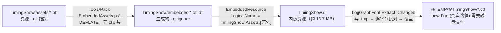

- `Pack-EmbeddedAssets.ps1`：`param($SourceDir='..\TimingShow\assets', $OutDir='..\TimingShow\embedded')`，逐文件 `ReadAllBytes` → `DeflateStream(CompressionLevel.Optimal, leaveOpen:true)` → 写 `<name>.dfl`。
- csproj 里 `<Target Name="PackEmbeddedAssets" BeforeTargets="PrepareResources" Inputs=… Outputs=…>` 靠 `Inputs/Outputs` 做增量；`<Exec>` 调脚本。
- LogicalName 是**扁平**的 `TimingShow.Assets.SourceHanSansSC-Regular.otf`（无目录），与 `LogGraphFont.cs` 里的常量逐字对应。
- 因此 `TimingShow.dll` 体积约 7.5 MB 起（内嵌压缩字体 13.7 MB 解压前）。**改了字体必须 `/t:Rebuild`**，增量构建会跳过重新嵌入，DLL 里留的是旧字体。
- `build2.ps1`（本机专用，未纳入 CI）因此强制 `/t:Rebuild`，并在部署前删除历史改名产物 `TimingShow.Core.dll` / `TimingShow.UMM.dll` / `TimingShow.Melon.dll`。

### 3.5 CI

两条流水线的形状差异很大——下面这张图是**最省时间的入口**：dev 只产 artifact，release 才改 `Repository.json` 并发布 Draft，而且**两者都不碰版本号**（release 完全不改，见下方缺口说明）。

```mermaid
flowchart TD
    subgraph dev["build-dev.yml · workflow_dispatch(branch) · contents: read"]
        D1["actions/checkout@v4<br/>fetch-depth: 1"] --> D2["私有库 adofai-libs@main → libs/"]
        D2 --> D3["Prepare CI version<br/>CI-[分支]-[hash6]<br/>改写 MelonInfo + Info.json"]
        D3 --> D4["setup-msbuild@v2 → 3 次 msbuild"]
        D4 --> D5["收集 5 个文件<br/>校验 Info.json.Version"]
        D5 --> D6["upload-artifact@v4<br/>保留 14 天 · 不产 zip"]
    end

    subgraph rel["build-release.yml · workflow_dispatch(tag) · contents: write"]
        R1["actions/checkout@v6<br/>（与 dev 的 @v4 不一致）"] --> R2["私有库 adofai-libs@main → libs/"]
        R2 --> R3["build.bat（shell: cmd）"]
        R3 --> R4["校验 TimingShow.zip"]
        R4 --> R5["CHANGELOG.md → GITHUB_OUTPUT<br/>heredoc body&lt;&lt;EOF"]
        R5 --> R6["git tag + git push origin tag"]
        R6 --> R7["gh release create --draft<br/>资产 TimingShow.zip"]
        R7 --> R8["改写 Repository.json<br/>bot 提交 → push 当前分支"]
    end
```

**`build-dev.yml` — Development Build**（`workflow_dispatch`，输入 `branch`，`windows-latest`，`permissions: contents: read`）

1. `actions/checkout@v4`（`fetch-depth: 1`）
2. 私有库 checkout：`repository: SleepingCui/adofai-libs`、`ref: main`、`token: secrets.ADOFAI_LIBS_TOKEN`、`path: libs`
3. `Prepare CI version`：`version = "CI-<safeBranch>-<shortHash>"`（hash 前 6 位，分支名 `-replace '[^A-Za-z0-9._-]','-'`）；正则改写 `MelonInfo(...)` 里的版本字符串（失败 `throw "Could not update the MelonInfo version in …"`）；改 `Info.json.Version` 并回写（`-Depth 100`）
4. `microsoft/setup-msbuild@v2` → 三次 msbuild
5. 复制 5 个文件到 `$RUNNER_TEMP/TimingShow-CI-<version>`，缺文件 `throw "Build output not found: …"`，并校验 `Info.json.Version`（否则 `throw "Info.json version mismatch"`）
6. `actions/upload-artifact@v4`（`name: TimingShow-<version>`、`retention-days: 14`、`if-no-files-found: error`）

不产 zip、不发布、不跑测试。

**`build-release.yml` — Build Release**（`workflow_dispatch`，输入 `tag`，`permissions: contents: write`）

1. `actions/checkout@v6`（注意：与 dev 的 `@v4` 不一致）
2. 同样的私有 libs checkout + `Inspect libs`
3. `setup-msbuild@v2` → **`shell: cmd` 直接跑 `build.bat`**
4. 校验 `TimingShow.zip` 存在
5. 读 `CHANGELOG.md` 全文塞进 `$GITHUB_OUTPUT`（heredoc `body<<EOF … EOF`）
6. `git tag <tag>` + `git push origin <tag>`
7. `gh release create <tag> TimingShow.zip --draft --title <tag> --notes <CHANGELOG 全文>`
8. 改 `Repository.json`：`Version=<tag>`、`DownloadUrl=https://github.com/<repo>/releases/download/<tag>/TimingShow.zip`、`Changes=""`，`-Encoding utf8NoBOM`
9. 以 `github-actions[bot]` 身份提交 `Update Repository.json to <tag>` 并 `git push origin "HEAD:${{ github.ref_name }}"`

**已知缺口**：release 流程**不改版本号**（`Info.json` / `MelonInfo` 保持仓库里的值，只有 dev 流程会自动改）；无测试；`git tag` 前不校验 tag 是否已存在；`Repository.json` 被推回**当前分支**，而 `Info.json.Repository` 指向 master 的 raw URL，因此在版本分支上 dispatch 时 UMM 读到的是旧版本。

### 3.6 安装路径与运行期文件

| 加载器 | 部署位置 | 必需文件 |
|---|---|---|
| UMM | `<game>\Mods\TimingShow\` | `Info.json`、`TimingShow.Loader.UMM.dll`、`TimingShow.dll`、`lang.json` |
| Melon | `<game>\Mods\`（平铺） | `TimingShow.Loader.Melon.dll`、`TimingShow.dll`、`lang.json` |

运行期产生：`<modPath>\Settings.json`、`<game>\Mods\TimingShow\Logs\`（默认日志）、`...\Cache\logmeta.cache`、`%TEMP%\TimingShow\`（字体缓存）。

---

## 4. 启动与生命周期

### 4.1 UMM 入口

`TimingShow.Loader.UMM\UMMEntry.cs`（34 行）

```csharp
public static bool Load(UnityModManager.ModEntry modEntry)
```

严格顺序：

1. `new UmmLogger(modEntry.Logger)` → 赋给 `ModContext.Logger`
2. `ModContext.Initialize(modEntry.Path, logger)`（内部会 `PlayStatePatches.RegisterSceneHook()`）
3. `ModContext.Settings = Settings.Load(modEntry.Path)`
4. `i18n.LoadLanguages(ModContext.ModPath)`
5. `ModContext.InitializeJudgeCompat()`（→ `HitMarginCompat.Initialize()`）
6. `XPerfectBridge.TryInit()`
7. `ModContext.HarmonyInstance = new Harmony(modEntry.Info.Id)`（Id = `TimingShow`）

回调注册：

```csharp
modEntry.OnToggle   = (entry, value) => { if (value) ModContext.Enable(); else ModContext.Disable(); return true; };
modEntry.OnGUI      = entry => ModContext.OnGUI();          // → Options.OnGUI()
modEntry.OnSaveGUI  = entry => ModContext.SaveSettings();   // → Settings.Save(modPath)
```

**UMM 载入时不会主动 `Enable()`**——它依赖 UMM 自己的 `OnToggle` 回调。若 UMM 配置为启动即启用，回调会在载入后立刻触发。

### 4.2 Melon 入口

`TimingShow.Loader.Melon\MelonEntry.cs`（109 行），`class MelonEntry : MelonMod`（namespace `TimingShow.Melon`）。

`OnInitializeMelon()`：`modPath = Path.GetDirectoryName(Assembly.GetExecutingAssembly().Location)` → 建 `MelonLoggerAdapter` → 与 UMM 相同的 3~6 步 → `new HarmonyLib.Harmony("TimingShow.Loader.Melon")` → **主动 `ModContext.Enable()`**（Melon 没有 UMM 那样的开关回调）。

自绘设置窗口：

- 常量 `WindowWidth = 900f`、`WindowHeight = 600f`；字段 `_showSettings`、`_isRebinding`、`_settingsWindowRect = new Rect(20,20,900,600)`、`_scrollPos`。
- `OnUpdate()`：`Input.GetKeyDown(Settings.ConfigKey)`（`None` 时回落 `KeyCode.F9`）切换 `_showSettings`；关闭瞬间 `SaveSettings()`。
- `OnGUI()`：`GUILayout.Window(GetHashCode(), rect, …)` → `BeginScrollView(_scrollPos, WindowWidth-20, WindowHeight-60)` 包住 `OptionsPage.OnGUI()`；底部额外两行（重绑定 `ConfigKey`、`保存并关闭`）；`GUI.DragWindow(new Rect(0,0,WindowWidth,20))`；标题 `$"TimingShow v{Info.Version}"`。
- `OnApplicationQuit()`：`SaveSettings()` + `Disable()`。

### 4.3 `ModContext` — 服务中心

`TimingShow.ModContext`（`static class`，192 行）持有全部跨模块状态：

| 成员 | 类型 | 职责 |
|---|---|---|
| `Logger` | `IModLogger` | 由 loader 注入 |
| `ModPath` | `string` | 设置与 `lang.json` 所在目录 |
| `Settings` | `Settings` | 唯一配置实例 |
| `HarmonyInstance` | `Harmony` | `Enable/Disable` 时 Patch/Unpatch |
| `IsEnabled` | `bool` | 所有 patch 的总守卫 |
| `IsPlaying` / `IsLevelFinished` | `bool` | 局面状态 |
| `UIDirty` | `bool` | 文本 HUD 需要重算 |
| `XAccVersion` | `int` | XACC 折线数据版本 |
| `TimingScatterSamples` | `List<TimingScatterSample>`（初容量 1024） | 散点样本环形积累（**无上限**，但有硬限 `100000` 写入保护） |
| `TimingScatterVersion` | `int` | 散点数据版本 |
| `FullXAccHistory` | `readonly List<float>[MaxPlayers]` | 逐玩家 XACC 全量历史 |
| `LastTiming/LastAngle/LastSongTimeMs/LastJudge/LastRawMargin/LastIsXP/LastBpm/LastSpeed/LastPitch` | 各自类型 | **转发到 `Players.Current.*`**，是"当前击打玩家"的语法糖 |
| `LastConfigGuiFrame` / `IsConfigOpen` | `int` / `bool` | IMGUI 帧号启发式：`Time.frameCount - LastConfigGuiFrame <= 1` |
| `Players`（`PlayerSession` 数组） | — | 见第 7 章 |

关键方法：

```csharp
static void Initialize(string modPath, IModLogger logger)   // 之后调 PlayStatePatches.RegisterSceneHook()
static void InitializeJudgeCompat()                          // HitMarginCompat.Initialize() + 日志 "Detected version: ..."
static void Enable()                                         // IsEnabled = true; HarmonyInstance?.PatchAll()
static void Disable()                                        // IsEnabled = false; UnpatchAll(Id);
                                                             // Players.ResetAll(); ClearTimingScatterSamples();
                                                             // HUDMan.Destroy(); EditorHitSnapshot.Clear()
static void OnGUI()                                          // Options.Options.OnGUI()
static void SaveSettings()                                   // Settings.Save(ModPath)
static void ClearTimingScatterSamples()                      // Clear() + InvalidatePendingScatterSample() + Version++
static string Format(double val, int precision)              // $"{val.ToString("F"+precision)}ms"
static string FormatAngle(double val, int precision)         // 同上 + "°"
```

> `Disable()` **不清理** `Options` 的 static 折叠状态、`OptionLogList` 的列表缓存、`LogGraphWindow` 的窗口实例、`HUDMan._badFormats`。这些会跨启用周期残留。

### 4.4 生命周期时序

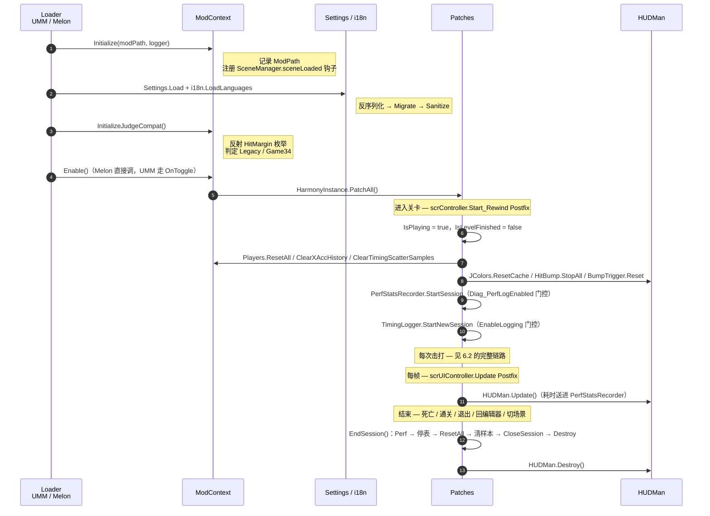

`EndSession()`（`PlayStatePatches.cs`）的固定顺序是刻意设计的：**先结束性能会话，再停表，再重置玩家，再清样本，再关日志，最后销毁 HUD**。

---

## 5. 运行时架构总览

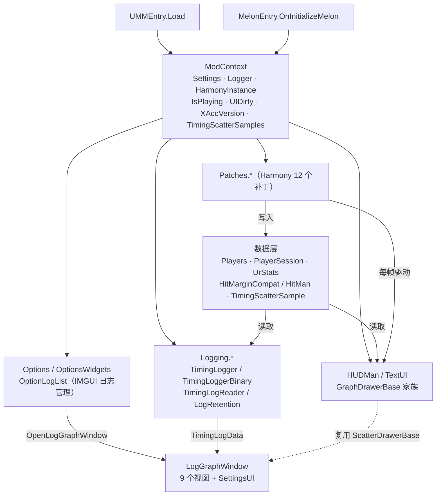

依赖方向严格单向：`Loader → ModContext → {Patches, Options, HUD, Logging}`。反向只有两处：`Options` 调用 `LogGraphWindow.Open`，`HUD.LogGraph` 读取 `Settings` 与 `ModContext`。

---

## 6. Harmony 接入层

### 6.1 补丁总表

三个静态容器类，全部由 `ModContext.Enable()` → `HarmonyInstance.PatchAll()` 一次注册。

#### `TimingShow\Source\Patches\TimingCalcPatches.cs`（444 行）

| Patch | 目标 | 类型 | 守卫 | 作用 |
|---|---|---|---|---|
| `PlanetSwitchPatch` | `scrPlanet.SwitchChosen(Nullable<long>)` | Prefix + Postfix | — | 每次换星球（= 每次击打）捕获上下文：玩家归属、BPM/speed/pitch、角度差、楼层；Postfix 复位 `Players.CurrentId` |
| `ScrMiscGetHitMarginInDegPatch` | `scrMisc.GetHitMarginInDeg(float,float,bool,float,float)` | Postfix | `Prepare() => HitMarginCompat.IsGame34` | 3.4+ 下由角度反算 timing |
| `ScrMiscGetHitMarginInSecPatch` | `scrMisc.GetHitMarginInSec(double,float,float)` | Postfix | 同上 | 3.4+ 下由时间差反算角度 |
| `MarginTrackerAddHitPatch` | `scrMarginTracker.AddHit(HitMargin)` | Prefix | `IsEnabled && IsPlaying` | 判定落账的**唯一权威入口**：写判定/计分/日志 |
| `MarginTrackerRevertPatch`（在 PlayStatePatches） | `scrMarginTracker.RevertToLastCheckpoint()` | Postfix | — | 清散点 + `SyncFromTracker` |

#### `TimingShow\Source\Patches\PlayStatePatches.cs`（214 行）

| Patch | 目标 | 类型 | 作用 |
|---|---|---|---|
| `LevelStartPatch` | `scrController.Start_Rewind()` | Postfix | 开局初始化（见 4.4） |
| `TogglePauseGamePatch` | `scrController.TogglePauseGame()` | Postfix | `SyncPauseState()` 停/启会话秒表 |
| `scnEditor_SwitchToEditModePatch` | `scnEditor.SwitchToEditMode()` | Prefix | **先** `EditorHitSnapshot.CaptureFromSession()` **再** `EndSession()` |
| `QuitToMainMenu_Patch` | `scrController.QuitToMainMenu()` | Prefix | `EditorHitSnapshot.Clear()` + `EndSession()` |
| `FailPatch` | `scrController.Fail2Action()` | Postfix | `IsLevelFinished=true`；`XAccVersion++`；`TimingScatterVersion++`；`UIDirty`；`PerfStatsRecorder.EndSession("fail")` |
| `OnLandOnPortalPatch` | `scrController.OnLandOnPortal(scrPlanet, Portal, string)` | Postfix | 同上，`EndSession("complete")` |

另有 `SceneManager.sceneLoaded` 的普通事件订阅（非 Harmony）：`OnSceneLoaded` 在场景名 ≠ `scnGame` 时 `EditorHitSnapshot.Clear(); EndSession();`。

#### `TimingShow\Source\Patches\UIPatches.cs`（389 行）

| Patch | 目标 | 类型 | 优先级 | 作用 |
|---|---|---|---|---|
| `HitTextManagerShowPatch` | `scrHitTextManager.ShowHitText(HitMargin, scrPlanet, float?, int?)` | Prefix + Postfix | — | 括号内写 `Players.CurrentId` 与 `CurrentHitMargin` |
| `HitTextMeshShowPatch` | `scrHitTextMesh.Show(Vector3, Vector3?, float?, float?, float?, float?, string?)` | Postfix | **199** | 把判定文字替换成数值（`ShowOnPlanet`） |
| `Fail2ActionPatch` | `scrController.Fail2Action()` | Postfix | — | 覆写 `txtTryCalibrating.text`（`ShowOnDeath`）+ `CloseSession()` |
| `WinPagePatch` | `scrController.OnLandOnPortal(...)` | Postfix | — | 反射 `DetailedResults.results` 追加统计（`ShowInWinPage`）+ `CloseSession()` |
| `UIReplacePatch` | `scrUIController.Update()` | Postfix | — | **HUD 每帧驱动入口**，也是标题替换点 |

> `HitTextMeshShowPatch` 的 `[HarmonyPriority(199)]` 让它在其它 `Show` patch 之前执行，保证拿到的 `__instance` 状态未被别人改写。

### 6.2 一次击打的完整调用链

这是全模组最重要的链路，重新发现它的成本最高：

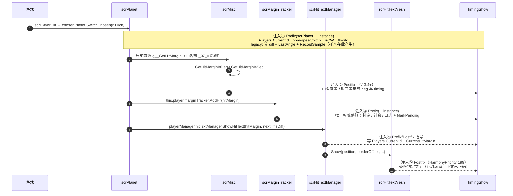

关键约束：

- `GetHitMarginInDeg/Sec` 在整个游戏程序集里**只有该局部函数一个调用者**，所以玩家归属只能靠在 `SwitchChosen` 的 Prefix 里 stash 星球来间接确定。
- `g__GetHitMargin|97_0` 每次 `SwitchChosen` **只调用一次** → 一次击打 = 一次采样。
- `scrHitTextMesh.Show` 全仓库只有两处调用者，都在 `scrHitTextManager.ShowHitText` 内部且同步 → 用 `ShowHitText` 的 Prefix/Postfix 做括号即可。
- Harmony 按**参数名**注入。签名与参数名必须与游戏完全一致，否则 `PatchAll` 整体抛异常。已用 IL dump 核对过的签名：

```
ShowHitText(HitMargin hitMargin, scrPlanet planet, [opt] float32 missAngle, [opt] Nullable<int32> msDiffNullable)
AddHit(HitMargin hit)
SwitchChosen([opt] Nullable<int64> hitTick)
Show(Vector3 position, [opt] Vector3 borderOffset, [opt] float32 missAngle, [opt] float32 scale, [opt] float32 angle, [opt] float32 fadeSpeed, [opt] string customText)
scrController.Fail2Action()                                  // 无参
scrController.OnLandOnPortal(scrPlanet planetThatWon, Portal, string)
```

### 6.3 核心 patch 详解

#### `PlanetSwitchPatch`（Prefix）

```csharp
static void Prefix(scrPlanet __instance)
{
    Players.CurrentId = Players.ResolvePlayerId(__instance);

    bool hasParams = conductor != null && conductor.song != null && planetarySystem != null;
    // 捕获 bpm / speed(pitch) / system.isCW
    // 写 player.LastFloorId / LastBpm / LastSpeed / LastPitch

    if (bpm * speed * pitch == 0) return;     // 防除零，直接放弃本次采样

    double diff = (__instance.angle - __instance.targetExitAngle)
                * (isCW ? 1.0 : -1.0)
                * 60000.0 / (Math.PI * bpm * speed * pitch);

    player.LastAngle = (__instance.angle - __instance.targetExitAngle)
                     * (isCW ? 1.0 : -1.0) * 180.0 / Math.PI;

    player.HasHit = true; ModContext.UIDirty = true;

    if (!HitMarginCompat.IsGame34)
    {
        player.LastIsXP = CalcXP.IsLegacyXPerfect(diff, bpm, speed, pitch);
        RecordSample(diff, player.LastAngle);
    }
}
```

要点：

- 旧版本走这条路径算 timing（3.4+ 由 `scrMisc` 的 Postfix 提供）。
- `speed` / `isCW` 取自 `__instance.planetarySystem`（即**该星球自己那套**），而不是 `scrController.instance.planetarySystem`（那是玩家 1 的）。单机下两者等价，coop 下这是必须的修正。
- 绝对值 `0` 检查用 `bpm*speed*pitch == 0`，避免除零产生 `Infinity`。

#### `MarginTrackerAddHitPatch`（Prefix）

```csharp
static void Prefix(HitMargin hit, scrMarginTracker __instance)
{
    if (!ModContext.IsEnabled || !ModContext.IsPlaying) return;
    Players.CurrentId = Players.ResolvePlayerId(__instance);   // 用 __instance 在 marginTrackers 里反查下标
    int raw = HitMarginCompat.ToRawCode(hit);
    PerfStatsRecorder.HitBegin();
    try { ApplyHit(raw, allowLog: !RDC.auto); } finally { PerfStatsRecorder.HitEnd(); }
}
```

`ApplyHit(int rawMargin, bool allowLog, bool countHit = true, double? timingOverride = null, double? angleOverride = null)`：

1. `LastRawMargin / LastJudge / LastIsXP` 落值
2. `MarkPendingTimingScatterSample(judge, isXP, rawMargin)` → 补全先前由 `AppendTimingScatterSample` 创建的样本（并 `TimingScatterVersion++`）
3. `countHit` 时累加 `TotalHitsCount`；`IsPerfectFamily` → `PerfectFamilyCount++`；`IsNormalPerfect` → `NormalPerfectCount++`；`LastIsXP` → `XPerfectCount++`
4. `allowLog` 时 `TimingLogger.LogHit(timing, angle, rawMargin, judge, isXP, floorId, bpm, speed, pitch)`

`ApplyAutoHit(timing, angle, allowLog)` 走同一条路径，但 `countHit: false`，`rawMargin = HitMarginCompat.RawAutoCode`。

#### `AppendTimingScatterSample` 与 pending 机制

散点样本**在判定之前**就可能产生（`RecordSample` 在 `SwitchChosen` 里调用，而判定在 `AddHit` 里），因此用"两段式"补齐：

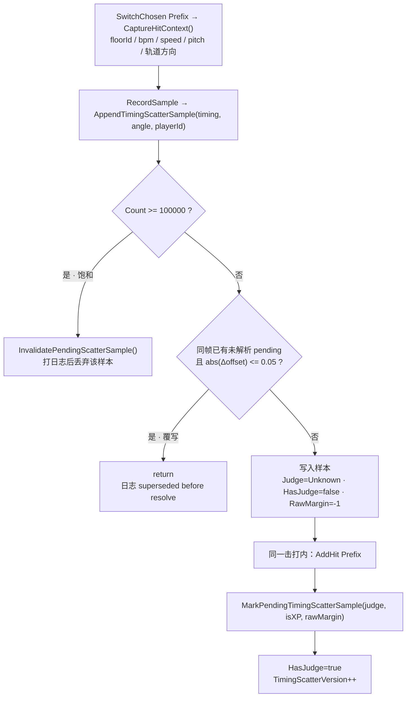

常量：`TimingScatterHardLimit = 100000`、`TimingScatterDedupeToleranceMs = 0.05f`、`TimingScatterWarningLimit`（读 `Settings.Diag_ScatterWarningLimit`，默认 5，`Clamp(0,100)`）。

#### `UIReplacePatch`（Postfix）— 每帧唯一驱动

```csharp
if (!IsEnabled) return;
if (IsPlaying)
{
    int frameId = PerfStatsRecorder.BeginFrame();
    HitBump.Tick(Time.deltaTime * 1000.0);
    ApplyTitleText(__instance);            // 标题替换（受 UIDirty 门控）
    PlayStatePatches.SyncPauseState();
    double hudMs = 计时 { HUDMan.Update(); };
    PerfStatsRecorder.EndFrame(frameId, Time.unscaledDeltaTime * 1000f, hudMs);
}
else { UIDirty = false; HitBump.StopAll(); BumpTrigger.Reset(); _titleBase = null; _titleAppliedSize = -1; }
```

### 6.4 Coop 归属的三处写入口

| 写入口 | 位置 | 归属来源 | 可靠性 |
|---|---|---|---|
| `SwitchChosen` Prefix/Postfix | `TimingCalcPatches.cs` | `scrPlanet.player.playerID`（失败走 `planetarySystem` 比对） | 采样创建用 |
| `AddHit` Prefix | 同上 | `__instance` 在 `scrMistakesManager.marginTrackers` 中的**下标** | 最权威，判定落账用 |
| `ShowHitText` Prefix/Postfix | `UIPatches.cs` | `scrPlanet` 参数 | 判定文字替换用 |

`ResolvePlayerId` 全路径都不抛异常，最终回落 0。

---

## 7. 数据模型

### 7.1 `HitMan` 与 `HitMarginCompat`

`TimingShow\Source\HitMan.cs`（241 行）

```csharp
enum HitMan {
    Unknown=-1, TooEarly=0, VeryEarly=1, EarlyPerfect=2,
    PerfectMinus=3, LegacyPerfect=3,          // 同值：两个游戏世代共用 3
    XPerfect=4, PerfectPlus=5, LatePerfect=6, VeryLate=7, TooLate=8,
    Multipress=9, FailMiss=10, FailOverload=11, Auto=12,
    OverPress=13, Midspin=14, FailedFloor=15
}
enum HitMarginVersion { Unknown=0, Legacy=1, Game34=2 }
```

`static class HitMarginCompat` 的职责：把游戏的 `HitMargin` 枚举（不同版本成员不同）映射到模组内部的稳定码。

| 成员 | 说明 |
|---|---|
| `Version` / `IsInitialized` / `IsGame34` / `IsLegacy` | 版本识别结果 |
| `RawAutoCode` / `RawXPerfectCode` | 反射得到的真实码值（`-1` = 不存在） |
| `AllRawValues` / `PerfectFamilyRawValues` | 排序后的合法码集合 |
| `HasNativeXPerfect => IsGame34` | 游戏原生是否带 XPerfect |
| `Initialize(bool force = false)` | 反射 `typeof(HitMargin)` 的 public static literal 字段，拼签名字符串；签名不变直接 return |
| `DetectVersion()` | 含 `XPerfect`/`PerfectMinus`/`PerfectPlus`/`Midspin`/`FailedFloor` 任一 → **Game34**；同时含 `Perfect`+`LatePerfect`+`Auto`+`OverPress` → **Legacy**；否则 **Unknown** |
| `ToJudgeKind(int raw)` / `ToRawCode(HitMargin)` / `FromRawCode(int)` | 码 ↔ 判定 |
| `IsPerfectFamily` | `{EarlyPerfect, PerfectMinus, XPerfect, PerfectPlus, LatePerfect}` |
| `IsFailFamily` | `{FailMiss, FailOverload, OverPress, FailedFloor}` |
| `IsNormalPerfect` | `LegacyPerfect`，或 `IsGame34 && PerfectPlus` |

`const int JudgeCodeVersion = 1`：语义为"code 即 `(int)HitMargin`，配合 `hitMarginVersion` 解释"。

### 7.2 `TimingScatterSample`（struct）

`ModContext.cs`，18 个字段，是所有散点/图表/日志/编辑器标记的数据原子：

```csharp
struct TimingScatterSample {
    float  TimeMs, OffsetMs;          // 会话时间 / 偏差（ms 或角度，由上下文决定）
    HitMan Judge;  bool HasJudge;
    bool   IsXPerfect;
    int    PlayerId;
    int    FloorId;  bool HasFloorId, FloorIdEstimated;
    float  AngleDeg, Bpm, Speed, Pitch;  bool HasAngle, HasHitParams;
    int    RawMargin;
    bool   OrbitClockwise, HasOrbitDirection;   // 仅运行时，不序列化
}
```

设计要点：

- `TimeMs` 来自**会随暂停停止的** `Stopwatch`（`PlayStatePatches.GetSessionTimeMs()`），不是音频时钟。
- `Has*` 系列的用途是区分"值为 0"与"该版本没有这项数据"。v8(JSON) / v9(binary) 之前的日志读回来时这些字段是 unknown 默认值。
- `OrbitClockwise` / `HasOrbitDirection` **不序列化**；编辑器标记对旧数据回退到 `scrFloor.isCCW` 的取反。
- `RawMargin` 在读日志时不被赋值（默认 0），只有实时采样带真实码。

### 7.3 `PlayerSession`、`UrStats`、`Players`

`TimingShow\Source\PlayerSession.cs`（237 行）

```csharp
sealed class UrStats {
    void Add(double x);   // Welford: n=++_count; d=x-_mean; _mean+=d/n; _s+=d*(x-_mean);
    double Mean(); double StdDev();   // StdDev = sqrt(_s / _count) * 10.0
    void Reset();
}

sealed class PlayerSession {
    readonly int PlayerId;
    bool HasHit;
    double LastTiming, LastAngle, LastSongTimeMs = -1.0;
    HitMan LastJudge = Unknown; int LastRawMargin = -1; bool LastIsXP;
    double LastBpm, LastSpeed = 1.0, LastPitch = 1.0;
    int LastFloorId = -1;
    readonly List<double> Offsets;    // 全部偏差（死亡/结算页用两趟算法）
    readonly UrStats Ur;              // HUD 用流式算法
    int NormalPerfectCount, PerfectFamilyCount, XPerfectCount, TotalHitsCount;
    bool IsXPerfect(HitMan judge) => IsGame34 ? judge == XPerfect : LastIsXP;
    void ResetLastHit(); void ResetCounters(); void ResetSession();
}

static class Players {
    const int MaxPlayers = 4, Unset = -1;
    int Count { get; }          // 每次实时读 scrPlayerManager.playerCount（try/catch→1，clamp 1..4，刻意不缓存）
    bool IsCoop => Count > 1;
    int CurrentId { get; set; } // 当前这次击打归属
    PlayerSession Current => Get(CurrentId);
    PlayerSession Get(int id);  // 越界回落 0
    void ResetAll();
    int ResolvePlayerId(scrPlanet);
    int ResolvePlayerId(scrMarginTracker);
}
```

**为什么有两套均值/标准差**：HUD 用 `UrStats`（Welford 单趟流式，O(1) 内存），死亡页/结算页用 `CalcUR.Mean(list)` / `CalcUR.calc(list)`（两趟，O(n) 内存）。二者数值等价，是刻意保留的两条路径以保证单机行为逐字节不变。

---

## 8. 计算内核

`TimingShow\Source\Calc.cs`（109 行）

### 8.1 UR

```csharp
static class CalcUR {
    double Mean(List<double> list);              // 空 → 0
    double calc(List<double> list);              // 总体标准差 × 10.0
}
```

### 8.2 Ratio

```csharp
class CalcRatio {
    string GetRatioString(PlayerSession p);   // 按 Settings.Ratio_Mode 取分子/分母
    string GetRatioText(PlayerSession p);     // 前缀 + ":1"
}
```

`Ratio_Mode`：`RatioMode_NormalPerfect = 0`（默认）、`RatioMode_PerfectFamily = 1`、`RatioMode_XPerfect = 2`。
`total == 0 → "0"`；`total - target <= 0 → "infinity"`；否则 `(target/other).ToString("F" + Settings.PercRatioHUD)`。

### 8.3 旧版 XPerfect 边界

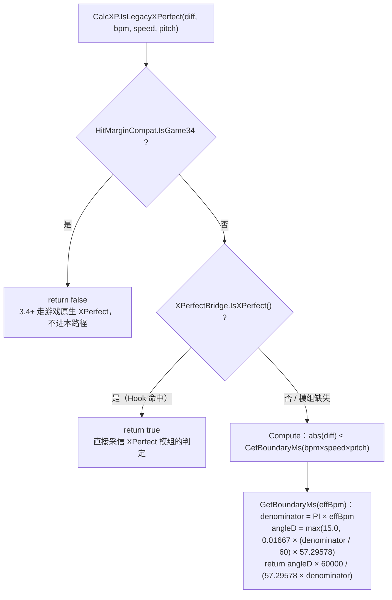

```csharp
static class CalcXP {
    bool IsLegacyXPerfect(double diff, double bpm, double speed, double pitch) {
        if (HitMarginCompat.IsGame34) return false;      // 3.4+ 由游戏自己给
        if (XPerfectBridge.IsXPerfect()) return true;    // Hook 模式
        return Compute(diff, bpm, speed, pitch);
    }

    double GetBoundaryMs(double effectiveBpm) {
        double denominator = Math.PI * effectiveBpm;
        double angleR = 0.01667 * (denominator / 60.0);
        double angleD = angleR * 57.295780181884766;
        double fBoundaryD = Math.Max(15.0, angleD);
        return (fBoundaryD * 60000.0) / (57.295780181884766 * denominator);
    }

    bool Compute(diff, bpm, speed, pitch) =>
        Math.Abs(diff) <= GetBoundaryMs(bpm * speed * pitch);
}
```

`15.0` 是角度下限（度）；`57.295780181884766` = 180/π 的单精度精确值。算法来自 [XPerfect](https://github.com/8100print/XPerfect)（MIT）。

### 8.4 3.4+ 的反算

```csharp
// GetHitMarginInDeg Postfix
double deg    = (hitAngle - refAngle) * (clockwise ? 1 : -1) * 57.29578;
double timing = deg / 180.0 / floorBpm / conductorPitch * 60000.0;

// GetHitMarginInSec Postfix
double timing = timeDiff * 1000.0;
double deg    = timeDiff * 3.0 * floorBpm * conductorPitch;
```

`3.0` 是 `180 / 60` 的合并常数。两条路径分别处理"游戏给了角度"与"游戏给了秒数"的情形。

---

## 9. 表现层：文本 HUD 与图表

### 9.1 `HUDMan`（223 行）

静态类，管理 6 个动态创建的 UI 对象：

| 字段 | 类型 | 内容 |
|---|---|---|
| `_hudObj/_hudInstance` | `GameObject` + `TextUI` | Timing |
| `_avgHudObj/_avgHudInstance` | 同上 | Avg |
| `_urhudObj/_urHudInstance` | 同上 | UR |
| `_ratiohudObj/_ratioHudInstance` | 同上 | Ratio |
| `_xaccGraphObject/_xaccGraphInstance` | `GameObject` + `XACCGraphDrawer` | XACC 图 |
| `_timingScatterObject/_timingScatterInstance` | `GameObject` + `TimingScatterDrawer` | 散点图 |

`Update()` 的显隐判断（**两套条件不一致，是有意的**）：

```csharp
bool isPlayBase = IsPlaying && scrController.instance != null && scrController.instance.gameworld
               && (!scrController.instance.paused || ModContext.IsConfigOpen);
// 文本 HUD 与 XACC 用它

bool isScatterBase = IsPlaying && scrController.instance != null && scrController.instance.gameworld;
// 散点图用它 —— 少了 paused / IsConfigOpen
```

因为散点图的交互只在"关卡结束或暂停"时开放，暂停时它必须继续存在。**改动 `isPlayBase` 会连带破坏散点图的暂停交互**。

图 Canvas 的创建：

| 图 | 名字 | sortingOrder | 额外组件 |
|---|---|---|---|
| XACC | `TimingShow_XACCCanvas` | 100 | — |
| 散点 | `TimingShow_TimingScatterCanvas` | 101 | `GraphicRaycaster`（交互必需） |
| 文本 HUD | 每实例一个 Canvas | 10001 | `CanvasScaler(1920×1080, MatchWidthOrHeight, 0.5)` |

`UIDirty` 门控：只有 `UIDirty` 为真时才重算 4 个 HUD 的文本（`Coop.Join(…)` → `BumpTrigger.Xxx(text)` → `UpdateTextHUD`），随后清零。`ApplyBumpSize` 与 `ApplyFont` 不在门控内，每帧都跑（前者读缓存的 ease，后者只做字符串比较）。

formatter：

```csharp
FormatTiming(player) // HUD_ShowAngle ? LastAngle : LastTiming；HUD_UseJudgeColor 时只把数字包进 <color=#hex>；末尾 ms / °
FormatAvg(player)    // Ur.Mean().ToString("F" + PercAvgHUD) + "ms"
FormatUr(player)     // Ur.StdDev().ToString("F" + PercURHUD)
FormatRatio(player)  // CalcRatio.GetRatioText(player)
```

`SafeFormat` 把抛异常的格式串记入 `HashSet<string> _badFormats` 并降级为裸值 —— 但**没有清理入口**，修好格式后必须重载 mod。

`SetPosition` 的坑：`anchoredPosition = (x * Screen.width, y * Screen.height)` 写入的是画布局部单位，而 canvas 有 `CanvasScaler`。**只有 1920×1080（scaleFactor = 1）时是精确的**，其它分辨率会二次缩放。

### 9.2 `TextUI`（219 行）

`public class TextUI : MonoBehaviour`，每个实例自带一个 `Canvas`（`ScreenSpaceOverlay`，`sortingOrder = 10001`）。

| 方法 | 签名 | 说明 |
|---|---|---|
| `SetText` | `public void SetText(string value)` | TMP 赋值 |
| `SetSize` | `public void SetSize(int size)` | 仅在变化时写 `fontSize` |
| `SetPosition` | `public void SetPosition(float x, float y)` | 见上面的坑 |
| `ApplyFont` | `public void ApplyFont(bool useCustomFont, string fontPath)` | 每帧调用，靠 `_fontConfigKey` 早退 |
| `SetAlignment` | `public void SetAlignment(int align)` | 0/1/2 → `MidlineLeft/Center/MidlineRight` |
| `SetBold` | `public void SetBold(bool bold)` | `FontStyles.Bold` / `Normal` |

字体链：自定义（反射 `Font.Internal_CreateFontFromPath` → `TMP_FontAsset.CreateFontAsset`）→ 游戏字体（扫 `Resources.FindObjectsOfTypeAll<scrHitTextMesh>()` 取第一个非空 `text.font`）→ `TMP_Settings.defaultFontAsset`。

阴影：`Shadow` 组件创建后 **`enabled = false`**（`effectColor=(0,0,0,0.45)`、`effectDistance=(2,-2)` 仅作占位）；真阴影是复制材质 `new Material(text.fontSharedMaterial)` 后开启 TMP underlay 关键字（`ShaderUtilities.Keyword_Underlay`，`OffsetX 0.1`、`OffsetY -0.1`、`Dilate 0.1`、`Softness 0.05`）。

**文本 HUD 没有静态字体缓存**：4 个 HUD 用同一字体也各自 `CreateFontAsset` → 4 份图集。

### 9.3 `GraphDrawerBase`（824 行）

`[RequireComponent(typeof(CanvasRenderer))] public abstract class GraphDrawerBase : MaskableGraphic`

抽象契约：

```csharp
protected abstract bool IsEnabled { get; }
protected abstract bool ShowGraph { get; }
protected abstract float Scale / Width / Height / PosX / PosY { get; }
protected abstract Color BgColor / GridColor / LineColor { get; }
protected abstract int MaxPoints { get; }
public abstract string GraphName { get; }          // PerfStatsRecorder 的 key
protected virtual int DataVersion => ModContext.XAccVersion;

protected abstract void UpdateData();              // 拉数据
protected abstract int GetDataCount();
protected abstract double GetDataValue(int index);
protected abstract double GetMinY(); GetMaxY();
```

可重写钩子：`ShowBorder`、`BorderColor`、`UseCustomFont`、`FontPath`、`AllowGameFontFallback`、`ShowPerfInfo`、`PerfDataCount`、`PerfExtraInfo`、`PerfTextColor`。

`Update()` 的重绘判据（**版本号不是唯一条件**）：

```csharp
needsRedraw = _lastDataVersion != DataVersion
           || rectChanged
           || settingsHash != _lastSettingsHash
           || continuousRedraw;
```

`ComputeSettingsHash()` 用 `hash = 17; hash = hash * 31 + X` 覆盖 Scale/Width/Height/PosX/PosY/MaxPoints/三色/Border/字体/ShowPerfInfo。**所以改外观设置无需 bump 版本号即可生效**。

`UpdateTransform()` 的坐标语义（与文本 HUD **相反**）：

```csharp
float w = Width * scale, h = Height * scale;
anchorMin = anchorMax = Vector2.zero; pivot = Vector2.zero;
sizeDelta = new Vector2(w, h);
anchoredPosition = new Vector2(Screen.width * PosX, Screen.height * (1.0f - PosY));
```

即图表的 `PosX/PosY` 是 **0–1 屏幕比例，Y 从顶部量起**，锚点是左下角。图 Canvas 没有 `CanvasScaler`，所以像素级精确。

`OnPopulateMesh` 绘制顺序：`vh.Clear()` → 尺寸校验 → 背景 → 网格 → 参考线 → 系列 → 边框；随后统计顶点数并写 `PerfStatsRecorder`。

文本：5 个固定 TMP 子对象（`TitleText` UpperLeft、`TopLabel`/`MidLabel`/`BotLabel` MiddleRight、`PerfInfoLabel` UpperLeft），`CreateText` 设 `anchorMin=anchorMax=(0,0)`、`pivot=(1,0.5)`、`raycastTarget=false`、`richText=false`、`NoWrap`、`Overflow`。

字体缓存：`static readonly Dictionary<string, TMP_FontAsset> FontCache`，key = `"custom:"+path` / `"game"` / `"system"`。**会缓存 null**（首次调用时游戏字体未就绪 → 该 key 永久为 null，整个会话不再重试）。

### 9.4 `XACCGraphDrawer`（333 行）

```csharp
GraphName => "XACC";
MaxPoints => XACCGraph_MaxPoints > 0 ? XACCGraph_MaxPoints : 250;
IsEnabled => ModContext.IsEnabled && ModContext.IsPlaying;
SeriesCount => Mathf.Clamp(Coop.ActiveCount, 1, Players.MaxPlayers);
```

绘制：逐段 `DrawSegment`，`float stepX = w / Mathf.Max(1, maxCapacity - 1);`，`normY = Mathf.Clamp01((value - minY) / rangeY)`。

抽稀两种模式（`BuildSeriesCache`）：

```csharp
// 关卡已结束且 total > targetPoints：均匀下采样
float step = (float)(total - 1) / (targetPoints - 1);
int idx = Mathf.Clamp((int)(i * step), 0, total - 1);

// 游玩中：滑动尾窗
int startIdx = Math.Max(0, total - targetPoints);
```

Y 轴范围：结束后 `_cachedMaxY = 100f`，`_cachedMinY = Mathf.Max(0f, Mathf.Floor(minVal - 1f))`，贴近 100 时改用 `Mathf.Floor(minVal * 10f) / 10f`，并保证跨度 ≥ `MinYRange = 0.1f`。游玩中按 `maxVal - minVal < 0.2f` 决定上下各留 1.0 或 1.5。

多序列着色：`SeriesCount > 1 ? Coop.PlayerColor(s) : LineColor`；图例 `UpdateLegend()` 用 `StringBuilder` 拼 `<color=#RRGGBB>P{n}</color>`。

### 9.5 `ScatterDrawerBase`（partial，6 文件 / 2250+ 行）

`public abstract partial class ScatterDrawerBase : GraphDrawerBase, IPointerDownHandler, IPointerUpHandler, IScrollHandler`

| 文件 | 行数 | 职责 |
|---|---|---|
| `ScatterDrawerBase.cs` | 210 | 抽象点、`ComputeSettingsHash`、`NeedsContinuousRedraw`、`Update` |
| `.Data.cs` | 571 | 采样、签名、视窗平滑、离群点过滤、抽稀（桶式 min/max） |
| `.Render.cs` | 390 | 色带、参考线、圆点、均值线、网格、越界标记 |
| `.Text.cs` | 221 | X 轴标签、均值标签、手势提示 |
| `.Interaction.cs` | 501 | 拖拽/缩放/钳制/自动滚动 |
| `.Detail.cs` | 283 | 悬停命中、详情面板 |
| `.Players.cs` | 222 | 玩家图例、筛选 |

两个子类：`TimingScatterDrawer`（游戏内）与 `LogScatterDrawer`（日志窗口）。

关键虚拟点：`LevelFinished`、`GamePaused`、`FullRangeMode`、`YUnitSuffix`、`ExternalPointerInput`、`ResetViewOnSizeChange`、`AllowPlayerFilter`、`ScatterDistinguishPlayers`、`ScatterPlayerCount`、`RobustYViewport`、`AxisLabelsInside`、`HintInFooter`、`GridAlphaScale`。

`DetailInteractive`（决定是否接受鼠标）：

```csharp
if (!IsEnabled || !ShowGraph) return false;
if (InteractionSuspended) return false;
if (LevelFinished) return true;      // 关卡结束后永久可交互
return GamePaused;                   // 游玩中仅暂停时可交互
```

每帧据此设 `raycastTarget = interactive` —— **这是散点 Canvas 与鼠标事件总线的唯一开关**。

### 9.6 `TimingScatterDrawer`（343 行）与判定窗口公式

判定窗口常量：

```csharp
internal const float ThresholdLenientBpm = 220f;
internal const float ThresholdNormalBpm  = 310f;
internal const float ThresholdStrictBpm  = 500f;
private const float PassAngleMsScale = 20000f;
private const float MinWindowMs = 25f;
private const float PerfectBaseMs = 20f;
private const float ElPerfectBaseMs = 30f;
private const float XpMinWindowMs = 16.666666f;
```

有效 BPM：

```csharp
double windowBpm = bpm * pitch * speed / marginScale / speedTrial;
```

`marginScale = controller.currFloor.marginScale`（仅当 `> 0.0`），`speedTrial` 来自反射 `GCS.currentSpeedTrial`（非法值回 1f）。

角度→毫秒：

```csharp
float angleTerm = 60000f / safeBpm * angle / 180f;
return Mathf.Max(Mathf.Max(angleTerm, baseWindowMs) / safeSpeedTrial, MinWindowMs);
```

三条判定带：`perfectMs = CalcWindow(bpm, trial, 30f, PerfectBaseMs)`、`elPerfectMs = CalcWindow(…, 45f, ElPerfectBaseMs)`、`passMs = CalcWindow(…, 60f, GetPassBaseMs())`。

`GetPassBaseMs()`：手动模式 `20000f / manualBpm`（与 60° 项恒等）；自动模式按 `GCS.difficulty`：0→91f、1→65f、2→40f、default 65f。

`GetThresholdBpm()`：手动 `Clamp(TimingScatter_BandThresholdBpm, 100, 600)`（默认 310）；自动按难度 0→220、1→310、2→500。

XPerfect 带：`xpMs = 60000f / windowBpm * 12.5f / 180f / speedTrial`，`Max(xpMs, 16.666666f)`（≈60fps 一帧）。

以 310 BPM、其余系数为 1 代入：`perfectMs ≈ 32.26`、`elPerfectMs ≈ 48.39`、`passMs ≈ 64.52`、`xpMs ≈ 13.44 → 被抬到 16.67`。

色带绘制顺序（外→内）：pass 两段 → elPerfect 两段 → perfect 一段 → XP 一段。阈值变化有 0.4 s 三次方缓出动画（首帧直接吸附）。

### 9.7 标题、死亡页、结算页

**标题**（`UIPatches.ApplyTitleText`）：仅 `UIDirty` 时重算

```csharp
BumpTrigger.Title(Coop.Join(BuildTitleValue));
_titleBase = Coop.Join(BuildTitlePart);      // 可能带 <color=#RRGGBB>
int size = Title_Bump ? BumpAnim.Scale(_titleBaseSize, HitBump.Title.Ease) : _titleBaseSize;
ui.txtLevelName.supportRichText = true;
ui.txtLevelName.text = size == 100 ? _titleBase : $"<size={size}%>{_titleBase}</size>";
```

TMP 的 `<size>` 是百分比，100 视为无效果，直接输出原文（省一次富文本解析）。

**死亡页**（`Fail2ActionPatch`）：

```csharp
// 逐项拼接，4 空格连接
i18n.T("Avg_Timing") + Format(CalcUR.Mean(Offsets), Perc3)
i18n.T("Label_UR")   + CalcUR.calc(Offsets).ToString("F" + Perc3)
"XACC: " + (GetPercentXAcc(player) * 100).ToString("F" + Perc3) + "%"
"Ratio: " + CalcRatio.GetRatioText(player)
// 外层 <size=Pct%>  …  </size>
```

**结算页**（`WinPagePatch`）：反射 `typeof(DetailedResults).GetField("results", NonPublic | Instance)`（`FieldInfo` 缓存），把行追加到 `resultsArray[i]`；反射失败时退回直接改 `textComponent.text`。

单机路径 `JoinLines(..., "    ")` 的输出与原实现逐字节相同——这是 coop 重构时刻意保留的兼容性约束。

### 9.8 `JColors` 与 `BumpAnim`

**`JColors`**（185 行）：判定 → 颜色。

```csharp
public static Color GetColor(HitMan judge, bool isXP, bool enableXP) {
    int code = (int)judge;
    if (code < -1 || code >= MaxFastJudgeCode /*20*/) return -1;
    int key = ((code + 1) << 2) | (isXP ? 2 : 0) | (enableXP ? 1 : 0);
    if (FastColorsSet[key]) return FastColors[key];     // 80 项定长表，热路径零分配
    return ResolveColor(judge, isXP, enableXP);         // 反射兜底
}
```

颜色来源：`RDC.hitMarginColoursBySettings`（静态字段）→ `RDConstants.data.hitMarginColours`（静态）→ 实例成员。取值同时接受 `Color` 与 `Color32`。三层缓存：`Dictionary<string,Color> Cache`、`HashSet<string> Missing`（记住失败名）、`FastColors/FastColorsSet`。

XPerfect 回退色 `#4DCCFF`（`Color32(77,204,255,255)`）。`ResetCache()` 只在开局调用。

**XPerfect 覆写只对非 3.4 生效**（3.4 没有独立 XP 判官）——这是 `JColors` 里最容易误读的分支。

**`BumpAnim`**（123 行）：`DurationMs = 500.0`、`PeakRatio = 0.28f`。

```csharp
// 31 项指数衰减查表
float p = i / 30f;
table[i] = p >= 1f ? 0f : (float)Math.Pow(2.0, -10.0 * p);
// 取值：最近邻取整
int idx = (int)(_elapsedMs / DurationMs * 30.0 + 0.5);

// 字号映射
int extra = (int)(baseSize * PeakRatio * ease + 0.5f);
return extra <= 0 ? baseSize : baseSize + extra;
```

驱动点唯一：`HitBump.Tick(Time.deltaTime * 1000.0)`（**用 deltaTime 不是 unscaled**，所以暂停时动画冻结）。触发去重由 `BumpTrigger` 负责：只有"显示出来的文本"变化才起跳。

---

## 10. 渲染与几何约束

### 10.1 顶点原语

```csharp
// GraphDrawerBase
protected static void DrawQuad(VertexHelper vh, Vector2 min, Vector2 max, Color color);       // 4 顶点 2 三角，uv 全零
protected static void DrawSegment(VertexHelper vh, Vector2 p1, Vector2 p2,
                                  float halfWidth, Color color);                              // 收的是半宽
```

`DrawSegment` 的约定是**半宽**，调用方普遍写 `lineWidth * 0.5f`。

圆点（`ScatterDrawerBase.Render.cs`）：正多边形扇形，环上 `segments` 个顶点、**不含圆心顶点**，三角为 `(base, base+i, base+i+1)`。单位圆顶点按段数静态缓存（`Dictionary<int, Vector2[]> CircleUnitCache`），同段数零分配。

### 10.2 硬上限

| 常量 | 值 | 位置 | 含义 |
|---|---|---|---|
| `MaxMeshVertexCount` | 65535 | `ScatterDrawerBase.Render.cs` | UGUI 16-bit index buffer 上限 |
| `FixedVertexBudget` | 128 | 同上 | 边框/线/面板预留 |
| `MinCircleSegments` / `MaxCircleSegments` | 6 / 16 | 同上 | 单点圆段数范围 |
| `MaxCircleSagittaPx` | 0.35 | 同上 | 弦高容忍（像素），决定段数 |
| `MaxSafePointCount` | `(65535-128)/(6+4)` = **6540** | 同上 | 不溢出顶点缓冲的最大点数 |
| `MinRenderPoints` / `MaxRenderPoints` / `DefaultRenderPoints` | 20 / 8000 / 800 | 同上 | 设置项 clamp 区间 |
| `MinYRangeMs` / `MinYPadMs` / `YPadRatio` | 2f / 1.5f / 0.08f | `.Data.cs` | Y 视窗最小跨度与留白 |
| `ViewSmoothTauSeconds` / `AvgSmoothTauSeconds` | 0.30f | `.Data.cs` | 视窗/均值平滑时间常数 |
| `ViewMarginRatio` / `MinViewSpanRatio` | 0.05f / 0.001f | `.Interaction.cs` | 平移边界与最小跨度 |
| `MaxOutOfRangeIndicators` | 120 | `ScatterDrawerBase.cs` | 越界三角标记上限 |
| `GestureDragThreshold` / `WheelZoomSpeed` | 5f / 0.08f | `.Interaction.cs` | 手势阈值与滚轮速度 |
| 文本宽度缓存上限 | 8192 条 | `GraphDrawerBase.cs` | 超限即清空 |
| 性能文本刷新间隔 | 0.2 s | `GraphDrawerBase.cs` | FPS EMA 系数 0.05 |

### 10.3 抽稀算法

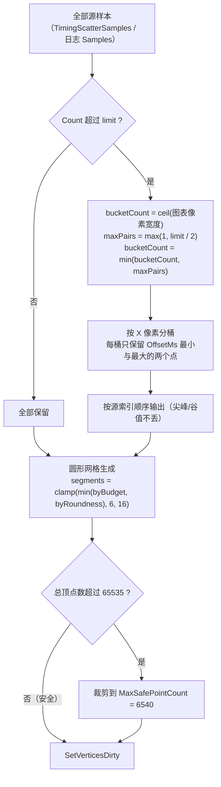

**桶式 min/max**（`ScatterDrawerBase.Data.cs`，散点图核心）：

```csharp
int bucketCount = Mathf.Max(1, Mathf.CeilToInt(rectTransform.rect.width));  // 每水平像素一桶
int maxPairs    = Mathf.Max(1, limit / 2);
if (bucketCount > maxPairs) bucketCount = maxPairs;
// 每桶只保留 OffsetMs 的最小值与最大值两点，按源序升序发射
```

效果：极值不丢、密度按像素收敛。**这是"点数上万也不炸性能"的原因**，但代价是放大到深层时同桶点重叠，hover 命中的"最近点"可能与视觉重合点不一致。

**圆点段数自适应**：

```csharp
int budgetPerPoint = (MaxMeshVertexCount - FixedVertexBudget) / Mathf.Max(1, pointCount);
int byBudget = budgetPerPoint - 4;
float cosHalf = Mathf.Clamp(1f - MaxCircleSagittaPx / radius, -1f, 1f);
float step = 2f * Mathf.Acos(cosHalf);
int byRoundness = Mathf.CeilToInt((Mathf.PI * 2f) / step);
return Mathf.Clamp(Mathf.Min(byBudget, byRoundness), 6, 16);
```

### 10.4 性能热点

| 场景 | 开销 | 触发条件 |
|---|---|---|
| 自动滚动 | **每帧全量重建几何** | `LiveScrollActive`（时间轴 + 未手动平移 + 开启 Always Scroll + 未暂停） |
| 手势平移 | 每帧重绘 | `_gesturePanning` |
| 悬停命中 | O(n) 线性扫描 | 每帧 `FindNearestRenderPoint`，n ≤ 6540 |
| 设置面板打开 | 每帧 `UIDirty = true` | 标题/HUD 文本每帧重建 |
| 日志列表 | ≤60 行 × 约 10 个 IMGUI 控件 | `LogListDrawBudget` |
| 大日志解析 | 后台线程整文件解析 | 打开日志图表窗口 |

实测基线（32.64 秒 / 6009 帧，平均 5.46 ms/帧 = 183 FPS）：Drawer mesh 平均 0.455 ms/帧（约 8.3% 帧时间），最大 1.400 ms；Drawer text 平均 0.301 ms；update 平均 0.064 ms。

### 10.5 已失败的优化尝试（不要重做）

**direct vertex path**（绕过 `VertexHelper` 直写 stream）已实现并**在游戏内验证失败后回滚**：

- 症状：散点全部消失，而背景/网格/参考线/均值曲线/缩放平移/悬停全部正常。
- 根因：`ScatterDrawerBase.Render.cs` 的 `FlushDirectVertices()` 只把 `_scratchVerts` 复制进 `_streamVerts`，**从未复制 `_scratchTris` 进 `_streamTris`** → 索引恒空 → 0 个三角形。
- 附带风险：`existingVerts` 重复提交；依赖 `VertexHelper.AddUIVertexStream` 转发到 `CanvasRenderer.AddUIVertexStream` 是弱保证。
- 处置：`ScatterDrawerBase.Render.cs` 回滚到 HEAD，删除 `GraphDrawerBase.OnBeforeDrawSeries` 钩子；副本留在 `.work/backup/ScatterDrawerBase.Render.directpath.cs`。

---

## 11. Coop 子系统

### 11.1 游戏侧机制（重新发现成本最高，优先参考）

- Coop 是**本地同屏 1–4 人**（`scrPlayerManager.MaxPlayers = 4`）。入口：暂停菜单 → `PauseMenu.Submenu.PlayerSelect` → `PlayerSelect.Finish()` → `scrPlayerManager.SetPlayerCount(n)`。
- 唯一开关：`scrController.coopMode => scrPlayerManager.playerCount > 1`。**没有 `isCoop` 字段，也没有持久化开关**。
- `scrPlayerManager.playerCount`（`public static int`）是唯一真相；切到 `scnCLS` / `scnEditor` / `scnMinesweeper` 会重置为 1。
- 身份标识：`scrPlayer.playerID`（public int，0 基）。逐玩家判定记录在 `scrPlayer.marginTracker` → `scrMistakesManager.marginTrackers[playerID]`（`public static scrMarginTracker[]`，**下标即 playerID**）。
- 星球→玩家：`scrPlanet.player`（public `scrPlayer`，序列化字段，读取不抛异常）。每玩家各自一套 `scrPlayer.planetarySystem`。
- **不存在 `scrController.playerTwo`**，只有 `playerOne`（`= players[0]`）。
- Coop 下游戏自身的行为：判定文字单实例但按存活玩家偏移表着色；误差计单实例；曲名全局唯一；死亡提示全局唯一；通关 `DetailedResults` 逐玩家翻页（`results` 是 `private string[]`，mod 反射读）；单相机跟随最前存活玩家；最后一名存活玩家死亡才算失败；`SaveCheckpointProgress`/`LoadCheckpointProgress` 直接 return；存档前缀 `coop_`。

### 11.2 模组侧实现

`TimingShow\Source\Coop.cs`（100 行）

```csharp
const string Placeholder = "--";
const string Separator = ",";
static readonly Color[] PlayerColors = {
    (1.00,0.35,0.35), (0.31,0.76,0.97), (1.00,0.84,0.31), (0.70,0.53,1.00)
};
static bool IsCoop => Players.IsCoop;
static int ActiveCount => IsCoop ? Players.Count : 1;
static string Label(int id) => "P" + (id + 1);
static string Join(Func<PlayerSession,string> format);                     // 单机=Text(format, Get(0))；coop 用 Separator 拼
static string Join(bool perPlayer, Func<...> format);
static string JoinLines(Func<...> format, string lineIndent = "");         // 每玩家一行，count>1 时行首 Label+"  "
static string JoinLines(bool perPlayer, Func<...>, string lineIndent);
static string Text(...);                                                   // IsCoop && !HasHit → "--"
```

内部共享一个 `StringBuilder _sb`（**不可重入**，实际调用点都是顺序调用）。

**单机逐字节一致的 6 条保障**（重构时确立的约束，改动时不要破坏）：

1. `Coop.ActiveCount` 单机恒 1。
2. `Coop.Text()` 的 `"--"` 只在 `IsCoop` 生效。
3. 死亡/通关页用 `CalcUR.Mean(list)` / `CalcUR.calc(list)`，HUD 用 `UrStats`（Welford）——两条路径故意保留。
4. `FormatTiming` 判定色只包数字，单位在颜色外。
5. `ApplyTitleText` 的 `BumpTrigger` 拿未着色值。
6. `WinPagePatch` 单机走 `JoinLines(..., "    ")`，与原 `$"<size=N%>    {string.Join("    ", items)}</size>"` 逐字节相同。

**唯一有意的行为改动**：HUD 格式串的单位并入数值（`"Timing - {0}ms"` → `"Timing - {0}"` 等），由 `Settings.Migrate` 的 `StripValueSuffix` 自动迁移。

---

## 12. 日志子系统

### 12.1 后端选择

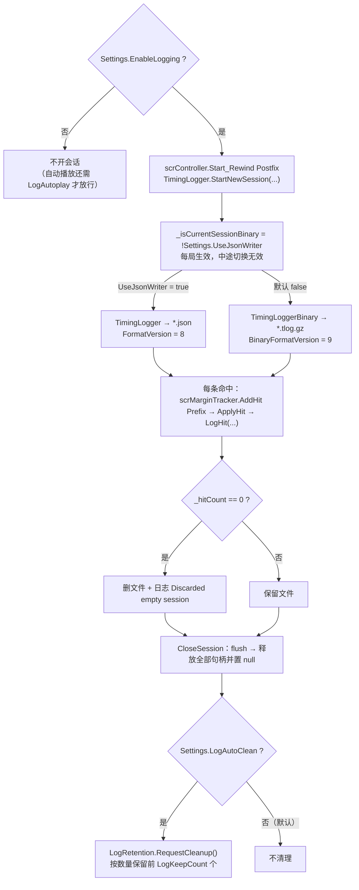

关闭会话共有 6 个触发点（`Fail2Action` / `OnLandOnPortal` / `scnEditor.SwitchToEditMode` / `QuitToMainMenu` / 切入非 `scnGame` 场景 / `EnableLogging` 关闭后的下一次开局）；`EndSession()` 里 `CloseSession()` 排在停表、重置玩家、清样本之后，销毁 HUD 之前。

唯一切换点：

```csharp
// TimingShow\Source\Logging\TimingLogger.cs
_isCurrentSessionBinary = !ModContext.Settings.UseJsonWriter;   // 默认 false → 二进制为默认
```

**每局生效**，中途切换无效。

| 维度 | JSON `TimingLogger` | Binary `TimingLoggerBinary` |
|---|---|---|
| 扩展名 | `*.json` | `*.tlog.gz`（`GZipStream` 恒压缩） |
| 版本常量 | `FormatVersion = 8` | `BinaryFormatVersion = 9` |
| 写入 | `StreamWriter`(UTF8 无 BOM) 手工 Append；每玩家一个 `StringBuilder`(4096) | `BinaryWriter` 逐条写，无聚合 |
| 每记录体积 | ≈45–90 字节 | ≈24–50 字节（gzip 后） |
| 空会话 | `_hitCount == 0` → 删文件 + 日志 `Discarded empty session` | 同（带 `(binary)`） |

### 12.2 命名、目录、缓冲

```csharp
long timestamp = DateTimeOffset.UtcNow.ToUnixTimeSeconds();       // 秒级
string fileName = $"{timestamp}_{safeSongName}{ext}";
```

`safeSongName` = `Path.GetFileNameWithoutExtension` → 非法字符换 `'_'` → 空格换 `'_'` → 空则 `"Unknown"`。**不裁长度**。

冲突处理：`new FileStream(path, FileMode.Create, …)` = **同秒同曲静默截断覆盖**，无后缀、无存在检查。

缓冲：`int bufferSizeBytes = Math.Max(4, bufferSize) * 1024;`（默认 64 → 65536）。**Flush 只发生在会话关闭时**（无 `AutoFlush`、无定时），所以崩溃会丢整段缓冲。

### 12.3 JSON v8 格式

头部 11 行（顺序固定）：

```
songName                // JsonEscape 只处理 \\ 和 \"
levelPath
timestamp               // Unix 秒
bpm / speed / pitch     // ToString("R", InvariantCulture)
isAngle                 // bool
formatVersion           // 8
hitMarginVersion        // "Unknown" / "Legacy" / "Game34"
judgeCodeVersion        // 1
```

数据体：`"offsets"`（旧单玩家）或 `"offsets_1"` … `"offsets_N"`。元素是**固定 10 项元组**（无 per-record player / xacc，玩家 = 数组下标）：

| 索引 | 字段 | 备注 |
|---|---|---|
| 0 | `songTimeMs` | `"F3"` invariant；NaN/∞/<0 → `null` |
| 1 | `value` | `"F{PercLog}"`；`isAngle` 决定是角度还是 ms。**缺 InvariantCulture**（locale 逗号小数点会写出 `1,234`，读取端按 invariant 解析成 NaN） |
| 2 | `rawMarginCode` | int，**读取端显式丢弃** |
| 3 | `judgeCode` | int |
| 4 | `isXPerfect` | 1/0，条件 `isXP && (IsGame34 || Logger_EnableXPerfect)` |
| 5 | `angleDeg` | `"F4"` invariant 或 null |
| 6–8 | `hitBpm` / `hitSpeed` / `hitPitch` | `"R"` 或 null |
| 9 | `floorId` | int 或 -1 |

冻结条件 `hasHitParams = bpm > 0 && speed > 0 && pitch > 0`；`hasAngle = hasHitParams && angle 有限`。

**没有 xacc 字段**：XACC/UR/Avg 全部由 offsets 在 HUD 侧推导。

版本演进：v≤6 单 `offsets` 5 元组；v7 起 `offsets_N`；v8 扩到 10 项并加两个版本字段。**读取端不按 `formatVersion` 分支**，按数组下标读（缺项即"无该能力"）。

### 12.4 二进制 v9 格式

头部：

| 偏移 | 内容 |
|---|---|
| 0–3 | magic ASCII `TSMZ`（`54 53 4D 5A`） |
| 4 | version u8 = 9 |
| 5–12 | timestamp int64 LE |
| 13… | songName（7-bit LEB128 长度 + UTF-8） |
| … | levelPath 同 |
| … | bpm / speed / pitch float64 LE × 3 |
| … | isAngle u8 |
| … | hitMarginVersion u8（1=Legacy, 2=Game34, 0=Unknown） |
| … | judgeCodeVersion u8 = 1 |
| … | playerCount u8（仅 v≥8） |

记录：

| 字段 | 编码 |
|---|---|
| `playerId` | u8（v≥8，越界回 0） |
| `songTime` | XOR-double |
| `value` | XOR-double |
| `rawMarginCode` | ZigZag varint |
| `judgeCode` | ZigZag varint |
| `isXPerfect` | u8 |
| `angle` / `bpm` / `speed` / `pitch` | float32 LE × 4（`SafeFloat`：无效 → NaN；v≥9） |
| `floorId` | ZigZag varint（-1 = 无；v≥9） |

**VarInt**（`VarInt.cs`，42 行）：

```csharp
uint ZigZag(int v)   => (uint)((v << 1) ^ (v >> 31));
int  UnZigZag(uint v) => (int)(v >> 1) ^ -(int)(v & 1);
// LEB128：每字节 7 位 + 0x80 续位；int32 最长 5 字节，读取端 bytesRead >= 5 即失败
```

**XOR-double**（`TimingLoggerBinary.cs`）：

```
xor = curBits ^ prevBits
xor == 0            → 只写 1 字节 0x00（沿用上条，prev 不变）
否则                → control = 0x80 | (leadingBytes << 4) | significantBytes
                     leadingBytes   = CountLeadingZeroBytes(xor)   // 0..7
                     trailingBytes  = CountTrailingZeroBytes(xor)
                     significantBytes = 8 - leading - trailing     // 1..8
                     随后写 significantBytes 个字节（小端窗口）
```

时间与值各维护一个 `prevBits`（首条 prev = 0）。

**尾部没有记录级 checksum**，只校验 gzip trailer 的 ISIZE：文件长度 ≥ 18，且末 8 字节之后 4 字节小端 == `(uint)(解压字节数 & 0xFFFFFFFF)`，不符置 `Truncated = true`（CRC32 不校验）。

### 12.5 读取器

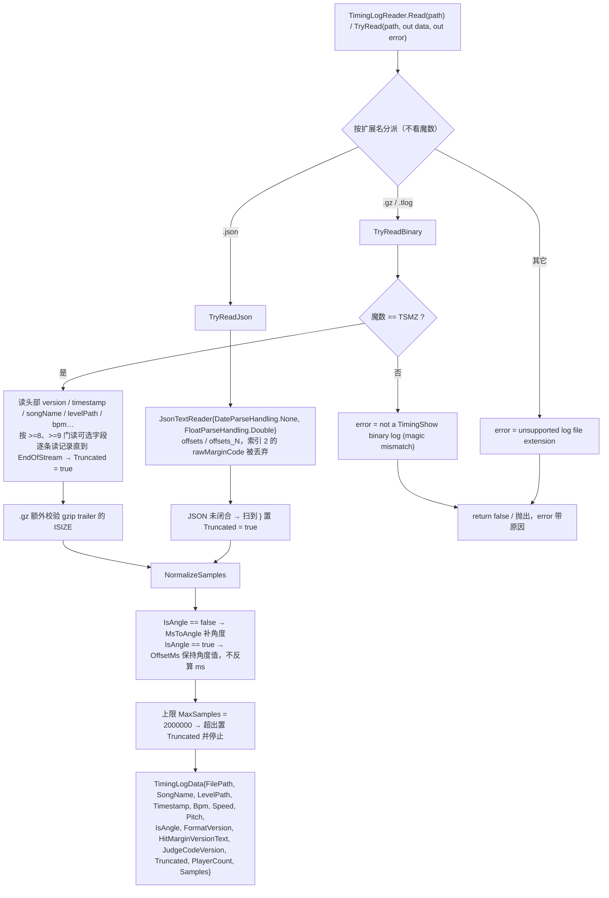

`TimingShow\Source\Logging\TimingLogReader.cs`（1026 行）

```csharp
public sealed class TimingLogData {
    string FilePath, SongName, LevelPath;
    long   Timestamp;
    double Bpm, Speed, Pitch;
    bool   IsAngle;
    int    FormatVersion;
    string HitMarginVersionText;
    int    JudgeCodeVersion;
    bool   Truncated;
    int    PlayerCount;                        // 默认 1
    List<TimingScatterSample> Samples;         // 容量 1024
}
public static class TimingLogReader {
    bool IsSupportedLogFile(string path);
    TimingLogData Read(string path);
    bool TryRead(string path, out TimingLogData data, out string error);
}
```

分派按**扩展名**（不是魔数）：`.gz` / `.tlog` → `TryReadBinary`；`.json` → `TryReadJson`；其它报 `unsupported log file extension`。上限 `MaxSamples = 2000000`（超出 `Truncated = true` 并停止）。

JSON 解析要点：

- `JsonTextReader { DateParseHandling.None, FloatParseHandling.Double }`
- `IsOffsetsField` 接受 `offsets` / `offsets_<digits>`；`OffsetsFieldPlayerId` 从键取 N−1（非法/>1000 → 0）并抬高 `PlayerCount`
- **索引 2 `rawMarginCode` 被显式丢弃**（`case 2:` 空体）
- 无任何已知头字段 → `not a TimingShow JSON log (no recognized fields)`

二进制解析要点：`.gz` 才套 `GZipStream` + `CountingStream` + `BufferedStream`；魔数不符 → `not a TimingShow binary log (magic mismatch)`；头部异常 → `binary header is incomplete or corrupt: <类型名>`；记录循环 `EndOfStreamException` → 跳出 + `Truncated = true`。

`NormalizeSamples`：

```csharp
// IsAngle == false：补角度
ms * 180.0 * bpm * speed * pitch / 60000.0
// IsAngle == true：OffsetMs 保持角度值，不反算
```

**下游必须看 `IsAngle`**，不能假设 `OffsetMs` 永远是毫秒。

### 12.6 保留策略

`TimingShow\Source\Logging\LogRetention.cs`（207 行）

- 触发：`TimingLogger.CloseSession()` 末尾**总是**调 `RequestCleanup()`，实际是否删除由 `Settings.LogAutoClean` 决定。
- `LogKeepCount`（默认 50）是**按数量保留**，`keep = Clamp(LogKeepCount, 0, 100000)`；`keep = 0` 即清空。
- 排序复用 `Settings.LogSort`：0=时间降序、1=大小降序、2=曲名 `OrdinalIgnoreCase` 升序；平手回退时间降序 → 文件名升序。
- 时间来源：优先文件名首个 `_` 前的数字（否则首个 `.` 前）→ `LastWriteTimeUtc` → 0。
- 范围：`Directory.GetFiles(dir)` 非递归，只处理 `.json` / `.tlog` / `.tlog.gz`，跳过 `TimingLogger.IsFileBeingWritten(path)`。
- 并发：`_running` 单飞 + `_pending` 合并 + 线程池；每轮结束 `Interlocked.Increment(ref _completedVersion)` 供日志列表感知。

### 12.7 改格式的同步清单

改动日志格式时，以下 12 处必须同步（缺一处就会出现静默错读）：

1. `TimingLogger.cs` 的版本常量与后端选择
2. 头部 11 行、十元组、尾部 `"offsets_N"`（注意 locale 隐患）
3. `TimingLoggerBinary.cs` 的字段顺序 + `WriteXorDouble` / `SafeFloat` / `VarInt` + flush 顺序
4. `VarInt.cs`（一旦变动旧文件即不可读）
5. `TimingLogReader.cs` 的索引表（含 `case 2` 丢弃）、`ApplyHeaderField` 键名、`>= 8` / `>= 9` 版本门、`NormalizeSamples`、gzip ISIZE 校验
6. `HitMan.cs` 的枚举值与 `HitMarginCompat` 的反射名单
7. `LogRetention.cs` 的扩展名过滤与 `TimestampFromFileName`
8. `OptionLogList.cs` 的扩展名过滤、`ReadLogMetadata` 头部探测、`CompareLogEntries`、`AbsLogPath`
9. `LogAnalyzerBridge.cs` 的 `ContentType` / 请求匹配 / CORS-PNA 头，以及网页分析器的 JS 解析器
10. `EditorHitSnapshot.cs` 与所有 `TimingLogData.Samples` 消费者（`IsAngle` / `HasFloorId` / `HasHitParams` 语义）
11. `newformat.md`
12. `lang.json` 文案与 `Options.cs` 的相关控件

**兼容红线**：新增字段必须伴随显式的版本门（`>= 10` 之类），否则旧 reader 会把新字段误当记录头。

---

## 13. 日志图表窗口（LogGraph）

约 30 个文件 / 11410 行。**纯 uGUI 立即模式自绘**，不是 IMGUI，也没有独立 Camera。

### 13.1 对象层级

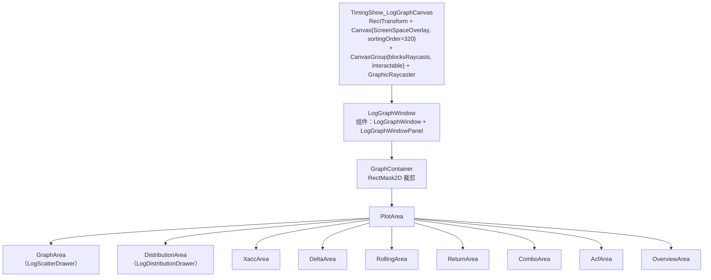

### 13.2 `LogGraphWindow` 的 partial 划分（9 文件 / 3007 行）

| 文件 | 行数 | 职责 |
|---|---|---|
| `LogGraphWindow.cs` | 643 | 常量、单例、`Open/Close/Build/Update/OnDestroy`、静态布局 Core 函数、配色 |
| `.Window.cs` | 317 | 尺寸/位置钳制、滑动代理、设置开关、拖拽/缩放落地、命中测试、保存尺寸 |
| `.Views.cs` | 415 | `GraphView` 枚举、`SetView`、`PushViewData`、`Ensure*Data`、下拉菜单 |
| `.Stats.cs` | 435 | 统计量计算与 9 个视图各自的四行统计文本 |
| `.Layout.cs` | 351 | 头部排版、`ApplyLayout`、选择器定位、设置页排版 |
| `.Distribution.cs` | 15 | `PushDistributionData()` 转发 |
| `.Input.cs` | 310 | EventSystem 回调 + 每帧轮询兜底 |
| `.Pane.cs` | 314 | `ILogGraphPanelInteraction` + `LogGraphWindowPanel` 自绘 chrome |
| `.Diagnostics.cs` | 207 | 越界/布局错位诊断 |

单例语义：

```csharp
private static LogGraphWindow _instance;
private static GameObject _root;
public static bool IsOpen => _instance != null && _root != null;
```

`Open(data)` 先 `Close()` 再 `Build(data)`；`Close()` **先把所有引用置 null 再 `Destroy(root)`**（防 `OnDestroy` 重入）。

### 13.3 打开链路（唯一入口）

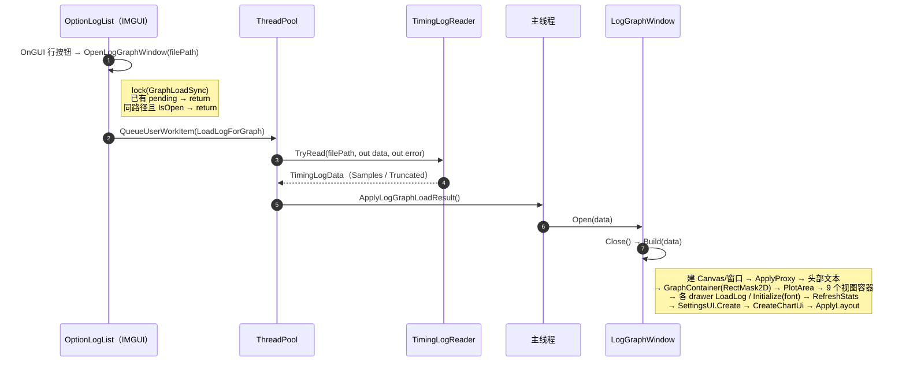

`Build` 顺序：`LogRoundedRect.SyncFromSettings()` → 读 `SavedWindowSize()` 并 clamp/居中 → 建 Canvas/窗口 → `ApplyProxy()` → 头部文本 → `GraphContainer(RectMask2D)` → `PlotArea` → `GraphArea`（`LogScatterDrawer`）→ `DistributionArea` → 7 个 `CreateChartArea` → `_drawer.LoadLog(data)` → 其余 8 个 drawer `Initialize(font)` → 填 `_viewAreas[9]` 并只激活一个 → `RefreshStats()` → `GraphSettingsUI.Create(...)` → `CreateChartUi(font)` → `ApplyLayout(size, position)`。

呼出动画：`Build` 时根节点 `CanvasGroup.alpha = 0`，之后 `UpdateOpenAnimation()` 用 `Time.unscaledDeltaTime` 在 0.18s 内做 OutCubic 缓动 —— alpha 0→1、窗口 `localScale` 0.94→1。窗口 pivot 在左下角，因此 `anchoredPosition` 按 `目标位置 + size * (1 - scale) / 2` 补偿，缩放围绕视觉中心；拖拽/缩放期间暂停动画，`ApplyLayout` 在动画进行中同步 `_openAnimTargetPosition` / `_openAnimSize`。

### 13.4 视图枚举与数据类

```csharp
enum GraphView { Scatter=0, Distribution=1, Xacc=2, Delta=3, Rolling=4,
                 ReturnMap=5, Combo=6, Acf=7, Overview=8 }
// 默认 _view = GraphView.Overview
```

| idx | 视图 | 绘制类 | 数据类 | 指标 |
|---|---|---|---|---|
| 0 | 散点 | `LogScatterDrawer : ScatterDrawerBase` | 直接用 `TimingLogData.Samples` | 每次命中偏差、色带、零线/均值线、玩家图例 |
| 1 | 分布 | `LogDistributionDrawer` | `DistributionStats` | 直方图 + 正态拟合 + 均值/±σ |
| 2 | XACC | `LogXaccDrawer` | `XaccData` | 逐玩家累计加权准确率 |
| 3 | Δ | `LogDistributionDrawer`（复用） | `DeltaData`（内含 `DistributionStats`） | 相邻命中差的直方图（无拟合曲线） |
| 4 | 滑动 | `LogRollingDrawer` | `RollingData` | ±1σ 滑动均值带 + 5–500 窗口滑块 |
| 5 | 偏移关系 | `LogReturnDrawer` | `ReturnData` | 前次 vs 本次、y=x、Pearson r、98% 轴范围 |
| 6 | 连击 | `LogComboDrawer` | `ComboData` | 连击条带 + 断连段 + 图例 |
| 7 | 自相关 | `LogAcfDrawer` | `AcfData` | lag 1–50 柱 + 置信带 |
| 8 | 概览 | `LogOverviewDrawer` | `OverviewData` | 4 卡片 + XACC + 判定分布 + 元信息 |

数据惰性缓存：`EnsureXaccData` / `EnsureDeltaData` / `EnsureRollingData` / `EnsureReturnData` / `EnsureComboData` / `EnsureAcfData` / `EnsureOverviewData`。玩家筛选变化时 `ClearChartCaches()`（**不清 `_xaccData`**）。

`EffectivePlayerId = _drawer.SelectedPlayerId >= 0 ? It : 0`（−1 = 全部玩家，按 0 计算聚合）。

散点页的交互门控：

```csharp
bool suspended = (_settingsUI != null && _settingsUI.IsOpen) || _view != GraphView.Scatter;
_drawer.InteractionSuspended = suspended;
```

### 13.5 各视图算法

**XACC**（`XaccData.Compute(samples, playerCount)`）

```csharp
// 两趟：先数每玩家 hitCount（!HasJudge 跳过，非法 playerId 归 0）并分配 float[hitCount]（全填 NaN）
// 第二趟：
int ordinal = ordinals[playerId]++;
double? weight = WeightOf(sample.Judge);
if (weight == null) continue;
weightedSums += weight.Value; countedHits++;
double value = weightedSums / countedHits * 100.0;      // 累计加权准确率
values[ordinal] = value;
```

权重表：`TooEarly 0.2`、`VeryEarly 0.4`、`EarlyPerfect 0.75`、`PerfectMinus/XPerfect/PerfectPlus 1.0`、`LatePerfect 0.75`、`VeryLate 0.4`、`TooLate 0.4`、`FailMiss/FailOverload/OverPress/FailedFloor 0.0`、`Auto 1.0`、`default null`（未知判型不计入分母）。

抽稀：`MaxRenderPointsPerSeries = 2048`；超过时 `bucketCount = 2048/4 = 512`、`bucketSize = ceil(count/512)`，每桶取 **first/min/max/last** 四个候选索引去重后按索引升序输出（LTTB 式保峰保谷）；整桶全 NaN 时输出 `x = start + (end-start)*0.5f + 0.5f, y = NaN` 制造断线。

**分布**（`DistributionStats.ComputeValues(values, binCount = 60, buildCurve)`）

1. `mean = Σx/n`；**`variance = Σ(x-mean)²/n`（总体方差，除以 n）**
2. 偏度 `(Σz³)/n`、超额峰度 `(Σz⁴)/n - 3`，`z = (x-mean)/stdDev`（仅 `stdDev > 0`）
3. 排序后 `median` / `q1` / `q3`，`Quantile` 用 **type-7 线性插值**（`position = (count-1)*q`）
4. **`robustSigma = (q3 - q1) / 1.349`**；范围截到 `[median - 4σ, median + 4σ]` ∩ 数据范围
5. 外扩 5% 得 `extendedMin/Max`；`binWidth = span / binCount`（`span == 0` 时取 1.0）
6. 索引 `Floor((v - extendedMin) / binWidth)` clamp 到 `[0, binCount-1]`；越界只 `ClippedCount++`（**仍参与均值/方差/分位数**）
7. 拟合曲线：`scale = maxBinCount / GaussianPdf(mean, mean, stdDev)`，201 采样点

绘制：`_yMax = Max(MaxBinCount, CurveMax) * 1.10f`；Y 3 刻度、X 3 刻度、网格 4 等分；柱色在 Δ 模式用 `(0.475,0.525,0.796,1)`；均值线 `(1,0.7176,0.3020,1)` 虚线 dash 5/gap 5；±σ 线 `(0.3098,0.7647,0.9686,0.6)` dash 3/gap 3，**Δ 模式不画 σ**。

**Δ**（`DeltaData.Compute`）：`!HasJudge || !IsTap(judge)` 或值为 NaN/Inf → **断链**（不跨断点求差）；统计 `Mean`、`MeanAbs`、总体 `StdDev`、`MedianAbs`（偶数取中位两值平均）。

**滑动**（`RollingData`）：环形窗口 `double[] window`；满时 `sum -= dropped; sumSquares -= dropped*dropped;` 再累加。

```csharp
mean = sum / windowCount;
variance = sumSquares / windowCount - mean * mean;   // 总体方差
sigma = variance > 0 ? sqrt(variance) : 0;
Upper = mean + sigma; Lower = mean - sigma;
// 漂移：首尾各 25% 的均值差
headLimit = Max(1, Floor(count*0.25)); tailStart = count - Max(1, Floor(count*0.25));
Drift = TailMean - HeadMean;
```

NaN/Inf 的 `OffsetMs` 不入窗口但 `ordinal` 仍自增（沿用上一窗口状态，不产生断点）。滑块 `5–500` 步长 5，默认 50；抽稀 `limit = 4000`。

**偏移关系**（`ReturnData`）：`ReturnPair{ Previous, Current, Hit }`，`MaxRenderPairs = 4000`。

```csharp
r = (Σxy/n - x̄ȳ) / (σx·σy);                      // 总体矩，n<2 或 σ≤0 → NaN
Limit = ComputeLimit(magnitudes);                  // |offset| 的 98 分位，下限 1.0
OutsideCount = magnitudes.Count(m => m > Limit);   // 逐元素计数
```

判定阈值：`r < -0.3` → `ReturnOvercorrect`（过度修正）、`r > 0.3` → `ReturnDrift`（偏差延续）、否则 `ReturnIndependent`。

**连击**（`ComboData`）

```csharp
bool keepsStreak = HitMarginCompat.IsPerfectFamily(sample.Judge) || sample.Judge == HitMan.Auto;
// 段划分：run + 空隙断段；MaxStoredSegments = 200000
// 统计：RunCount / LongestRun / AverageRun（只算连击段）
int ComboBin(int len, int maxLen) => Mathf.Clamp(Mathf.FloorToInt(6 * Mathf.Sqrt((float)len / maxLen)), 0, 5);
```

6 档绿 `(0.227,0.420,0.204)` → `(0.376,1.000,0.306)`；断连色 `(0.20,0.20,0.20,1)`；条带高 `Clamp(plotHeight*0.46f, 12f, 90f*UiScale)`，垂直居中。**这是唯一自己接管拖拽与滚轮的图**（`raycastTarget = true`）：滚轮 0.85/格，`MinVisibleHits = 10f`，悬停用二分查找 `FindSegmentAt(hit)`。

**自相关**（`AcfData`）：只取 tap，**遇非 tap 或 NaN/Inf 就切断 run**，ACF 只在同一 run 内配对；`values.Count < 3` 放弃。

```csharp
R = (Σab/n - āb̄) / (σa·σb);
Band = 1.96 / Math.Sqrt(pairs - 1);          // 仅 pairs > 2
// Strongest：Lag >= 2 且 |R| > Band 且非 NaN，取 |R| 最大
YSpan = Min(1.0, Max(0.2, Max(maxAbsR * 1.3, maxBand * 1.3)));
```

绘制：`step = plotWidth / 50`、`barWidth = Max(1, step*0.7)`；`LagCenterX(lag) = xMin + (lag - 0.5) * step`。

**概览**（`OverviewData`）：`Ur = StdDev * 10.0`（角度模式不显示 UR）；`Xacc = Σ(group·weight) / Σgroup * 100`，分组 `{failMiss, TooEarly, VeryEarly, EarlyPerfect, perfectGroup, LatePerfect, VeryLate/TooLate}`、权重 `{0, 0.2, 0.4, 0.75, 1.0, 0.75, 0.4}`（**与 XACC 图的逐判型权重是两套口径**）。

4 张卡：蓝 `(0.129,0.588,0.953)` / 橙 `(1,0.718,0.302)` / 紫 `(0.851,0.345,1)` / 绿 `(0.376,1,0.306)`，`cardHeight = 68*UiScale`。判定分布顺序 `Game34Order = {9,0,1,2,3,4,5,6,7,8,10,11,12,13,14,15}`（Multipress 置顶）与 `LegacyOrder` 两套。

### 13.6 统计面板

`StatsRowCount = 4`；`StatLabelKeys = {StatTotalHits, StatUR, StatRatio, StatXAcc}`、`DistributionStatLabelKeys = {DistMean, DistStdDev, DistSkewness, DistKurtosis}`，表头 `ToUpperInvariant()`。

`ComputeStats()`：`_playerCount` **上限再 cap 到 4**；按玩家 `[4]` 分 5 组；UR 交给外部 `CalcUR.calc(all)`。

> **语义陷阱**：散点页统计里的 "XACC" 实际是 `xPerfect / total * 100`（XPerfect 占比），而 XACC 图是加权累计准确率，概览页又是分组权重——**同名三套口径**，做数值对照时必须明确指哪一个。

精度工具：`FormatStat` 对 NaN/Inf 返回 `"-"`（`CultureInfo.InvariantCulture`）；`FormatSigned` 正数加 `"+"`；`UnitSuffix => IsAngle ? "°" : "ms"`。

### 13.7 设置面板（`LogGraphSettingsUI`，5 文件 / 1317 行）

`public sealed partial class LogGraphSettingsUI : MonoBehaviour`（namespace `TimingShow.HUD.LogGraphSettingsUI`）。

**行模型 + 自绘**：`List<Row> _rows`（`RowKind{Title,Tab,Slider,Toggle,ColorPick,ColorPreview,Text,Button}`）+ `List<TextMeshProUGUI> _texts` + 嵌套 `SettingsPanelGraphic : MaskableGraphic`。

输入全在 `Update()` 里**轮询**（`Input.mousePosition` + `RectTransformUtility.ScreenPointToLocalPointInRectangle`），不依赖 EventSystem；`_graphic.raycastTarget = false`，即面板不吃射线、靠屏幕坐标手算命中。

基准尺寸（全乘 `UiScale`）：`BasePadding=10`、`BaseContentMaxWidth=420`、`BaseTitleHeight=20`、`BaseTabHeight=22`、`BaseRowHeight=22`、`BaseRowGap=4`、`BaseFontSize=12`、`BaseTrackHeight=8`、`BaseToggleSize=14`、`BaseLabelRatio=0.42`、`LineHeightRatio=1.4`。行高自适应：`rowHeight = Min(22*scale, available/count - rowGap)`，最小 12，字号 `Clamp(Min(fontSize*0.9, rowHeight/1.4), 8, fontSize)`。

**Draft 机制**：

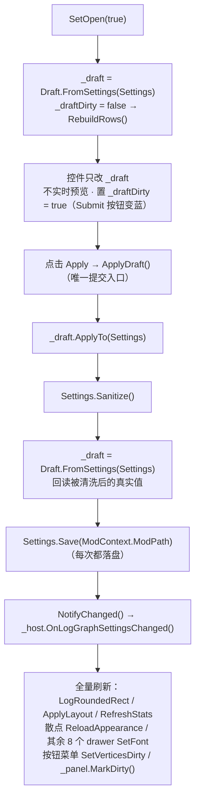

宿主回调 `OnLogGraphSettingsChanged()` 做全量刷新：`LogRoundedRect.SyncFromSettings()` → `ApplyLayout` → `RefreshStats()` → 散点 `ReloadAppearance()` → 其余 8 个 drawer `SetFont + ReloadAppearance` → 按钮/菜单 `SetFont + SetVerticesDirty` → `_panel.MarkDirty()`。

**Basic 页 16 行**：`LogGraph_UiScale`(0.75–3, F2)、`LogGraph_CornerScale`(0–2, F2)、`Label_PointSize`(1–12, F1)、`Label_MaxRenderPoints`（**对数滑块** 20–8000, F0）、`Toggle_IgnoreOutliers`、`Toggle_UseHitAxis`、`Toggle_UseJudgeColor`、`Toggle_DistinguishPlayers`、`Toggle_ShowZeroLine`、`Toggle_ShowAvgLine`、`Toggle_ShowGrid`、`Toggle_ShowJudgeBands`、`Toggle_ShowXpBand`、`Label_BandThresholdBpm`(100–600, F0)、`Toggle_CustomFont`、`LogGraph_FontHint`。

**Colors 页**：`ColorSlotCount = 10`（Bg/Grid/Point/ZeroLine/AvgLine/AxisText/BandPerfect/BandElPerfect/BandEarlyLate/BandXp），2 列色块；三个 RGB 滑块（`ByteDisplay` 时显示 `RoundToInt(Clamp01(v)*255)`）；每槽右侧 Reset **只重置 RGB、保留 alpha**；底部预览 `"#" + ToHtmlStringRGB + "    A " + alpha.ToString("F2")`，文字色按亮度 `0.299r+0.587g+0.114b > 0.55` 选深/浅色。

### 13.8 字体与绘图基础件

**`LogGraphFont`**（static，398 行）

- 资源：`TimingShow.Assets.SourceHanSansSC-Regular.otf`、`…GmarketSansMedium.otf`、`…OFL.txt`；韩语判定 `Settings.Language == "한국어"`。
- **解析优先级：bundled → latin → cjk → hangul**，成功后 `PreloadSettingsGlyphs(_primary)` 并 `AddFallback`。
- 系统候选：CJK = Microsoft YaHei UI / Microsoft YaHei / SimHei / SimSun；Hangul = Malgun Gothic；Latin = Segoe UI / Arial / Tahoma / Verdana / Liberation Sans；探针 `"字"` / `"한"` / `"Aa0"`。
- 加载：`EnsureBundledAssets()` 用 `DeflateStream` 解到 `Application.temporaryCachePath/TimingShow`（异常/空回 `Path.GetTempPath()`）；`ExtractIfChanged` 先写 `.tmp` 再逐字节 `SameContent` 比对，不同才 `File.Delete + File.Move`（**Unity 的 `new Font(path)` 必须真实磁盘路径，且 mod 更新同名文件需按内容刷新**）。
- 图集参数：`SamplingPointSize=48`、`AtlasPadding=6`、`AtlasWidth=AtlasHeight=2048`、`atlasPopulationMode=Dynamic`、`isMultiAtlasTexturesEnabled=true`。
- 兼容 hack：`TryCreateAssetWithAtlas` 反射找 `TMP_FontAsset` 的 **8 参** `CreateFontAsset`，`renderMode = Enum.ToObject(parameters[3].ParameterType, 0x1045)`，Invoke `{source, 48, 6, renderMode, 2048, 2048, Dynamic, true}`；找不到退回 3 参重载。
- 缓存 `Dictionary<string, TMP_FontAsset>`（**含 null**）。

**`LogChartDrawer`**（抽象基类，327 行）提供的原语：

```csharp
protected static void DrawQuad(VertexHelper vh, Vector2 min, Vector2 max, Color color);
protected static void DrawTriangleQuad(VertexHelper vh, Vector2 a, Vector2 b, Vector2 c, Vector2 d, Color color);
protected static void DrawSegment(VertexHelper vh, Vector2 from, Vector2 to, float halfWidth, Color color);
protected static void DrawCircle(VertexHelper vh, Vector2 center, float radius, Color color, int segments);
protected static void DrawDashedVertical(VertexHelper vh, float x, float yMin, float yMax, float dash, float gap, float halfWidth, Color color);
protected static void DrawDashedHorizontal(VertexHelper vh, float y, float xMin, float xMax, float dash, float gap, float halfWidth, Color color);
protected static string ColorToHex(Color color);
protected static float EstimateTextWidth(string content, float fontSize);   // length * fontSize * 0.62f
```

**`LogRoundedRect`**（static，134 行）：`GlobalScale` 来自 `Settings.LogGraph_CornerScale`（默认 0.4，`Clamp(0,2)`）；半径 `WindowRadius=10`、`InnerPanelRadius=6`、`PanelRadius=8`、`ControlRadius=4`、`SmallRadius=3`、`SwatchRadius=2`、`MenuRadius=7`、`MenuItemRadius=4` 全部乘以它；`CapsuleRatio = Clamp01(0.5f * GlobalScale)`。`GlobalScale = 0` 即全直角。

**`LogChartUi.cs`**（561 行）：`LogPillButton`、`LogSlider`（默认 `5/500/50/5`）、`LogChartMenu`（默认 `180/22/4`，`MaxRows = 12`）。

### 13.9 输入双通道

1. **EventSystem 通道**：`LogGraphWindowPanel` 实现 `IPointerDownHandler / IDragHandler / IPointerUpHandler / IPointerClickHandler / IPointerMoveHandler / IPointerExitHandler`，转发给 `ILogGraphPanelInteraction`（`LogGraphWindow` 自己实现）。
2. **每帧轮询兜底** `UpdateInputFallback()`（实际主通道）：处理失焦强制结束手势、拖窗/缩放、滚轮缩放、按钮按到 mouse-up 才触发、标题栏拖动、图表区左键 → 先 `TryPlayerLegendClick(screen)`，否则 `BeginPan`。

`_ignoreNextClick` 是脆弱点：鼠标快速按下抬起、失焦、菜单开关顺序都可能吞错一次点击。

---

### 13.10 上次击打报告（内存快照）

日志关闭时也能看的一局报告。**不读任何文件**：会话结束前把 `ModContext.TimingScatterSamples` 深拷贝一份，包成合成的 `TimingLogData` 交给 `LogGraphWindow.Open()` —— 9 个视图、玩家筛选、统计面板全部复用，没有新增图表代码。

| 环节 | 位置 |
|---|---|
| 会话元数据（曲名 / 关卡 / bpm / speed / pitch） | `TimingShow/Source/Patches/PlayStatePatches.cs` 的 `LevelStartPatch`，**在 logging 门控之前**采集，所以日志关闭时也有值 |
| 快照时机 | `Fail2Action` Postfix、`OnLandOnPortal` Postfix、`EndSession()` 首行（覆盖回编辑器 / 退回主菜单 / 换场景） |
| 快照与窗口控制 | `TimingShow/Source/SessionReport/LastSessionReport.cs`：`HasReport` / `Capture` / `OpenWindow` / `ToggleWindow` / `CloseOnLevelStart` / `Clear` |
| 快捷键轮询 | `TimingShow/Source/SessionReport/SessionReportHotkey.cs`：`DontDestroyOnLoad` 的常驻 `MonoBehaviour`。UMM 没有逐帧回调，报告又要在 `scnGame` 和 `scnEditor` 都生效，与其给两个场景对象各打一个补丁，不如自己养一个宿主 |
| 设置字段 | `Settings.ReportKey`（默认 `KeyCode.F10`，`None` 视为关闭） |

三处刻意的选择：`data.IsAngle` 恒为 `false`，因为内存样本的 `OffsetMs` 永远是毫秒、角度另存 `AngleDeg`（`Logger_ShowAngle` 只管写盘单位）；`PlayerCount` 取 `max(开局人数, 样本最大 PlayerId + 1)`，避免回编辑器时 `scrPlayerManager` 已被重置；开局时会关掉还开着的报告窗口但**保留数据**，直到下一局结束把它覆盖。

### 13.11 散点范围筛选

散点视图左上角的 `[最小] ~ [最大]` 输入框，按 Y 值（`OffsetMs`，角度日志即角度）过滤散点。

| 环节 | 位置 |
|---|---|
| 数据过滤 | `ScatterDrawerBase.Data.cs` 新增 `IsOffsetInRange(float)` / `HasOffsetRangeFilter` 虚成员，在收集 `_visibleIndices` 时剔除区间外的样本；同时统计 `OffsetRangeKept` / `OffsetRangeHidden`。手游 HUD 散点不覆盖，行为不变 |
| 均值线 | `BuildAverageSeries` 在 `dropOutliers || _playerFilter >= 0 || HasOffsetRangeFilter` 时按 `_visibleIndices` 逐点计算，避免把区间外的点算进均值 |
| 状态 | `LogScatterDrawer.SetOffsetRange(hasMin, min, hasMax, max)`：值不变直接返回，否则 `_dataVersion++` 触发重建；`RangeKeptCount` / `RangeHiddenCount` 供状态栏使用 |
| 输入控件 | `LogRangeField.cs`：自绘的 `MaskableGraphic`，读 `Input.inputString` 处理数字 / `-` / `.` / 退格，`Enter` / `Escape` / 点击别处结束编辑，编辑时绘制闪烁光标；不使用 `TMP_InputField`，避免依赖 EventSystem 与第二套焦点模型 |
| 布局与状态 | `LogGraphWindow.Filter.cs`：`CreateRangeFilter` 建条，`ApplyLayout` / `SetView` 调 `SyncRangeFilterVisible`（仅散点页且设置面板关闭时显示），`ApplyLayout` 里的 `PositionRangeFilter` 放在 `ResolvedPlotRect()` 左上角 |
| 输入冲突 | `LogGraphWindow.Input.cs` 在指针位于筛选条上时跳过滚轮缩放与拖拽平移；鼠标按下时结束不在指针下的输入框编辑 |

文案键：`LogGraph_RangeFilter`、`LogGraph_RangeInRange`（`{0}` 为范围内点数），重置按钮复用 `Btn_ResetColor`。

已知限制：编辑状态直接消费键盘，游戏/编辑器自身的快捷键（例如 `-` 触发编辑器缩小）仍会响应，无法在不打补丁的前提下拦截。

## 14. 关卡编辑器击打点

`Source\LevelEditor\EditorHitSnapshot.cs`（202 行）+ `EditorHitMarkerController.cs`（787 行）

### 14.1 数据与快照

```csharp
class EditorHitSnapshotData {
    string LevelPath, SongName;
    int FloorCount, PlayerCount, SampleCount;
    bool Truncated;
    long CapturedAtUtcTicks;
    TimingScatterSample[] Samples;
}
```

`MatchesEditor`：优先 `OrdinalIgnoreCase` 比 `ADOBase.levelPath`；路径为空时**退化为楼层数相等**；`editor.floors` 访问包 try/catch。

`CaptureFromSession()` 在 `scnEditor.SwitchToEditMode` 的 **Prefix**、`EndSession()` **之前**执行（必须在清理前深拷贝）。各字段独立 try/catch；`Truncated = copy.Length >= TimingCalcPatches.SampleHardLimit`（= 100000）。

`TryLoadFromLog` 错误键：`EditorHits_ImportNotEditor`、`_ImportReadFailed`、`_ImportNoFloor`（无 `HasFloorId`，需 JSON v8+ / TLog v9+）、`_ImportLevelMismatch`。

### 14.2 渲染

**单个 Mesh + 单个 MeshRenderer**，不是逐点 GameObject：

- 每标记 = 虚线圆环 `MarkerDashCount = 8` × `MarkerDashSegments = 3` = **96 顶点 / 48 三角形**。
- CPU 重建进复用 List → `SetVertices` / `SetColors` / `SetTriangles(..., 0, true)`；`IndexFormat.UInt32`、`MarkDynamic()`。
- shader `Sprites/Default`，回退 `Unlit/Transparent`；`sortingOrder = 32000`。
- Billboard：`right/up/towardCamera`，位置 `+ towardCamera * 0.15f`。
- 世界/像素换算 `WorldPerPixel`：正交 `orthographicSize * 2f / pixelHeight`；透视 `2f * Tan(fov * 0.5f * Deg2Rad) * depth / pixelHeight`（`depth = max(0.01f, |cam.z|)`）。
- 尺寸跟随编辑器缩放：`zoomScale = Clamp(1f / userSizeMultiplier, 0.1f, 10f)`（反射读取相机同一 GameObject 上 MonoBehaviour 的同名字段，缺失时回退 1）；`radiusPixels = Clamp(MarkerSize * zoomScale, 2f, 200f)`（回退 `MarkerRadiusPixels = 35f`），`radius = radiusPixels * worldPerPixel`；描边 `Clamp(radiusPixels * 0.16f, 0.75f, 4f)` px 折算成世界半宽；`dashStep = 2π/8`、`dashAngle = dashStep * 0.72f`（占空比 0.72）、`segmentAngle = dashAngle / 3`。
- 多人纵向错开：`up * ((PlayerId - (playerCount-1) * 0.5f) * Clamp(3.5f * zoomScale, 1f, 30f) * worldPerPixel)`。
- 剔除：`screen.z <= 0` 与 `pixelRect ± (radiusPixels + 8f)`。

### 14.3 坐标换算

```csharp
Vector3 AngleOffsetPosition(scrFloor floor, TimingScatterSample sample, float scale) {
    Vector3 center = floor.transform.position;
    if (!hasAngle || NaN/Inf || floor.prevfloor == null || spacing < 1e-5f) return center;

    // baseX/baseY = 楼层朝向单位向量（= 0°）
    bool clockwise = HasOrbitDirection ? OrbitClockwise : !floor.previous.isCCW;  // 旧数据回退
    float delta = (clockwise ? 1f : -1f) * AngleDeg * Deg2Rad;
    float actualX = baseX * cos + baseY * sin;
    float actualY = baseY * cos - baseX * sin;

    float radiusScale = floor.previous.radiusScale;   // < 0.001f → 1
    float radius = spacing * radiusScale * Clamp(scale, 0, 3);
    center.x += (actualX - baseX) * radius;
    center.y += (actualY - baseY) * radius;
    return center;      // scale 只缩放半径差
}
```

### 14.4 状态机

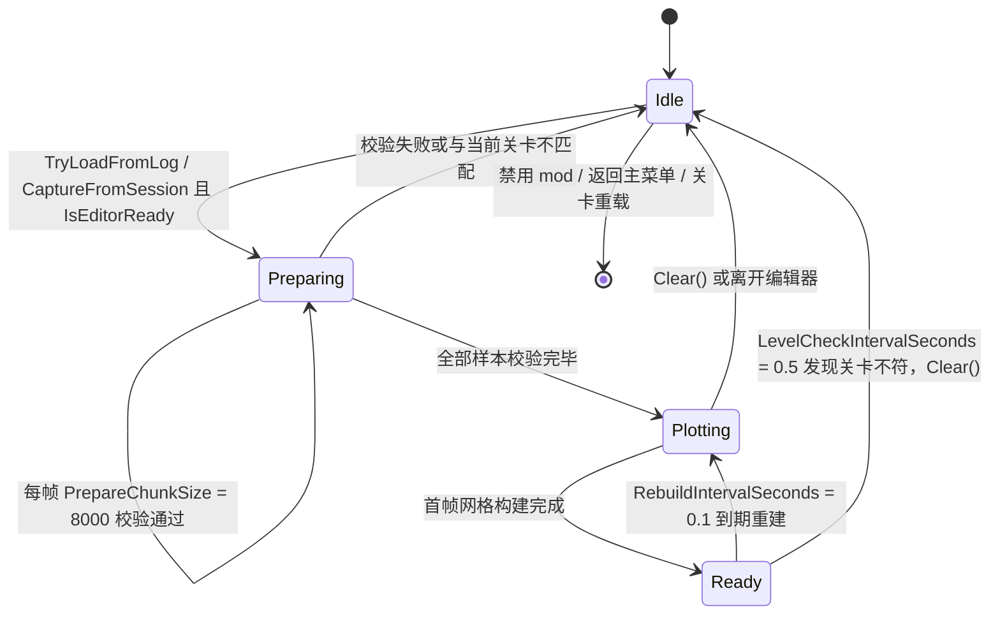

`Phase { Idle, Preparing, Plotting, Ready }`；`PrepareChunkSize = 8000` 校验 `HasJudge && floors != null && FloorId >= 0 && < floors.Count && floor != null && floor.seqID == FloorId`；`RebuildIntervalSeconds = 0.1f`；`LevelCheckIntervalSeconds = 0.5f` 不符即 `Clear()`；`IsEditorReady` 要求 `editor`、`!IsPlaying`、`camera`、`floors` 全部就绪。

进度条 360×26 @ `(center.x, yMin+20f)`，文案 `EditorHits_Progress = "准备击打点: {0} / {1}"`。

### 14.5 悬停

悬停半径 `max(HoverRadiusPixels = 11f, radiusPixels + 3f)`（每次重建时按缩放更新）；tooltip 位置 `mouse + (14, -14)`，尺寸 `max(150, …) × max(40, …)` 并 clamp 进 viewport（`pivot = (0,1)`）；仅 `best != _hoverSampleIndex` 时重建。内容含 `Detail_Player/Timing/Angle/Judge`、`BPM:{F1} ×{Speed:F2}`（`HasHitParams` 才显）、楼层 `(FloorIdEstimated ? "~#" : "#") + FloorId`。

---

## 15. 配置与本地化系统

### 15.1 配置界面架构

`Options.OnGUI()` **没有标签页**，是一条线性堆叠的折叠区列表，外层滚动条由加载器提供。每帧固定 17 个调用，顺序即页面顺序：

```
DrawLanguageSettings → DrawTitleSettings → DrawPlanetSettings → DrawDeathAndWinSettings
→ DrawTimingHUD → DrawAvgHUD → DrawURHUD → DrawRatioHUD
→ DrawXACCGraphSettings → DrawTimingScatterSettings → DrawEditorHitSettings
→ DrawLoggingSettings → DrawSessionControls → OptionLogList.Draw
→ DrawLogGraphSettings → DrawAdvancedSettings（内含 DrawDebugSettings）
```

入口副作用：

```csharp
if (!ModContext.IsConfigOpen) OptionLogList.OnConfigOpened();   // 日志刷新 + 触发自动清理
ModContext.LastConfigGuiFrame = Time.frameCount;
ModContext.UIDirty = true;
```

`IsConfigOpen` 是**帧号启发式**（`Time.frameCount - LastConfigGuiFrame <= 1`），因此 IMGUI 一帧内多次 `OnGUI` 也只触发一次 `OnConfigOpened`。

三种折叠实现并存（不一致，是布局细节的来源）：

1. `OptionsWidgets.FoldoutToggle` / `ToggleFold`：复选框是总开关，左侧三角仅在开启时出现，关闭时用 `GUILayout.Toggle(false, "", ExpandStyle)` **占位对齐**。
2. 自绘 `GUILayout.Button($"{label} {▲|▼}")`（宽 150）：替换设置、日志散点图窗口、高级功能、Debug 选项、日志列表。
3. 折叠状态全是 `Options` 的 `private static bool`，**不进 `Settings`、不落盘、重启复位**。

另有 7 个文本框 static 快照：`_bufferSizeText`、`_maxPointsText`、`_analyzerPortText`、`_analyzerTimeoutText`、`_scatterSampleCountText`、`_scatterMaxPointsText`、`_logGraphMaxPointsText` —— 只在 `null` 时从 `Settings` 初始化一次，之后单向写入。

### 15.2 `OptionsWidgets` 控件工厂

`internal static class OptionsWidgets`，`public const float ContentIndent = 40f;`

| 签名 | 行为 |
|---|---|
| `ActiveButton(string label, bool active, float width)` | 复用同一 `GUIStyle`，按 `active` 改 `fontStyle` |
| `FoldoutToggle(string label, ref bool toggle, ref bool foldout)` | 一行内画箭头 + 复选框（关闭时占位） |
| `ToggleFold(string label, ref bool toggle, ref bool foldout)` | `FoldoutToggle` 的语义别名 |
| `SettingFold(...)` / `SettingRow(...)` | **当前无调用点**（死代码） |
| `ToggleWithDescription(bool value, string labelKey, string descKey, string extraDescriptionHtml = "", float indent = ContentIndent, string extraLabelHtml = "")` | 富文本复选框 + 灰色说明；**返回新值不写字段**，便于"新旧对比再触发副作用" |
| `IndentedLabel(string text, float indent = ContentIndent)` | 缩进标签 |
| `HUDBase(ref float x, ref float y, ref float scale, ref bool bold, ref int align, ref string format, ref int prec)` | 四 HUD 共用五件套 |
| `SliderFloat(string labelKey, ref float value, float min, float max)` | 标签自带冒号，显示 `"X轴偏移: 0.05"`，滑块宽 120 |
| `SliderInt(...)` | 同上，宽 100 |
| `Toggle(ref bool value, string labelKey, float indent = ContentIndent)` | `indent = 0` 用于紧凑的判定替换 14 项 |
| `IntField(string labelKey, ref string text, ref int value, int min, int max, int fallback, float labelWidth = 120)` | **非法/越界立刻把文本和值都重置为 `fallback`** |
| `RatioModeButtons()` / `AlignButtons(ref int align)` | 三按钮组 |
| `ColorPicker(string label, ref Color color)` | 标签 + R/G/B/A 字母 + 4 条 0–1 滑块；**无预览块、无 hex 输入** |

### 15.3 `Settings` 持久化

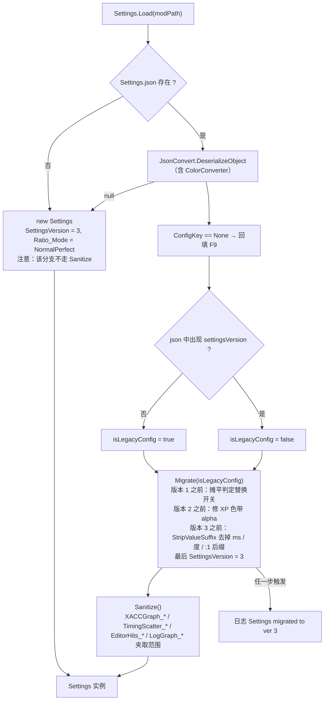

`TimingShow\Source\Settings.cs`（588 行）

```csharp
public const int CurrentSettingsVersion = 3;
public int SettingsVersion;   // 默认 0；字段名序列化为 "settingsVersion"
```

**`Load(string modPath)`**：

1. 文件存在 → `JsonConvert.DeserializeObject<Settings>`（`ColorConverter` 处理 `UnityEngine.Color`），`null` 视为失败
2. `ConfigKey == KeyCode.None` → 回填 `F9`
3. `isLegacyConfig = json.IndexOf("settingsVersion", OrdinalIgnoreCase) < 0`
4. `Migrate(isLegacyConfig)` → `Sanitize()`
5. 异常 → `Logger?.Error($"Failed to load settings: {e.Message}")`
6. 回退对象 `new Settings { SettingsVersion = CurrentSettingsVersion, Ratio_Mode = RatioMode_NormalPerfect }`（**不跑 Sanitize**）

**`Migrate(bool isLegacyConfig)`** 逐步：

| 条件 | 动作 |
|---|---|
| `isLegacyConfig \|\| SettingsVersion < 1` | `ReplacePerfectMinus = ReplacePerfect`；`ReplacePerfectPlus = ReplacePerfect`；`ReplaceXPerfect = Planet_EnableXPerfect`；`ReplaceOverPress = ReplaceFailMiss`；`ReplaceAuto = false` |
| `SettingsVersion < 2` | `TimingScatter_BandXpColor` 若四通道**精确等于** `(77/255, 204/255, 1, 1)` → `a = TimingScatter_BandPerfectColor.a` |
| `SettingsVersion < 3` | 四个 `*HUD_Format` 过 `StripValueSuffix`：依次 `Replace("{0}ms","{0}")`、`("{0}°","{0}")`、`("{0}:1","{0}")` |
| `SettingsVersion < CurrentSettingsVersion` | `SettingsVersion = 3` |
| `Ratio_Mode < 0` | `Ratio_Mode = Ratio_UseXPerfect ? RatioMode_XPerfect : RatioMode_NormalPerfect` |

任一步触发 → `Logger?.Log("Settings migrated to ver " + CurrentSettingsVersion)`（文案恒为 3，不反映来源版本）。

**`Sanitize()`** 覆盖：`XACCGraph_*`、`TimingScatter_*`、`EditorHits_*`、`LogGraph_*`（含 `WindowWidth/Height` 的 `> 0` 条件钳制）。

**未校验**：`Perc1/2/3/4`、`PercHUD/AvgHUD/URHUD/RatioHUD`、`PercLog`（仅使用点 `Math.Max(0, …)`）、四组 `*_FontSize`、`LogBufferSizeKB`、`LogKeepCount`、`AnalyzerBridgePort/TimeoutSec`、`Title_FontSize`。手改 JSON 成负数会让 `ToString("F" + n)` 抛 `FormatException`。

**`Save`**：`File.WriteAllText(Path.Combine(modPath, "Settings.json"), JsonConvert.SerializeObject(this, Formatting.Indented, JsonSettings))`，异常只记日志。**无自动保存、无脏标记、非原子写。**

### 15.4 本地化

`TimingShow\Source\i18n.cs`（49 行）

```csharp
static Dictionary<string, Dictionary<string, string>> _langData;
static IEnumerable<string> AvailableLanguages => _langData.Keys;     // 顺序 = lang.json 顶层键顺序
static void LoadLanguages(string modPath);                            // 读 <modPath>\lang.json（UTF8 + JsonConvert）
static string T(string key);
```

**回退链**：`_langData[Settings?.Language ?? "English"][key]` → `_langData["English"][key]` → **返回 `key` 本身**。因此 `lang.json` 缺失时整个 UI 变成键名列表。

`lang.json`（836 行）：三语言 `简体中文` / `English` / `한국어`，扁平两层，键前缀即功能区（`Toggle_*`、`Label_*`、`Btn_*`、`Desc_*`、`Status_*`、`Err_*`、`LogGraph_*`、`EditorHits_*`、`SortBy*`、`Judge_*`、`Detail_*`、`Hint_*`）。

**覆盖缺口**（实测）：English 284 键；简体中文 271 键，缺 13 个——`Toggle_ShowPerfInfo`、`LogAnalyzerBridgeDisabled`、`Toggle_DiagGraphBounds`、`Toggle_DiagInputTrace`、`Toggle_DiagTrackMesh`、`Toggle_DiagPerfLog`、`Label_DiagBoundsInterval`、`Label_DiagBoundsTolerance`、`Label_DiagBoundsLogLimit`、`Label_DiagBoundsRepeat`、`Label_ScatterWarningLimit`、`Label_LogListDrawBudget`、`Label_UR`；韩语 273 键，缺 11 个（同上除前两项）。

语言切换**无缓存、无重载**：`i18n.T` 每次实时查表，下一帧即生效。但 `Options._editorHitsStatus` 是已格式化的字符串快照，切语言后仍是旧语言。

> 新增 i18n 键时，必须同时更新 `LogGraphFont.PreloadSettingsGlyphs` 的硬编码键表，否则设置面板可能出现缺字。

---

## 16. 桥接与诊断

### 16.1 `XPerfectBridge`（121 行）

```csharp
static Type  t = AppDomain.CurrentDomain.GetAssemblies()
                    .Select(a => a.GetType("XPerfect.AccuracyState"))
                    .FirstOrDefault(x => x != null);
// 属性链：GetProperty("LastJudgeForText", Public|Static) ?? GetProperty("LastJudge", …)
// Delegate.CreateDelegate(typeof(Func<int>), getter) 缓存 → 零反射调用，无编译期引用
static bool IsXPerfect() => _getLastJudgeDelegate() == 1;     // XpEnum = 1
static bool IsSupported => !HitMarginCompat.IsGame34;         // 3.4 走 NotApplicable
enum HookState { Disabled, Success, Failed, NotApplicable }
```

`TryInit(force)` 仅在 UI 关→开时传 `force: true`；**先置 `_isInitialized = true` 再尝试**（失败不重试）；`SetState` 非 Success 时强制 `_getLastJudgeDelegate = null`。状态色：绿 `#55FF55`、红 `#FF5555`、蓝 `#55CCFF`。

### 16.2 `LogAnalyzerBridge`（167 行）

方向：**在本机起临时只读 HTTP 服务，让浏览器 GET**，不是向外 POST。

```csharp
const string AnalyzerUrl = "https://sleepingcui.github.io/adofai_offset_analyzer/";
// new TcpListener(IPAddress.Loopback, requestedPort)   // 0 → OS 分配并回读
// 路径 /log?token=<Guid.NewGuid().ToString("N")>
// GET     → 200 + 全字节 + Content-Disposition: attachment; filename="…"
// OPTIONS → 204（CORS 预检）
// 其它    → 404
// 匹配方式：StartsWith("GET " + expectedPath + " ", Ordinal)   // 带尾空格
```

响应头：`Access-Control-Allow-Origin: https://sleepingcui.github.io`、`Allow-Methods: GET, OPTIONS`、`Allow-Headers: *`、`Allow-Private-Network: true`、`Cache-Control: no-store`、`Connection: close`。

`ContentType`：`.json` → `application/json`；`.tlog.gz` → `application/gzip`；其它 → `application/octet-stream`。

URL = `AnalyzerUrl + "?source=" + EscapeDataString("http://127.0.0.1:<port>/log?token=<token>") + "&name=" + EscapeDataString(fileName)`。

常量 `MinTimeoutSeconds = 5`、`MaxTimeoutSeconds = 3600`、`DefaultTimeoutSeconds = 60`；线程名 `TimingShow.LogAnalyzerBridge`（**单次 Accept**）与 `TimingShow.LogAnalyzerExpiry`。

> **已知缺陷**：一次 Accept 即 Stop，浏览器的 `OPTIONS` 预检会吃掉唯一连接，导致随后的 GET 失败。异常只 `Log`，UI 无反馈。

### 16.3 `PerfStatsRecorder`（699 行）

单局逐帧性能探针，与 `TimingLogger` 无关，只写 `PerfLogs/`。

```csharp
static void StartSession(string levelPath, string songName);   // ← Start_Rewind Postfix，受 Diag_PerfLogEnabled
static int  BeginFrame();                                      // ← UIReplacePatch（仅 IsPlaying，非录制态不递增 _frameId）
static void EndFrame(int frameId, double deltaMs, double hudMs);
static void HitBegin(); static void HitEnd();                  // finally 保护，可重入深度计数
static void EndSession(string result);                         // "quit" / "fail" / "complete"
```

输出 `<LogDirectory>/PerfLogs/perf_{safeSong}_{yyyyMMdd_HHmmss}.txt|.csv`（`UTF8Encoding(false)`）。

CSV 18 列表头：

```
time_s,frame_ms,fps,hud_ms,points,scatter_render_points,scatter_mesh_ms,scatter_text_ms,
scatter_update_ms,scatter_vtx,scatter_mesh_ran,scatter_text_ran,scatter_update_ran,
mesh_total_ms,vtx_total,drawers,hits,hit_ms
```

`scatter_*_ran` 的判定（**ran vs carried-over 语义**）：

```csharp
updateRan = LastUpdateFrameId == frameId;
textRan   = LastTextFrameId   == frameId;
meshRan   = (LastMeshFrameId == frameId || LastMeshFrameId == frameId - 1)
            && LastMeshFrameId != MeshReportedFrameId;      // mesh 允许晚一帧上报并去重
```

未执行项留空而不是写 0。TXT 章节：Frame rate / TimingShow CPU cost per frame / Frame rate vs scatter point count / Drawer cost vs scatter point count / Scatter rendered geometry / Frame time vs note rate / Graph drawers / Settings snapshot。

魔数：`Samples` 预分配 16384，`FrameCap = 400000`（静默丢弃）；点数桶 `{50,100,150,200,300,400,600,800,1200,2000,5000,int.MaxValue}`；速率桶 `{8,16,24,32,48,64,96,int.MaxValue}`（rolling 1 s，`rate = span > 0.2 ? cum/span : 0`）；分位数 nearest-rank `idx = (int)Math.Round((len-1)*q)` 无插值。

`DrawerStats` 全 public 可变字段：`Name`、`Frames/UpdateFrames/TextFrames/MeshFrames`、`UpdateMsSum/TextMsSum/MeshMsSum/MeshMsMax`、`VertexSum/VertexMax`、`LastUpdateMs/LastTextMs/LastMeshMs`、`LastVertices`、`LastRenderPoints`、`LastUpdateFrameId/LastTextFrameId/LastMeshFrameId/MeshReportedFrameId(=-1)`。

> 缺陷：静态单例；`FrameCap` 静默截断；`EndSession` 在主线程排序 ≤40 万条（数百 ms 尖峰）。

---

## 17. 测试与几何校验

`Tools\GeometryTests\Program.cs`（644 行，net8.0 Exe，**不在 `slnx` 内**）

```bash
dotnet run --project Tools/GeometryTests/GeometryTests.csproj
```

前置：先 Release 构建 `TimingShow/bin/Release/TimingShow.dll`。`FindRepoRoot()` 从 `AppContext.BaseDirectory` 向上 ≤10 层找同时含 `libs/` 与 `TimingShow/` 的目录；`AssemblyResolve` 按 `libs/{SimpleName}.dll` 解析。

校验内容（`RunCase` 组合 `windowWidths` × `windowHeights` × `scales` × `labelWidths` × `footers` = **648 cases**）：

1. **2 条硬断言**：不得存在 static `PlotRect`；必须有实例 `ResolvedPlotRect`。
2. 布局不变量：content ⊆ window；container ⊆ window/content；`container != window`；`GraphRectsCore` container == `GraphContainerRectCore`；五子矩形 ⊆ container ⊆ window 且 ⊆ plot；中线不越界；`plot.Width/Height >= 1`；`plot != container/window`（`Eps = 0.01`）。
3. `MirrorLabels`（6 标签）独立重算 `gap = 6*scale`、`yFont = clamp(round(12*scale), 8, 32)`、`xFont = clamp(round(11*scale), 8, 32)` 等，必须 ⊆ plot ⊆ window。
4. `GridLineFractions(int)`：输入 `{-5,0,1,2,3,4,5,10,20,50,100}`，线数 `= clamp(divisions,2,20) - 1`，比值严格在 `(0,1)` 且递增。
5. 色块几何 `ColorResetRect/ColorChipLabelWidth/ColorSwatchSize`（`cellWidths` × `chipHeights`）。
6. `RunChromeChecks`（36 cases）：用 `RuntimeHelpers.GetUninitializedObject(typeof(Settings))` 反射塞 `ModContext.Settings`，断言 `UiScale`、`ContentWidth/Height`、`StatsColumnWidth`、`StatsRowMetrics`、`ViewToggleFits`、`ClampSize`（宽 `[480, max(480,min(1920,screenW))]`、高 `[260, max(260,min(1080,screenH))]`）、`ClampPosition`、`MetaReserveWidth == 0`。
7. `--dump w h scale [labelWidth=64] [footer=0]` 打印矩形（F2）。

退出码：`0` 全通过 / `1` hard failure / `2` 缺 DLL。

> 这是**唯一可自动化的回归保障**。它覆盖的是 LogGraph 的布局纯函数，不覆盖 HUD 窗口公式、抽稀、命中测试、日志编解码——这些只能手测。

---

## 18. 开发工作流

### 18.1 本地热调试

`build2.ps1`（机器专用，未纳入 CI）：

1. 顶部硬编码 `$gameDir`（需改成你本机的游戏目录）
2. 重打包字体 → `/t:Rebuild` → 部署到 `<game>\Mods\TimingShow`
3. 部署前删除历史改名产物 `TimingShow.Core.dll` / `TimingShow.UMM.dll` / `TimingShow.Melon.dll`
4. 启动游戏
5. 尾随 `%USERPROFILE%\AppData\LocalLow\7th Beat Games\A Dance of Fire and Ice\Player.log`（`Start-Job { Get-Content $logPath -Wait -Encoding UTF8 }`，500 ms `Receive-Job`）

### 18.2 新增一个源文件

1. 在 `TimingShow/Source/<功能目录>/` 下建 `.cs`
2. **手工把 `<Compile Include="Source\…\NewFile.cs" />` 加到 `TimingShow/TimingShow.csproj`**（legacy 项目不会自动发现）
3. 若是 loader 工程的新文件，同样改对应的 loader csproj
4. 编译验证

### 18.3 新增一个设置项

1. `Settings.cs` 加 `public` 字段 + 默认值
2. 若是数值型且需要约束：加 UI 区间 + `Sanitize()` 钳制
3. 若要改默认值的语义：`Migrate()` 加版本步，并 bump `CurrentSettingsVersion`
4. `Options.cs` 加控件（选对折叠组、缩进、`IntField` 的 min/max/fallback）
5. `lang.json` 三语言都加键（`Label_*` / `Toggle_*`）
6. 消费点在读取时考虑 `ModContext.Settings == null` 兜底

### 18.4 新增一个 i18n 键

三语言键必须同时加（否则中文/韩语界面露英文或露键名）；同时更新 `LogGraphFont.PreloadSettingsGlyphs` 的硬编码键表。

### 18.5 新增一个 Harmony patch

1. 放在 `Source/Patches/` 下对应的静态容器类里
2. `[HarmonyPatch(typeof(Target), "MethodName")]` + `[HarmonyPatch]` 组合
3. **参数名必须与游戏程序集完全一致**（Harmony 按名字注入），用 IL dump 核对
4. 加 `if (!ModContext.IsEnabled) return;` 之类的守卫
5. 记录到本文档 6.1 的补丁总表

### 18.6 修改判定/日志相关

必读 12.7 的同步清单。改判定枚举时**不要改已有码值**（旧日志会静默错读）。

### 18.7 修改绘制原语

`DrawQuad` / `DrawSegment` / `DrawDashedVertical` 等在原语在**四处重复实现**：`GraphDrawerBase`、`LogChartDrawer`、`LogXaccDrawer`、`LogDistributionDrawer`（后两者整段复制）。改绘制必须四处同步。

### 18.8 提交前自检

- [ ] 新 `.cs` 已登记到 csproj
- [ ] 三语言 `lang.json` 齐全
- [ ] `Settings` 新字段有 `Sanitize`（若需要）
- [ ] 未引入 C# 7.3 之后的语法
- [ ] `dotnet run --project Tools/GeometryTests/GeometryTests.csproj` 通过（若动了 LogGraph 布局）
- [ ] 单机行为未被 coop 分支改变（对照第 11.2 的 6 条保障）

---

## 19. 已知缺陷与技术债

按严重程度排列。**这些都是代码事实，不是推测。**

### 19.1 正确性缺陷

| # | 缺陷 | 位置 | 后果 |
|---|---|---|---|
| 1 | **`Perc2` / `Perc3` 错配** ✅ 已修复 | `Options.cs` 星球精度滑块写 `Settings.Perc3`，`UIPatches.cs:54-55` 读 `Settings.Perc2` | 该滑块**完全无效**，且与"死亡页精度"共享同一字段（两处联动） |
| 2 | **`DrawPlanetSettings` 里的 `return` 跳出整个 `OnGUI`** | `Options.cs` 的 `AutoReloadInEditor` 分支 | 该帧后续 10 个分组全部不生成，IMGUI Layout/Repaint 控件数量不一致，可能控件错位或抛 `Getting control X's position` |
| 3 | **`Perc*` 无 Sanitize** ✅ 已修复 | `Settings.Sanitize()` 未覆盖精度字段 | 手改 JSON 为负数 → `ToString("F-1")` 抛 `FormatException`：HUD 数字走 `SafeFormat` 兜底降级，但死亡页/结算页/标题没有兜底，异常从 Harmony Postfix 抛出，对应 UI 停止更新并刷日志（不是进程崩溃） |
| 4 | **`LogGraph_Enabled` 是死字段** ✅ 已删除 | 仅被 `PerfStatsRecorder` 打印 | 关掉无法停用窗口 |
| 5 | **`IntField` 无法逐位输入** | `OptionsWidgets.cs` | 清空后输入 `2`（min 10）立刻重置为 200；`LogBufferSizeKB` 输 `1` 立刻回退 64 |
| 6 | **JSON `value` 缺 `InvariantCulture`** | `TimingLogger.cs` | 逗号小数点 locale（de/fr 等）下写出 `1,234`，读取端按 invariant 解析成 NaN |
| 7 | **`Settings.Save` 非原子写** | `Settings.cs` | 写一半崩溃留下截断 JSON → 下次 `Load` 抛异常回退默认，配置全丢 |
| 8 | **`AnalyzerBridge` 一次 Accept 即 Stop** | `LogAnalyzerBridge.cs` | 浏览器 `OPTIONS` 预检吃掉唯一连接 → GET 失败 |
| 9 | **`TextUI` 坐标与 `CanvasScaler` 冲突** | `TextUI.SetPosition` | 仅 1920×1080 精确，其它分辨率 HUD 二次缩放偏移 |
| 10 | **`GraphDrawerBase.FontCache` 缓存 null** | `GraphDrawerBase.cs` | 首次调用时游戏字体未就绪 → 该 key 永久 null，整个会话不再重试 |
| 11 | **`HUDMan._badFormats` 无清理入口** | `HUDMan.cs` | 修好格式串后仍需重载 mod |
| 12 | **`JColors.Missing` 只在开局清** | `JColors.cs` | 反射失败的判定色永久为灰，直到下一局 |
| 13 | **`TimingScatterDrawer` 未重写 `AllowPlayerFilter`** | 默认 false | 游戏内散点**不显示玩家图例、不能按玩家过滤**（但点色仍按玩家分） |
| 14 | **散点渲染恒用 `enableXP = true`** | `ScatterDrawerBase.Render.cs` | 同一击在图上显示为 XP 色、文本 HUD 却不是（受 `HUD_EnableXPerfect` 控制）——已知显示不一致 |
| 15 | **`Settings.Load` 回退对象不跑 `Sanitize()`** | `Settings.cs` | 默认值合法时无碍，改默认即失守 |
| 16 | **`i18n.LoadLanguages` 异常分支不清空旧字典** | `i18n.cs` | 可能出现"半旧半新"语言表 |
| 17 | **`LogRetention` 只看文件名推断时间/曲名** | `LogRetention.cs` | `LogSort_SongName` 生效时，"保留前 N"的顺序与列表显示顺序不同 |
| 18 | **`MetaCache` 失效键是 `(Length, LastWriteTicks)`** | `OptionLogList.cs` | 同长度同 mtime 的内容改写（极罕见）会命中脏缓存 |

### 19.2 并发与状态

| # | 问题 |
|---|---|
| 19 | 日志写入器全静态单会话；两个场景钩子同时开局时，后者以 `FileMode.Create` 覆盖前者 |
| 20 | `TimingLogger` 的 `_hitCount` / `StringBuilder` 无锁（假定主线程） |
| 21 | 清理线程与写入线程有竞争窗口：检查通过后新会话立刻以 Create 打开同一路径 → Delete 失败记 Error |
| 22 | JSON 空会话分支提前 `return` **未重置** `_playerBuffers` / `_isCurrentSessionAngle` |
| 23 | `ModContext.Disable()` 不清 `Options` 折叠状态、`OptionLogList` 缓存、`LogGraphWindow` 实例、`_badFormats` |
| 24 | `_ignoreNextClick`（窗口输入）吞点击机制脆弱：快速按下抬起、失焦、菜单开关顺序都可能吞错一次 |
| 25 | `LogGraphSettingsUI` 用 Draft 快照 → 窗口打开期间若 `Options.cs` 改了同名项，点"应用"会被旧值覆盖 |
| 26 | 会话中途改 `LogDirectory` / `PercLog` / `LogBufferSizeKB` 只影响下一局（不是缺陷，但容易误判） |

### 19.3 性能

| # | 问题 |
|---|---|
| 27 | `LiveScrollActive` 命中即每帧全量重建几何（自动滚动是唯一持续开销） |
| 28 | `FindNearestRenderPoint` / `IsRenderableSourceIndex` 是 O(n) 线性扫描，逐帧 hover |
| 29 | `Options.OnGUI` 每帧 `UIDirty = true`：面板打开期间标题/HUD 文本每帧重建 |
| 30 | `Options.OnGUI` 每帧 17 个分组全量构建；日志列表每帧 ≤60 行 × 约 10 个控件 |
| 31 | `LogGraphWindow.Open` 每次重建 `Canvas`/`GameObject`，关闭 `Destroy` |
| 32 | `RebuildRows()` / `ClearTexts()` 每次布局变化或切 Tab 都 `Destroy` 全部 TMP 文本再重建，`PlaceText` 还逐条 `ForceMeshUpdate()` |
| 33 | `FileBrowser.PickFile/PickFolder` 在 IMGUI 内**同步模态**，阻塞主线程至对话框关闭 |
| 34 | `TextUI` 无静态字体缓存 → 4 个 HUD 各建一份图集 |
| 35 | 6 个 overlay Canvas（4 文本 + 2 图）无法批处理合并 |
| 36 | `ModContext.TimingScatterSamples` 与 `FullXAccHistory` 无上限，长曲/长会话内存线性增长 |
| 37 | 版本号用 `int` 单调递增，溢出未处理（`_lastDataVersion = -1` 与 `int.MinValue` 哨兵混用） |

### 19.4 兼容性与可维护性

| # | 问题 |
|---|---|
| 38 | 大量反射依赖：`RDC` / `RDConstants` / `GCS` / `DetailedResults.results` / `Font.Internal_CreateFontFromPath` / `TMP_FontAsset.CreateFontAsset` 8 参重载 / `XPerfect.AccuracyState`。字段改名不会崩，但功能会静默退化 |
| 39 | `PlayerSession.MaxPlayers = 4` 被 `FullXAccHistory` 数组、`_seriesCache`、`_legendTexts[4]` 硬编码；超 4 人 coop 会静默丢序列 |
| 40 | `LogGraph_CornerScale`、10 个色槽、`ShowGrid` 等只能从窗口内改，两套设置入口的可见性不一致 |
| 41 | 图表窗口没有 DPI 适配（无 `CanvasScaler`），高分辨率屏需手动调 `UIScale` |
| 42 | 绘制原语在 `GraphDrawerBase` / `LogChartDrawer` / `LogXaccDrawer` / `LogDistributionDrawer` 四处重复实现 |
| 43 | "XACC" 同名三套口径（游戏原生 / XACC 图逐判型加权 / 概览页分组加权） |
| 44 | 统计量统一用总体方差（÷n），与外部工具（样本方差 ÷n−1）不一致 |
| 45 | 判定码 3 在旧版本同时表示 `Perfect` 和 `Perfect−`，跨版本数据不可直接比较 |
| 46 | 无单元测试框架；`GeometryTests` 只覆盖 LogGraph 布局纯函数 |
| 47 | `.github/workflows/build-release.yml` 用 `actions/checkout@v6`，与 dev 的 `@v4` 不一致 |
| 48 | release 流程不改版本号（`Info.json` / `MelonInfo` 保持仓库值），`Repository.json` 推回当前分支而 `Info.json.Repository` 指向 master |

---

## 20. 故障排查

| 症状 | 原因 | 处置 |
|---|---|---|
| `MSB3243` / `MC1000` 找不到 `..\libs\*.dll` | libs 缺失或版本旧 | 从私有仓库取齐 18 个 DLL。注意 `Reference` 名是 `Assembly-CSharp` 而 HintPath 是 `Assembly-CSharp340.dll`，这是**刻意**的，不是拼写错误 |
| `MSB3644` "The reference assemblies for .NETFramework,Version=v4.8.1 were not found" | 只装了 4.8 运行时，没装 4.8.1 targeting pack | 安装 .NET Framework 4.8.1 Developer Pack |
| `'msbuild' 不是内部或外部命令` | 在普通 cmd 而非 Developer 环境 | 用 "Developer Command Prompt for VS 2022"；`dotnet msbuild` **不能**编 legacy .NET Framework 项目 |
| 改了字体但游戏里仍是旧字形 | 增量构建跳过重新嵌入 | `/t:Rebuild`（`build2.ps1` 已经这么做） |
| `Compress-Archive` 找不到文件 | 打包在构建前执行，或某一步静默失败 | 检查三步 msbuild 的退出码 |
| 版本号改了但 UMM 显示旧的 | `Info.json` 与 `MelonInfo` 未同步 | 两处都改。release 流程**不会**自动改版本号 |
| 改完 `Repository.json` UMM 仍不更新 | bot 提交推到版本分支而非 master，而 `Info.json.Repository` 指向 master raw URL | 手动合并到 master，或在 master 上 dispatch |
| release notes 乱码 | `Get-Content -Raw` 未指定 `-Encoding` | 加 `-Encoding utf8` |
| 游戏里出现两套 HUD | 同时装了 UMM 版与 Melon 版（Harmony Id 不同：`TimingShow` vs `TimingShow.Loader.Melon`，各自 PatchAll） | 只留一套 |
| `Tools\` vs `tools\` 在大小写敏感环境下失效 | csproj 写 `..\tools\`，磁盘是 `Tools\`，靠 Windows 大小写不敏感 | 统一大小写 |
| `PatchAll` 整体抛异常 | Harmony 参数名与游戏签名不匹配 | 用 IL dump 核对参数名 |
| `Unrecognized HitMargin enum version` | 游戏更新了判定枚举 | 更新 `HitMarginCompat.DetectVersion` 的反射名单 |
| 散点全消失但背景/网格正常 | `FlushDirectVertices` 只复制了顶点没复制索引 | 见 10.5，直写路径已回滚，不要在 `_streamTris` 上重犯 |
| 设置面板文字出现方块 | `LogGraphFont.PreloadSettingsGlyphs` 的键表未更新 | 把新键补进去 |

---

## 21. 第三方依赖清单

`libs\` 18 个 DLL，全部 `Private=False`，**无一随包分发**。

| DLL | 体积 | 被谁引用 | 用途 / 备注 |
|---|---|---|---|
| `0Harmony.dll` | 2,219,008 | 三工程 | 方法注入 |
| `Assembly-CSharp.dll` | 2,783,232 | **无项目引用** | 3.3.1 遗留，保留作对照 |
| `Assembly-CSharp340.dll` | 2,820,608 | 编译基准 | Reference 名却是 `Assembly-CSharp` |
| `BepInEx.dll` | 128,512 | **无引用** | 历史遗留 |
| `MelonLoader.dll` | 1,951,232 | Loader.Melon | `MelonMod` 基类 |
| `Newtonsoft.Json.dll` | 691,712 | 运行期硬依赖 | `Settings.cs`、`i18n.cs`、`ColorConverter.cs`、`TimingLogReader.cs` |
| `RDTools.dll` | 5,120 | `HUD/JColors.cs` | 反射 `RDConstants.data` |
| `Unity.TextMeshPro.dll` | 446,464 | 三工程 | TMP |
| `UnityEngine.dll` | 196,520 | 三工程 | 门面程序集 |
| `UnityEngine.AudioModule.dll` | 142,248 | | 音频（`conductor.song`） |
| `UnityEngine.CoreModule.dll` | 1,938,432 | | 核心 |
| `UnityEngine.IMGUIModule.dll` | 213,936 | TimingShow + Melon | IMGUI（设置页） |
| `UnityEngine.InputLegacyModule.dll` | 45,480 | TimingShow + Melon | 旧输入（`Input.GetKeyDown`、`Input.mousePosition`） |
| `UnityEngine.TextRenderingModule.dll` | 39,344 | | `Font` |
| `UnityEngine.UI.dll` | 276,480 | | uGUI |
| `UnityEngine.UIModule.dll` | 49,576 | | `Canvas` / `CanvasRenderer` |
| `UnityFileDialog.dll` | 8,704 | `Source/Options/Options.cs` | `FileBrowser.PickFile/PickFolder` |
| `UnityModManager.dll` | 204,288 | Loader.UMM | `UnityModManager.ModEntry` |

框架引用：`System`、`System.Core`、`System.IO.Compression`、`System.Xml.Linq`、`System.Data.DataSetExtensions`、`Microsoft.CSharp`、`System.Data`、`System.Net.Http`、`System.Xml`。

---

## 22. 附录：文件索引

按代码规模（`read` 工具实测行数）从大到小，供快速定位：

| 文件 | 行数 | 一句话职责 |
|---|---|---|
| `TimingShow/Source/Logging/TimingLogReader.cs` | 1026 | 双格式日志读取 + 样本归一化 |
| `TimingShow/Source/Options/OptionLogList.cs` | 960 | IMGUI 日志列表、元数据缓存、图谱打开链路 |
| `TimingShow/lang.json` | 836 | 三语言文案 |
| `TimingShow/Source/HUD/LogGraph/Charts/Histogram/LogDistributionDrawer.cs` | 830 | 直方图 + 正态拟合绘制 |
| `TimingShow/Source/HUD/GraphDrawerBase.cs` | 824 | 图表基类（顶点原语、布局、字体、性能上报） |
| `TimingShow/Source/LevelEditor/EditorHitMarkerController.cs` | 787 | 编辑器击打点单 Mesh 渲染 + 状态机 + tooltip |
| `TimingShow/Source/HUD/LogGraph/Charts/Xacc/LogXaccDrawer.cs` | 788 | 日志 XACC 折线（独立复制的几何原语） |
| `TimingShow/Source/HUD/LogGraph/Charts/Xacc/XaccData.cs` | 254 | 累计加权准确率 + LTTB 抽稀 |
| `TimingShow/Source/Diagnostics/PerfStatsRecorder.cs` | 699 | 逐帧性能探针与报告 |
| `TimingShow/Source/HUD/LogGraphWindow/LogGraphWindow.cs` | 643 | 窗口单例、Build、静态布局 Core（同目录 9 文件合计 3007 行，其余 8 个 partial 见下表） |
| `Tools/GeometryTests/Program.cs` | 644 | 布局纯函数不变量校验（648 + 36 cases） |
| `TimingShow/Source/Settings.cs` | 588 | 全部配置字段 + 迁移 + Sanitize |
| `TimingShow/Source/HUD/LogGraph/Charts/Combo/LogComboDrawer.cs` | 598 | 连击条带（唯一自带平移缩放） |
| `TimingShow/Source/HUD/LogGraph/Charts/Rolling/LogRollingDrawer.cs` | 585 | 滑动均值带 |
| `TimingShow/Source/HUD/LogGraph/Charts/Scatter/LogScatterDrawer.cs` | 254 | 日志散点（复用 `ScatterDrawerBase`） |
| `TimingShow/Source/HUD/ScatterDrawerBase.Data.cs` | 571 | 采样、签名、视窗平滑、过滤、抽稀 |
| `TimingShow/Source/HUD/LogGraph/Charts/Overview/LogOverviewDrawer.cs` | 555 | 概览仪表盘 |
| `TimingShow/Source/HUD/ScatterDrawerBase.Interaction.cs` | 501 | 拖拽/缩放/钳制 |
| `TimingShow/Source/HUD/TimingScatterDrawer.cs` | 343 | 游戏内散点 + 判定窗口公式 |
| `TimingShow/Source/Patches/TimingCalcPatches.cs` | 444 | 采样与判定落账（核心） |
| `TimingShow/Source/HUD/LogGraph/Charts/Acf/LogAcfDrawer.cs` | 410 | 自相关柱 |
| `TimingShow/Source/Patches/UIPatches.cs` | 389 | 每帧驱动 + 标题/判定/死亡/结算替换 |
| `TimingShow/Source/HUD/LogGraph/Charts/Return/LogReturnDrawer.cs` | 372 | 偏移关系散点 |
| `TimingShow/Source/HUD/LogGraph/Font/LogGraphFont.cs` | 398 | 内嵌字体解析与缓存 |
| `TimingShow/Source/HUD/ScatterDrawerBase.Render.cs` | 390 | 几何绘制 |
| `TimingShow/Source/HUD/LogGraph/LogGraphSettingsUI/*`（5 文件合计） | 1317 | 窗口内设置面板 |
| `TimingShow/Source/HUD/LogGraph/LogGraphUi/LogChartUi.cs` | 561 | 按钮/滑块/菜单三件套 |
| `TimingShow/Source/HUD/XACCGraphDrawer.cs` | 333 | 游戏内 XACC 折线 |
| `TimingShow/Source/HUD/LogGraph/LogGraphUi/LogChartDrawer.cs` | 327 | 图表基类 + 几何原语 |
| `TimingShow/Source/HUD/LogGraphWindow/LogGraphWindow.Window.cs` | 317 | 窗口尺寸/位置/拖拽/设置开关 |
| `TimingShow/Source/HUD/LogGraphWindow/LogGraphWindow.Input.cs` | 310 | 输入双通道 |
| `TimingShow/Source/HUD/LogGraphWindow/LogGraphWindow.Pane.cs` | 314 | 自绘窗口 chrome |
| `TimingShow/Source/PlayerSession.cs` | 237 | 逐玩家状态 + `Players` |
| `TimingShow/Source/HUD/HUDMan.cs` | 223 | 6 个 HUD 对象的生命周期 |
| `TimingShow/Source/HUD/TextUI.cs` | 219 | 文本 HUD 组件 |
| `TimingShow/Source/Patches/PlayStatePatches.cs` | 214 | 局面生命周期 + 会话秒表 |
| `TimingShow/Source/Logging/LogRetention.cs` | 207 | 日志保留策略 |
| `TimingShow/Source/LevelEditor/EditorHitSnapshot.cs` | 202 | 快照与日志导入 |
| `TimingShow/ModContext.cs` | 192 | 服务中心 |
| `TimingShow/Source/Logging/TimingLogger.cs` | 191 | JSON 写入器 |
| `TimingShow/Source/Logging/TimingLoggerBinary.cs` | 185 | 二进制写入器 |
| `TimingShow/Source/HUD/JColors.cs` | 185 | 判定配色（反射 + 定长表） |
| `TimingShow/Source/Logging/TimingLogReader.cs`（辅助） | — | 见上 |
| `TimingShow/Source/Bridge/LogAnalyzerBridge.cs` | 167 | 本地 HTTP 服务 |
| `TimingShow/Source/Bridge/XPerfectBridge.cs` | 121 | XPerfect 反射挂钩 |
| `TimingShow/Source/Calc.cs` | 109 | UR / Ratio / XPerfect 边界 |
| `TimingShow.Loader.Melon/MelonEntry.cs` | 109 | Melon 入口 + 自绘窗口 |
| `TimingShow/Source/Bridge/XPerfectBridge.cs` | 121 | 见上 |
| `TimingShow/Source/HUD/BumpAnim.cs` | 123 | 跳动动画 |
| `TimingShow/Source/Coop.cs` | 100 | 多人拼接 |
| `TimingShow/Source/Logging/VarInt.cs` | 42 | ZigZag + LEB128 |
| `TimingShow/Source/Logging/ColorConverter.cs` | 43 | `UnityEngine.Color` 的 JSON 转换 |
| `TimingShow/Source/i18n.cs` | 49 | 本地化 |
| `TimingShow.Loader.UMM/UMMEntry.cs` | 34 | UMM 入口 |
| `TimingShow/TimingShow.csproj` | 197 | 工程定义 + 字体打包 Target |
| `TimingShow.Settings`（`Settings.cs`，见上） | 588 | — |
